# Atomic shared pointer benchmarks

How LumexLib's `atomic_shared_ptr` behaves under contention, compared with the standard library's `std::atomic<std::shared_ptr<T>>`, measured with the method the author used for his libc++ implementation of `std::atomic<std::shared_ptr<T>>` (llvm-project pull request 194215). Every number is a ratio to `std::atomic<std::uint64_t>::compare_exchange_strong` timed in the same process, with the same threads, right before; a ratio of 10 means ten times the cost of one contended 64-bit compare-exchange.

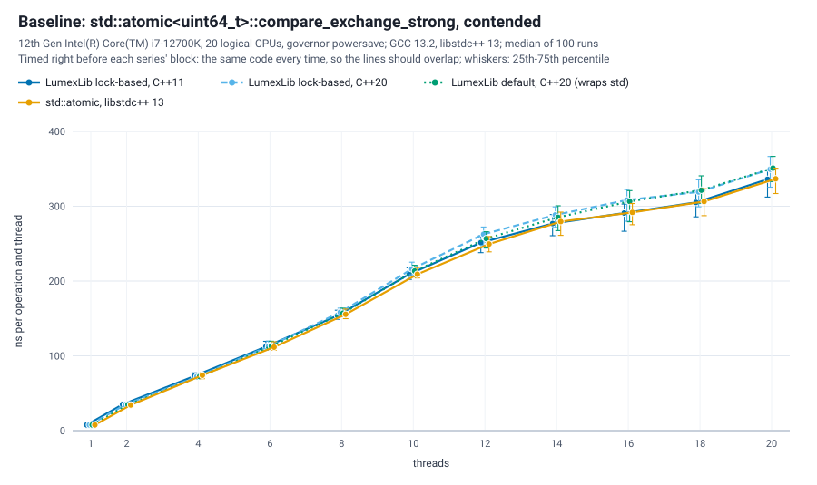

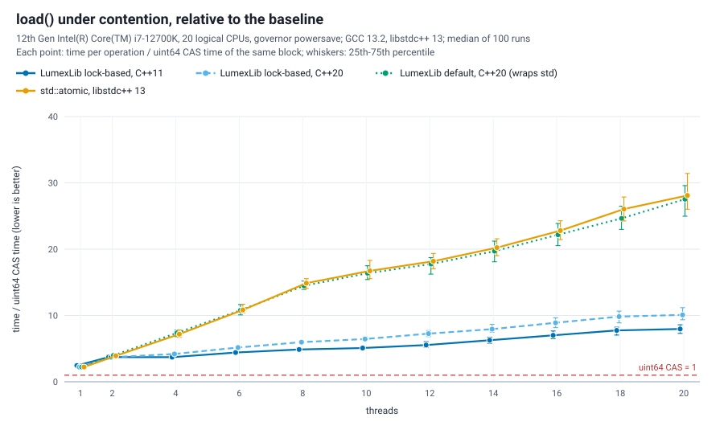

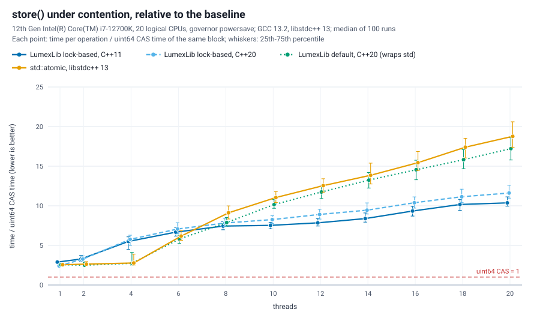

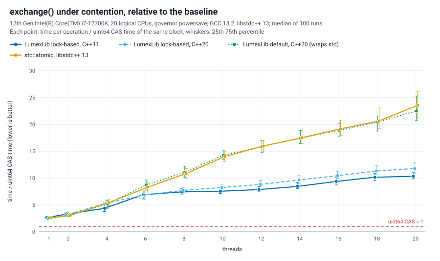

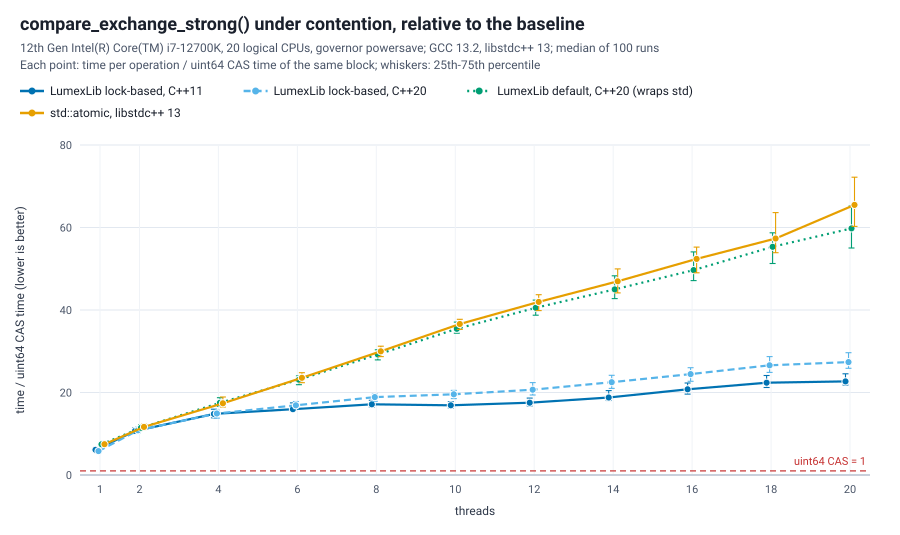

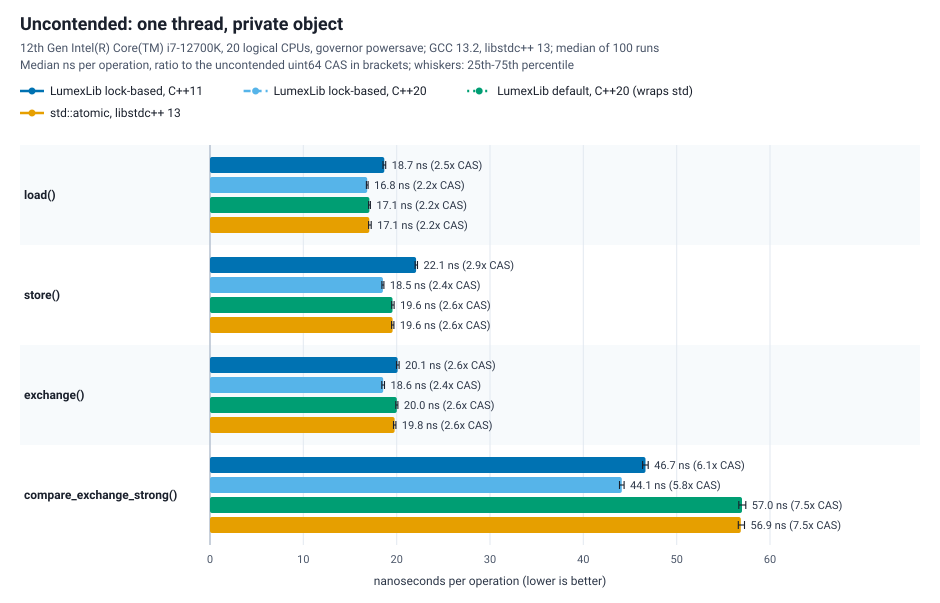

The split-count engine, the weak pointers, the read-heavy run and the destruction latency are in [their own section](#the-split-count-engine). The numbers behind the charts: [results/atomic_benchmark.md](results/atomic_benchmark.md) (medians and quartiles: [results/atomic_benchmark.csv](results/atomic_benchmark.csv)).

In short, on the machine below: under contention LumexLib's lock-based implementation grows much more slowly than libstdc++ 13's `std::atomic<std::shared_ptr<T>>`; at 20 threads it costs 2.8-3.5 times less for `load ()`, 2.4-2.9 times less for `compare_exchange_strong ()`, 2.0-2.3 times less for `exchange ()` and 1.6-1.8 times less for `store ()`. libstdc++ wins `store ()` with 2 to 6 threads. Uncontended, all four implementations cost 17-22 ns for `load ()`, `store ()` and `exchange ()`, and the lock-based compare-exchange is cheaper (44-47 ns against 57 ns). LumexLib's default selection at C++20, which wraps libstdc++'s type, measures the same as libstdc++ itself.

## What is compared

| Series | What it is | Selected implementation |
| --- | --- | --- |
| LumexLib lock-based, C++11 | `atomic_shared_ptr_lock_based<int>` in a translation unit built at C++11, sleeping on the striped wait table | `lock_based_table_wait` |
| LumexLib lock-based, C++20 | the same class at C++20, sleeping in `std::atomic::wait` | `lock_based_std_wait` |
| LumexLib lock-free, C++11 | `atomic_shared_ptr_lock_free<int>`: the hazard-protected box engine, the replaced value destroyed immediately (the default policy) | `lock_free_table_wait` |
| LumexLib lock-free, C++20 | the same class at C++20 | `lock_free_std_wait` |
| LumexLib lock-free, C++20, deferred | `atomic_shared_ptr_lock_free<int, reclaim::deferred>`: the replaced box is retired, a pass of the hazard domain destroys it later | `lock_free_deferred_std_wait` |
| LumexLib common name, C++20 | `atomic_shared_ptr<int>` with nothing forced: the lock-free engine where the build has it (a `static_assert` in the unit checks it), the lock-based one otherwise | `common_std_wait` |
| LumexLib std-backed, C++20 | `atomic_shared_ptr_std_backed<int>`: the wrapper of the standard library's `std::atomic<std::shared_ptr<T>>` with a conforming `wait`; it was the C++20 default before the lock-free engine and is an explicit name now | `std_backed_std_wait` |
| std::atomic, libstdc++ 13 | `std::atomic<std::shared_ptr<int>>` of the standard library | - |
| boost::atomic_shared_ptr | only when CMake finds Boost: a spinlock around a `boost::shared_ptr` (another smart pointer family, a lock-based competitor, not a lock-free one) | `boost` |

The harness checks which implementation each series measured: the units fail to compile when a forcing switch did not take effect, `--list` prints the selected inline namespace of every series, and `run_benchmark.py` stops when a LumexLib series measured something else.

Not measured here:

- **The libc++ lock-free method.** It works on libc++'s own control block and cannot run over another library's `std::shared_ptr` (see `lumex/core/atomic/README.md`); the lock-free series above is a different algorithm, the hazard-protected box. The author's measurements of the two libc++ methods are summarized [below](#the-libc-implementation-reference) for reference. Folly, just::thread and Daniel Anderson's repository are not offline-buildable and are not measured.
- **The MSVC STL** is a separate series, on another machine: [MSVC STL](#msvc-stl). The `std` series there is MSVC's `std::atomic<std::shared_ptr<T>>`.

## Method

- **Operations**, as in the libc++ benchmark: `load ()`; `store ()` of the same value every time; `exchange ()` of the same value; and `load (relaxed)` followed by `compare_exchange_strong ()` towards the other of two values, the client pattern that exposed the livelock of the libc++ lock-free method. A fifth, `load_one_writer`: one thread stores alternating values in a loop while all the others `load ()` (the readers-heavy pattern in which the libc++ double-width method crashed); the time is per load of a reader.
- **Contention**: 1, 2, 4, 6, ..., 20 threads on one shared object (1 and every even count up to the logical CPUs), plus an uncontended run: one thread on an object of its own.
- **One measurement**: the threads start together, run the operation for 100 ms and stop together; the result is the wall time per operation and thread, the figure Google Benchmark reports for `Threads (N)->UseRealTime ()`.
- **Normalization**: every block (one implementation at one thread count) starts with the baseline loop of the libc++ benchmark, `std::atomic<std::uint64_t>` `load (relaxed)` + `compare_exchange_strong` on one shared word with the same threads; each operation of the block is divided by it. Raw nanoseconds are only compared within one process.
- **Interleaving**: all four implementations live in one executable (LumexLib's inline ABI namespaces keep its selections apart), and at every thread count they take turns, starting with a different one in every repetition, instead of running as blocks.
- **Repetitions**: 100 runs of the program, a 30 s pause before every run but the first; the tables give the median of the per-run ratios with the 25th and 75th percentiles.
- **Checks**: after every measurement the two values the threads passed around must hold their own reference only, so an implementation that leaks a reference fails the run instead of producing a number.

Two differences from the libc++ runner, both consequences of having every implementation in one process: the implementations alternate per block instead of per process, and each block has its own baseline instead of one per process. The baseline chart shows how much the machine drifted between the blocks: its lines should overlap.

## Running

```sh
cmake -S . -B build-bench -DCMAKE_BUILD_TYPE=Release -DLUMEX_BUILD_BENCHMARKS=ON
cmake --build build-bench --target LumexAtomicBenchmark
python benchmarks/atomic/run_benchmark.py --exe build-bench/bin/LumexAtomicBenchmark --quick --out-dir build-bench/atomic-quick
```

`--quick` (3 runs, no pause, 20 ms windows) checks the setup in a few seconds; its numbers are not results, so it writes into the build directory (`--out-dir`) and leaves the committed `results/` alone. Without it the sweep uses the defaults above and takes about an hour and a half on 20 hardware threads. `run_benchmark.py` writes `results/atomic_benchmark.csv` and calls `plot_results.py`, which needs only the Python standard library and writes the SVG charts and the Markdown table next to the CSV. The target `LumexAtomicBenchmarkRun` does all of it and rewrites `results/`. Other options: `--scenario shared|weak|destroy` (the split-count section: weak pointers, destruction latency; `--name` sets the stem of the result files), `--repetitions`, `--settle-seconds`, `--duration-ms`, `--threads 1,2,4,8`, `--raw-csv FILE` (every row of every run).

## The lock-free engine: a reduced run

The charts and tables above are the full sweep of 2026-10-03 (100 runs), made before the lock-free engine existed; their "LumexLib default, C++20" series is what `atomic_shared_ptr_std_backed` is now. The lock-free engine and the new operation were measured with a reduced run (7 runs, 3 s pauses, 100 ms windows, threads 1, 2, 4, 8, 12, 16, 20, the same machine and GCC 13.2 as above, `python benchmarks/atomic/run_benchmark.py --repetitions 7 --settle-seconds 3 --threads 1,2,4,8,12,16,20`): the data is in [results/lock_free_reduced/](results/lock_free_reduced/atomic_benchmark.md), the CSV next to it. Reduced means fewer repetitions, and the machine was shared with the builds of other jobs (load average 8.5 at the start and 16.4 at the end, the benchmark's own threads included): read it as a measurement of the order of magnitude, not as a result with the confidence of the full sweep. Ratios to the uint64 compare-exchange at 2 / 8 / 20 threads (medians; lower is better), and nanoseconds uncontended:

| Operation | lock-based C++20 | lock-free C++20 (immediate) | lock-free C++20 (deferred) | std-backed C++20 | boost (spinlock) | uncontended ns: lock-based / lock-free / deferred / std-backed |
| --- | ---: | ---: | ---: | ---: | ---: | --- |
| `load ()` | 4.0 / 5.9 / 10.5 | 2.1 / 2.0 / 2.3 | 2.1 / 2.0 / 2.2 | 3.4 / 14.7 / 31.3 | 1.1 / 0.9 / 1.1 | 17 / 20 / 20 / 17 |
| `store ()` | 3.7 / 7.9 / 11.9 | 5.9 / 4.1 / 3.9 | 9.4 / 4.7 / 4.5 | 2.3 / 8.0 / 18.4 | 2.5 / 2.8 / 3.7 | 19 / 45 / 65 / 20 |
| `exchange ()` | 3.4 / 7.6 / 11.9 | 6.3 / 5.9 / 5.8 | 10.3 / 6.9 / 6.1 | 2.8 / 11.4 / 21.9 | 2.3 / 2.5 / 3.5 | 18 / 53 / 73 / 20 |
| `compare_exchange_strong ()` | 11.6 / 18.1 / 27.3 | 9.8 / 9.9 / 8.5 | 10.4 / 8.4 / 8.2 | 8.5 / 27.6 / 57.5 | 3.4 / 2.9 / 4.0 | 44 / 74 / 95 / 57 |
| `load_one_writer` | 2.7 / 5.4 / 10.4 | 4.9 / 2.1 / 2.1 | 2.3 / 1.7 / 2.1 | 4.4 / 13.9 / 25.7 | 0.6 / 0.8 / 1.2 | 17 / 20 / 20 / 17 |

What it shows:

- **Scaling.** The lock-free engine's `load ()` stays at 2.0-2.3 times the baseline from 2 to 20 threads, against 10.5 for the lock-based engine and 31 for the standard library's type; at 20 threads `store ()` costs 3.9 against 11.9 and 18.4, `exchange ()` 5.8 against 11.9 and 21.9, `compare_exchange_strong ()` 8.5 against 27.3 and 57.5. The lock-free `compare_exchange_strong ()` and `store ()` are the first to beat the lock-based engine, from 4 threads on.
- **Price.** Uncontended, a replacing operation allocates a box and scans the hazard slots for it: `store ()` 45 ns against 19 ns lock-based, `exchange ()` 53 against 18, `compare_exchange_strong ()` 74 against 44, `load ()` 20 against 17. The scan reads every hazard slot ever created (about 160 here after the 20-thread blocks, one cache line each), which is why the immediate policy costs more than a plain lock uncontended but nothing like what the lock costs under contention.
- **Immediate against deferred.** The deferred policy is not cheaper: uncontended it is slower (`store ()` 65 ns against 45 ns, `exchange ()` 73 against 53), because retiring costs more than scanning one address, and at 8 to 20 threads the two agree within 15 %. The deferred policy also lets up to `max (1000, 2 * R) - 1 + R` replaced values live on. The immediate scan is therefore not too slow, and the common names pick the lock-free engine with the immediate policy.
- **Boost.** `boost::atomic_shared_ptr` is a spinlock and, for this short critical section on this machine, it is the fastest series for `load ()` (0.9-1.1 times the baseline at 20 threads) and for the readers-heavy pattern; the lock-free engine is within two times of it for `load ()` and loses to it on every replacing operation. Neither is wait-free; a preempted lock holder is not a problem the benchmark can show.
- **Readers with one writer.** No series crashes or hangs (the libc++ double-width method did); the lock-free engine's reader time at 8 to 20 threads, 2.1, is the same as without the writer.

The charts of the reduced run, in the same form as the charts of the full sweep above, one per operation with the ratios to the uint64 compare-exchange of the same block (nine series: the lock-based and the lock-free engine at C++11 and at C++20, the lock-free engine with the deferred policy, the common name, the std-backed wrapper, libstdc++ 13 and Boost). The files carry the `lock_free_reduced_` prefix so the Doxygen image names stay unique: `python benchmarks/atomic/plot_results.py --prefix lock_free_reduced_ benchmarks/atomic/results/lock_free_reduced/atomic_benchmark.csv` writes them from the CSV, and the same Markdown table next to it.

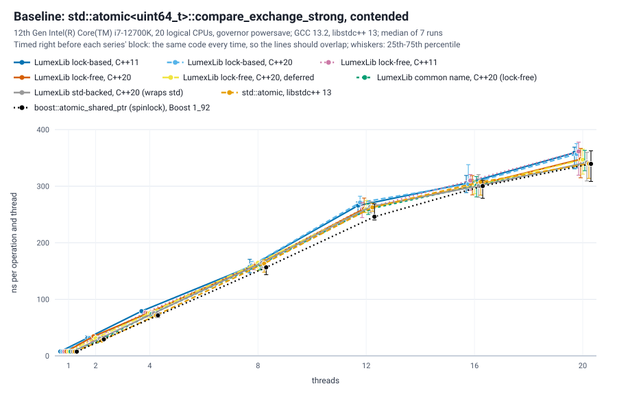

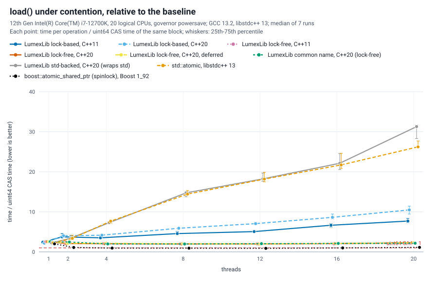

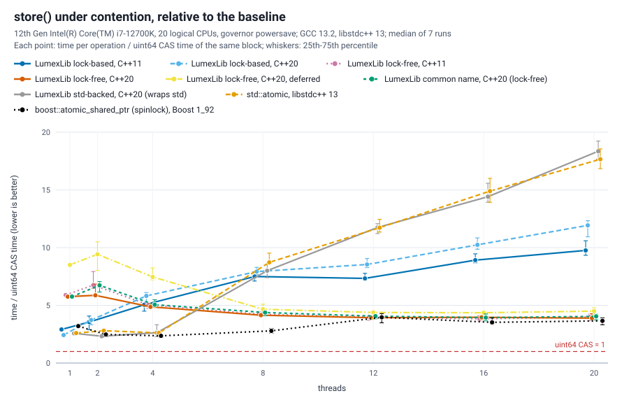

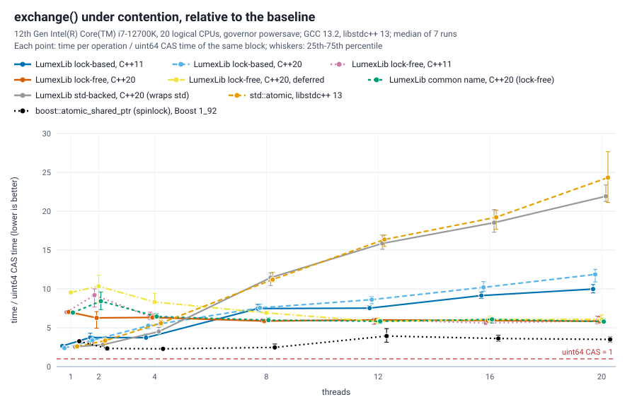

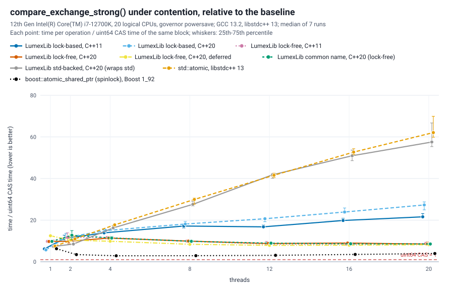

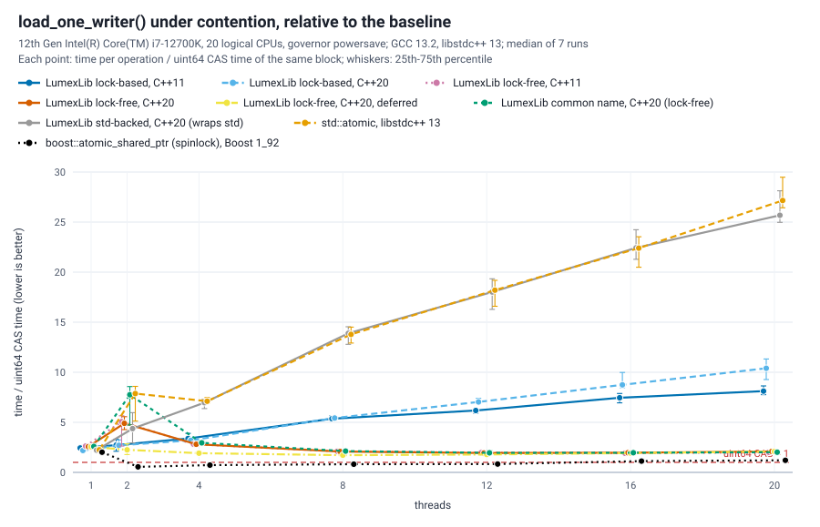

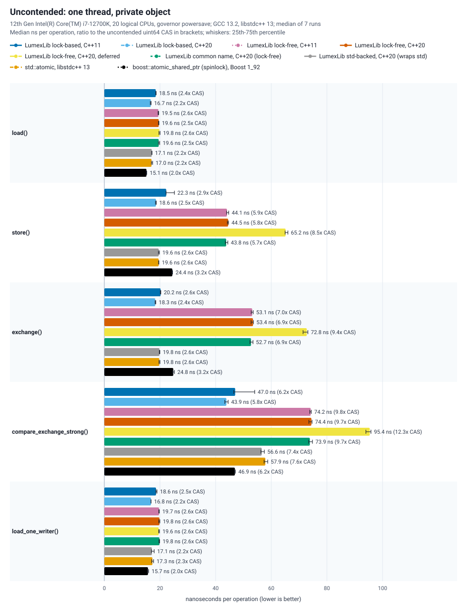

## The split-count engine

`atomic_shared_ptr_lock_free_split_count<T>` and `atomic_weak_ptr_lock_free_split_count<T>` (x86-64, a 16-byte word updated by a 128-bit compare-and-swap; see `lumex/core/atomic/README.md`, "The split-count engine") had never been measured. This section says where they are faster and where they are slower than the other engines. It states measurements only: whether the engine is wanted, whether the family alias `lumex::core::smart_ptr::atomic_shared_ptr` should become it, and which `reserve` is the production value are decisions that are not made here.

Files: `results/split_count/store_wait_benchmark.*` and `store_wait_pinned.*` (the time of every single store under a read load), `results/split_count/split_count_benchmark.{csv,md}` (the four operations, the read-heavy run, the load plus store pair, cycles; 11 series), `split_count_weak_benchmark.*` (weak pointers), `split_count_oversubscribed.*` (20, 40 and 60 threads), `split_count_destroy.*` (destruction latency), `split_count_alignment_{default,aligned64}.csv` (the code placement check) and the charts `split_count_*.svg`, all in [results/split_count/](results/split_count/split_count_benchmark.md).

### What is compared

| Series | What it is | Pointer type |
| --- | --- | --- |
| split-count r8, C++11 / C++20 | `atomic_shared_ptr_lock_free_split_count<int>` as shipped (reserve 8, and the same reserve 8 for a successful `compare_exchange`; the unit refuses to build the series if `split_native_policy_t::reserve ()` is not 8). **The tables of this section were measured before `compare_exchange` got its reserve**, see "Reserve in compare_exchange" | own `lumex::core::smart_ptr::shared_ptr` |
| split-count r4, C++20 | the same cell with a policy that differs from the production one in `reserve ()` and `cas_reserve ()` (both 4); no engine header is changed | own |
| split-count r8, no cas reserve, C++20 (`lumex_split_count_nocasres`) | the production policy with `cas_reserve () == 0`: the engine as it was before the reserve of the compare-exchange; not part of the sweep above, it is the control of the section "Reserve in compare_exchange" | own |
| lock-based own ptr, C++11 / C++20 | `atomic_shared_ptr_lock_based_lumex<int>`: the like-for-like competitor, the same pointer under the lock-based engine (this is what the family alias is today) | own |
| box lock-free immediate / deferred, C++20 | `atomic_shared_ptr_lock_free<int>` (hazard-pointer box engine), the replaced value destroyed in the call, or later | `std::shared_ptr` |
| lock-based std ptr, C++20 | `atomic_shared_ptr_lock_based<int>` | `std::shared_ptr` |
| std-backed, C++20 | `atomic_shared_ptr_std_backed<int>` (wraps libstdc++'s type) | `std::shared_ptr` |
| `std::atomic`, libstdc++ 13 | `std::atomic<std::shared_ptr<int>>` | `std::shared_ptr` |
| `boost::atomic_shared_ptr` 1.92 | a spinlock around a `boost::shared_ptr` | `boost::shared_ptr` |

The pointer types differ. A series over the own `shared_ptr` and a series over `std::shared_ptr` differ in the engine and in the pointer (copy and destruction of the pointer, the layout of the control block), so only the pairs split-count against lock-based own ptr are engine-only comparisons. The weak series are the weak twins: split-count weak, lock-based weak (own and std pointer), box lock-free weak, std-backed weak and `std::atomic<std::weak_ptr<int>>`.

Each series is a class in an inline namespace that names its way of sleeping (`split_count_std_wait`, `split_count_table_wait`, `lock_based_lumex_std_wait`, ...); `--list` prints it and `run_benchmark.py` stops when a series measured something else.

### Method deltas

The method of the sections above (baseline loop per block, interleaving, 100 ms windows, medians and quartiles, the leak check) is unchanged. Added:

- **New rows.** `one_writer_stores`: the writer's side of `load_one_writer` (one thread stores alternating values while the others load; the loads of the readers are `load_one_writer`; at one thread the thread loads or stores alone). `load_store`: one `load ()` and one `store ()` of the same value per iteration, on one thread. `weak_load` and `weak_load_lock`: `load ()` of a weak atomic, and `load ()` followed by `weak_ptr::lock ()`. Destruction latency: a thread replaces the value 20000 times with a new object that has a deleter; the latency of an object is the time from the start of the replacing store to the run of its deleter; with 4 threads the other three load in a loop, so the last owner can be a reader.
- **Cycles.** For one thread the user-mode cycles and instructions of the timed loop are read with `perf_event_open` (`PERF_COUNT_HW_CPU_CYCLES`, `_INSTRUCTIONS`, the calling thread, user mode) and divided by the operations. The core clock is not fixed (governor `powersave`), so cycles and nanoseconds do not convert by a constant.
- **Sizes.** Shared pointers: 100 repetitions, 30 s pauses, 1 and every even count up to 20 threads (the project method; 191.5 minutes). The new scenarios use fewer repetitions: weak pointers 50 repetitions with 10 s pauses (26.8 minutes), oversubscription (20, 40 and 60 threads, the 20 logical CPUs of the machine) 30 repetitions with 10 s pauses (22.3 minutes), destruction latency 100 repetitions with 5 s pauses (9.8 minutes, 20000 objects each, at 1 and 4 threads). The code placement check is a reduced run (12 repetitions, 2 s pauses, 1, 8, 16 and 20 threads, five series).
- **No pinning.** The benchmark threads are not pinned to CPUs (the project method never pinned them; only the compile-time measurement uses `--cpu`).
- **Not evaluated.** Whether `compare_exchange_*` should also take a reserve needs an engine change and was not implemented, so it is not evaluated. The writer in the read-heavy run only stores (no `exchange` writer). The time of a single `store` under read load is measured by its own scenario (`store_wait`, below).

- **Store wait.** One writer thread times every `store ()` call on its own (`std::chrono::steady_clock`, two reads per store; no `rdtsc`) while the other threads `load ()`; the result is the distribution of the time of one store in nanoseconds, not a rate and not normalized (a latency has no baseline ratio). 40 repetitions of 100000 timed stores per series and thread count (4 million per cell), after 2000 untimed stores, 10 s pauses, threads 2, 4, 8, 12, 20 (the 20 logical CPUs) and 40, 60 (oversubscribed), 43.2 minutes with the lock held exclusively. Six series: split-count r8 and lock-based over the own pointer, the box lock-free engine (immediate destruction), lock-based over `std::shared_ptr`, `std::atomic<std::shared_ptr>`, Boost. The writer's involuntary context switches (`getrusage (RUSAGE_THREAD)`, `ru_nivcsw`) are counted over the timed loop and read after every store over 1 ms, never in the loop of the ordinary stores. A reduced run with every thread pinned to its own CPU (10 repetitions, threads 4, 12, 20, 60, 5 s pauses) is in `store_wait_pinned.*`; raising the writer's priority was not possible on this machine (no real-time priority for the user), so it was not done.

The commands of the sweeps (`SERIES` is the eleven keys `lumex_split_count_cxx11,lumex_split_count,lumex_split_count_r4,lumex_lock_based_lumex_cxx11,lumex_lock_based_lumex,lumex_lock_free,lumex_lock_free_deferred,lumex_lock_based,lumex_std_backed,std,boost`; the runs were made in this order):

```sh
EXE=build-bench/bin/LumexAtomicBenchmark
OUT=benchmarks/atomic/results/split_count
STORE_WAIT_SERIES=lumex_split_count,lumex_lock_based_lumex,lumex_lock_free,lumex_lock_based,std,boost
python benchmarks/atomic/run_benchmark.py --exe $EXE --scenario store_wait --series $STORE_WAIT_SERIES --name store_wait_benchmark --repetitions 40 --settle-seconds 10 --stores 100000 --out-dir $OUT
python benchmarks/atomic/run_benchmark.py --exe $EXE --scenario store_wait --series $STORE_WAIT_SERIES --name store_wait_pinned --pin --threads 4,12,20,60 --repetitions 10 --settle-seconds 5 --stores 100000 --out-dir $OUT
python benchmarks/atomic/run_benchmark.py --exe $EXE --scenario destroy --name split_count_destroy --repetitions 100 --settle-seconds 5 --out-dir $OUT
python benchmarks/atomic/run_benchmark.py --exe $EXE --scenario weak --name split_count_weak_benchmark --repetitions 50 --settle-seconds 10 --out-dir $OUT
python benchmarks/atomic/run_benchmark.py --exe $EXE --series $SERIES --name split_count_oversubscribed --threads 20,40,60 --repetitions 30 --settle-seconds 10 --out-dir $OUT
python benchmarks/atomic/run_benchmark.py --exe $EXE --series $SERIES --name split_count_benchmark --repetitions 100 --settle-seconds 30 --out-dir $OUT
```

The check of the code placement is the same executable configured a second time with `-DCMAKE_CXX_FLAGS="-falign-functions=64 -falign-loops=64"` and run with `--repetitions 12 --settle-seconds 2 --threads 1,8,16,20` on `lumex_split_count_cxx11,lumex_split_count,lumex_split_count_r4,lumex_lock_based_lumex_cxx11,lumex_lock_based_lumex`.

### Machine and build

| | |
| --- | --- |
| CPU | 12th Gen Intel Core i7-12700K, 20 logical CPUs, governor `powersave` |
| OS, kernel | Astra Linux 1.7, Linux 6.1.170 |
| Compiler | GCC 13.2 with libstdc++ 13, Release, LumexLib's `Portable` level (`-O2 -march=x86-64 -mtune=generic`); Boost 1.92 |
| Run | 2026-10-13, nothing else was built or run (the workstation build lock was held by the sweep). The main sweep started right after the oversubscription run, so its load average of the start (30) is that run's own threads |

The baseline rows of the main sweep agree within 3 % of their mean at every thread count for ten of the eleven series. The block of `split-count r8, C++11` is the exception: its baseline was 8 to 15 % above the mean at 6 to 20 threads (table "Baseline" in [results/split_count/split_count_benchmark.md](results/split_count/split_count_benchmark.md)), so its ratios read about 10 % lower than those of its neighbours. In nanoseconds the C++11 and the C++20 build of the engine agree: `load` 2764 against 2776 ns at 20 threads, `store` 1052 against 1079, `exchange` 1090 against 1111, `compare_exchange_strong` 6692 against 6707 (and 966 against 972, 508 against 529, 529 against 545, 2440 against 2446 at 8 threads). The ratios of the C++11 series are therefore not used below to claim a difference between the two standards. The cause of the higher baseline was not investigated.

### Code placement check

Identical machine code with different times is code placement. The lock-based engine over the own pointer moves with the placement: built with `-falign-functions=64 -falign-loops=64`, its contended `load ()` ratio at 20 threads goes from 11.6 to 14.6 and its `store ()` from 12.9 to 15.2, while the split-count engine moves by 0.6 at most (9.0 to 9.6, 3.5 to 3.6). Uncontended the five series get 4 to 8 % faster. The orderings below that survive both builds are marked; a difference under about 15 % between the lock-based engine and anything else is within what placement does and is not claimed. The machine code of the C++11 and the C++20 `split_count_cell::load` is not identical (different frame and register allocation), so the equal times of the two builds are not an identical-code case; their equality is a measurement, the cause is not investigated.

### Results

Charts (ratio to the uint64 compare-exchange, lower is better; the lines are medians, the whiskers 25th-75th percentiles; the C++11 split-count line carries the baseline remark above):

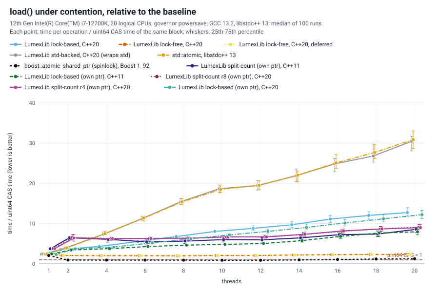

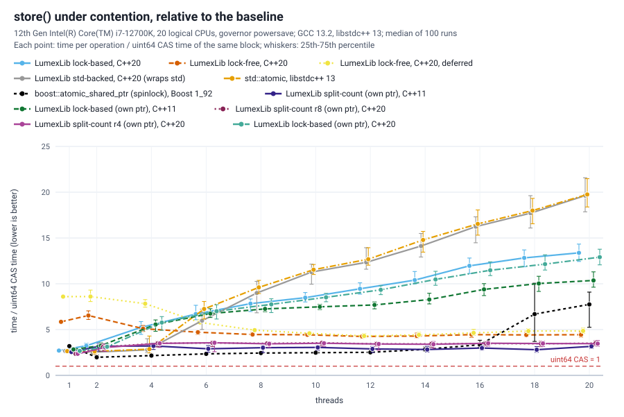

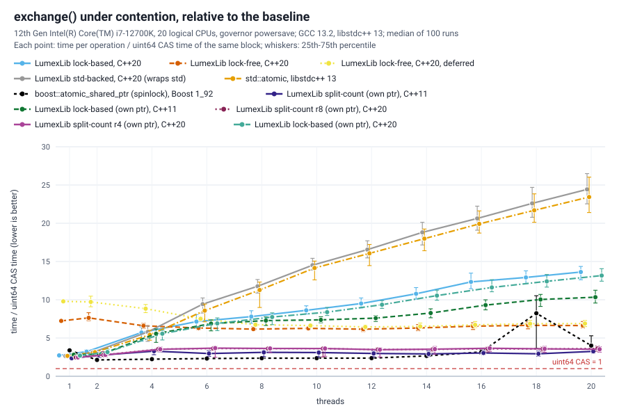

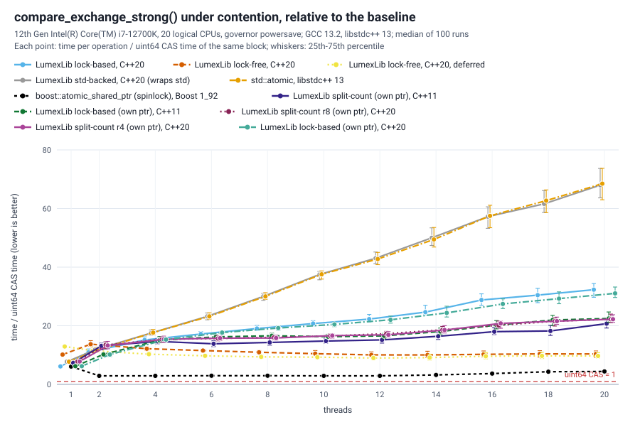

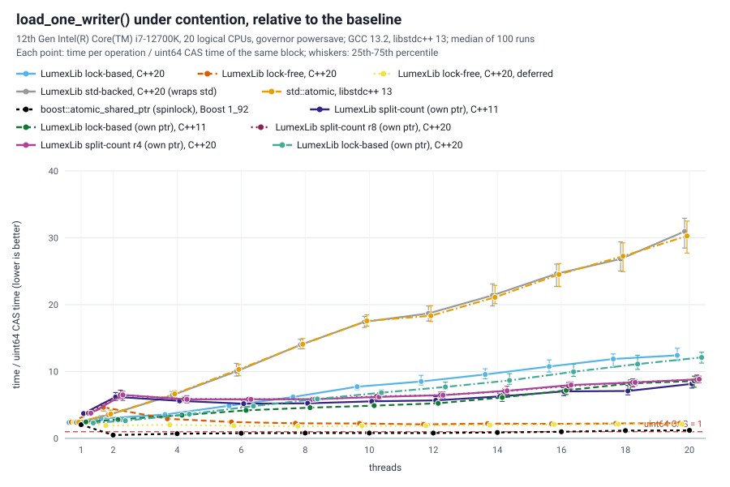

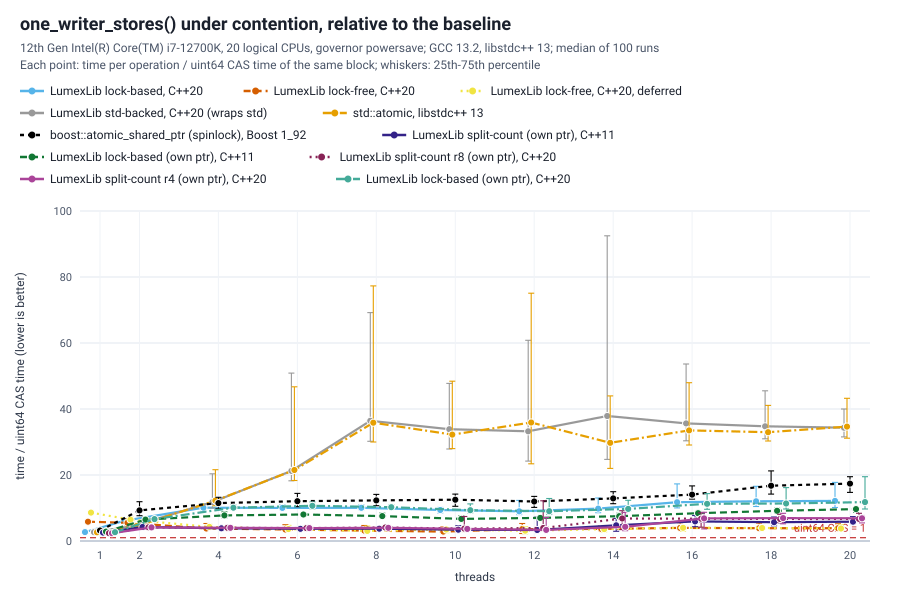

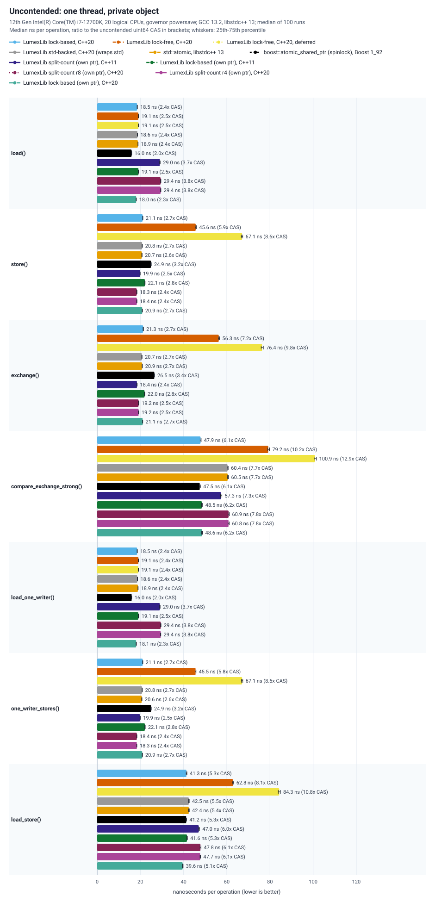

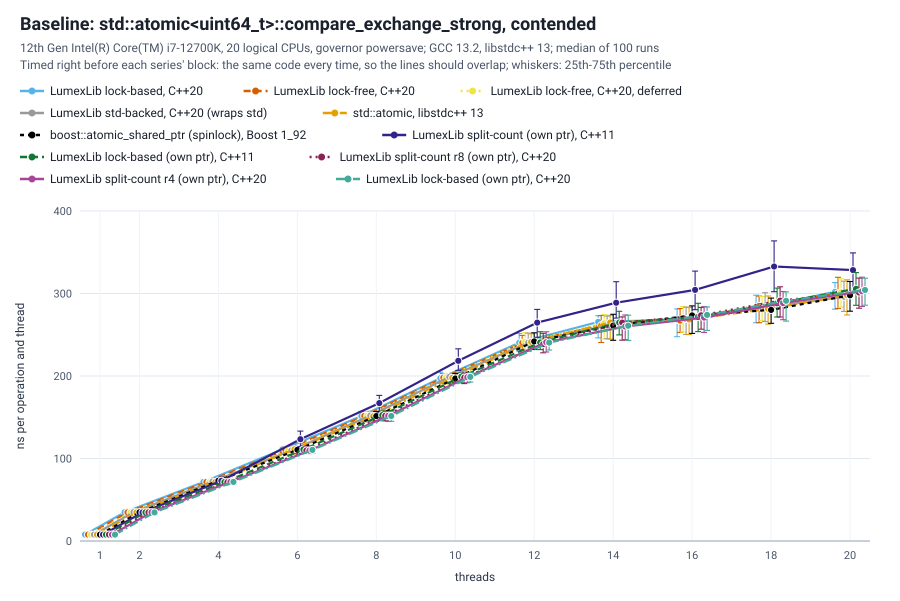

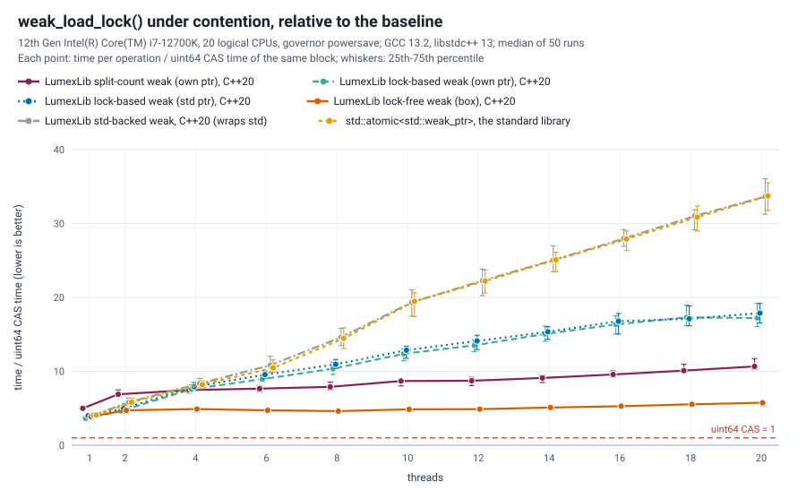

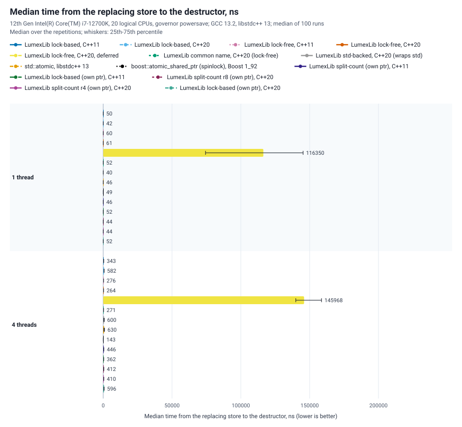

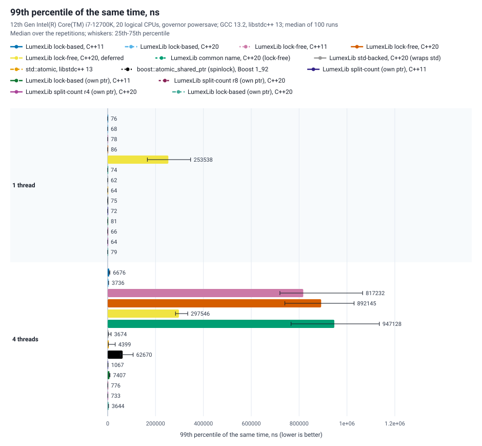

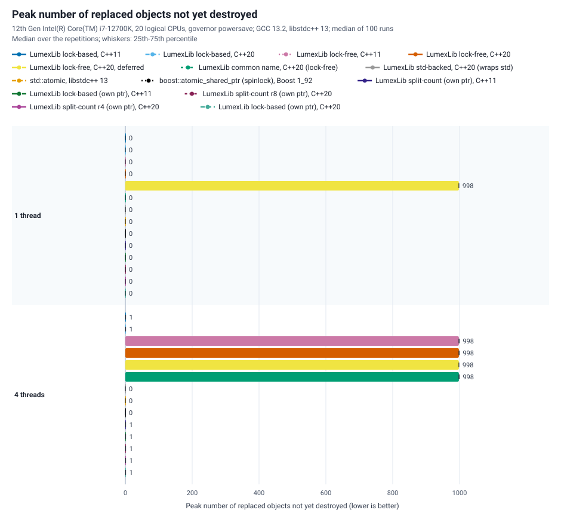

The tables (every number below is in them; the full tables with all thread counts and the quartiles are in the `.md` files next to the CSVs):


#### Uncontended (one thread, private object)

Median ns per operation; cycles and instructions per operation in brackets (user mode, `perf_event_open`).

| Series | `load` | `store` | `exchange` | `compare_exchange_strong` | `load_store` |
| --- | ---: | ---: | ---: | ---: | ---: |
| split-count r8, C++11 | 29.0 (124 cyc, 113 ins) | 19.9 (85 cyc, 89 ins) | 18.4 (79 cyc, 98 ins) | 57.3 (246 cyc, 224 ins) | 47.0 (202 cyc, 198 ins) |
| split-count r8, C++20 | 29.4 (126 cyc, 111 ins) | 18.3 (79 cyc, 64 ins) | 19.2 (82 cyc, 76 ins) | 60.9 (261 cyc, 240 ins) | 47.8 (205 cyc, 177 ins) |
| split-count r4, C++20 | 29.4 (126 cyc, 111 ins) | 18.4 (79 cyc, 64 ins) | 19.2 (82 cyc, 76 ins) | 60.8 (261 cyc, 240 ins) | 47.7 (204 cyc, 177 ins) |
| lock-based own ptr, C++11 | 19.1 (82 cyc, 48 ins) | 22.1 (95 cyc, 53 ins) | 22.0 (94 cyc, 57 ins) | 48.5 (208 cyc, 118 ins) | 41.6 (178 cyc, 98 ins) |
| lock-based own ptr, C++20 | 18.0 (77 cyc, 29 ins) | 20.9 (89 cyc, 34 ins) | 21.1 (90 cyc, 36 ins) | 48.6 (208 cyc, 102 ins) | 39.6 (170 cyc, 71 ins) |
| box lock-free immediate, C++20 | 19.1 (82 cyc, 108 ins) | 45.6 (195 cyc, 530 ins) | 56.3 (241 cyc, 559 ins) | 79.2 (340 cyc, 808 ins) | 62.8 (269 cyc, 641 ins) |
| box lock-free deferred, C++20 | 19.1 (82 cyc, 108 ins) | 67.1 (288 cyc, 341 ins) | 76.4 (327 cyc, 368 ins) | 100.9 (432 cyc, 620 ins) | 84.3 (361 cyc, 450 ins) |
| lock-based std ptr, C++20 | 18.5 (80 cyc, 40 ins) | 21.1 (90 cyc, 43 ins) | 21.3 (91 cyc, 46 ins) | 47.9 (205 cyc, 110 ins) | 41.3 (177 cyc, 84 ins) |
| std-backed, C++20 | 18.6 (80 cyc, 32 ins) | 20.8 (89 cyc, 37 ins) | 20.7 (89 cyc, 40 ins) | 60.4 (259 cyc, 106 ins) | 42.5 (182 cyc, 69 ins) |
| std::atomic, libstdc++ 13 | 18.9 (81 cyc, 32 ins) | 20.7 (89 cyc, 37 ins) | 20.9 (89 cyc, 40 ins) | 60.5 (259 cyc, 108 ins) | 42.4 (182 cyc, 69 ins) |
| boost::atomic_shared_ptr 1.92 | 16.0 (68 cyc, 24 ins) | 24.9 (107 cyc, 35 ins) | 26.5 (113 cyc, 41 ins) | 47.5 (203 cyc, 83 ins) | 41.2 (177 cyc, 60 ins) |

#### `load ()` under contention

Ratio to the uint64 compare-exchange of the same block, median (p25-p75) at 2 / 4 / 8 / 12 / 20 threads.

| Series | 2 | 4 | 8 | 12 | 20 |
| --- | ---: | ---: | ---: | ---: | ---: |
| split-count r8, C++11 | 6.5 (6.0-6.8) | 6.1 (5.4-6.3) | 5.6 (5.0-6.2) | 5.9 (5.4-6.5) | 8.6 (7.8-9.1) |
| split-count r8, C++20 | 6.5 (5.9-7.2) | 6.3 (5.8-6.7) | 6.4 (6.1-6.7) | 6.7 (6.3-7.1) | 9.1 (8.6-9.8) |
| split-count r4, C++20 | 6.4 (5.6-7.3) | 6.3 (5.8-6.6) | 6.3 (5.9-6.7) | 6.7 (6.1-7.1) | 9.0 (8.7-9.7) |
| lock-based own ptr, C++11 | 3.4 (3.2-3.8) | 3.8 (3.5-3.9) | 4.6 (4.5-4.8) | 5.0 (4.8-5.4) | 8.0 (7.2-8.6) |
| lock-based own ptr, C++20 | 3.7 (3.3-4.0) | 4.2 (3.9-4.4) | 6.2 (6.0-6.5) | 8.1 (7.5-8.6) | 12.2 (11.3-13.3) |
| box lock-free immediate, C++20 | 2.1 (1.9-2.2) | 2.0 (1.9-2.2) | 2.0 (1.9-2.1) | 2.0 (1.9-2.1) | 2.3 (2.2-2.6) |
| box lock-free deferred, C++20 | 2.1 (1.9-2.3) | 2.0 (1.9-2.2) | 2.0 (1.9-2.1) | 2.1 (1.9-2.1) | 2.3 (2.1-2.5) |
| lock-based std ptr, C++20 | 3.5 (3.3-3.8) | 4.3 (4.0-4.6) | 6.8 (6.5-7.0) | 8.8 (8.2-9.4) | 12.7 (11.9-13.9) |
| std-backed, C++20 | 3.9 (3.7-4.3) | 7.3 (7.0-7.8) | 15.4 (14.8-16.3) | 19.4 (18.3-20.7) | 30.5 (28.1-31.7) |
| std::atomic, libstdc++ 13 | 3.9 (3.7-4.3) | 7.5 (7.1-8.1) | 15.4 (14.7-16.2) | 19.5 (18.4-20.6) | 30.9 (28.6-33.0) |
| boost::atomic_shared_ptr 1.92 | 0.9 (0.9-1.0) | 0.9 (0.9-1.0) | 0.9 (0.9-0.9) | 0.9 (0.8-0.9) | 1.2 (1.2-1.3) |

#### `store ()` under contention

Ratio to the uint64 compare-exchange of the same block, median (p25-p75) at 2 / 4 / 8 / 12 / 20 threads.

| Series | 2 | 4 | 8 | 12 | 20 |
| --- | ---: | ---: | ---: | ---: | ---: |
| split-count r8, C++11 | 3.2 (2.6-3.5) | 3.2 (2.8-3.5) | 3.0 (2.5-3.2) | 2.9 (2.5-3.2) | 3.2 (2.9-3.5) |
| split-count r8, C++20 | 3.1 (2.6-3.4) | 3.5 (3.1-3.7) | 3.5 (3.3-3.7) | 3.4 (3.2-3.6) | 3.5 (3.2-3.8) |
| split-count r4, C++20 | 3.0 (2.6-3.4) | 3.5 (3.1-3.7) | 3.4 (3.1-3.7) | 3.4 (2.7-3.6) | 3.5 (3.2-3.8) |
| lock-based own ptr, C++11 | 3.2 (3.0-3.6) | 5.6 (4.8-6.1) | 7.3 (6.9-7.7) | 7.7 (7.3-8.0) | 10.4 (9.6-11.3) |
| lock-based own ptr, C++20 | 3.1 (3.0-3.4) | 5.8 (4.9-6.4) | 7.8 (6.9-8.4) | 9.3 (8.8-9.8) | 12.9 (12.1-13.8) |
| box lock-free immediate, C++20 | 6.5 (6.1-7.0) | 5.1 (4.8-5.4) | 4.5 (4.3-4.7) | 4.2 (4.0-4.4) | 4.4 (4.2-4.7) |
| box lock-free deferred, C++20 | 8.6 (8.1-9.3) | 7.8 (7.4-8.3) | 4.9 (4.8-5.1) | 4.3 (4.1-4.6) | 4.9 (4.6-5.2) |
| lock-based std ptr, C++20 | 3.2 (2.9-3.5) | 5.2 (4.5-5.9) | 7.8 (7.0-8.3) | 9.5 (8.9-10.1) | 13.4 (12.4-14.3) |
| std-backed, C++20 | 2.5 (2.3-2.8) | 2.8 (2.5-4.0) | 9.0 (6.8-10.3) | 12.3 (11.6-13.9) | 19.6 (17.9-21.6) |
| std::atomic, libstdc++ 13 | 2.6 (2.3-2.9) | 2.9 (2.5-4.3) | 9.6 (8.9-10.4) | 12.7 (12.0-13.9) | 19.8 (18.4-21.5) |
| boost::atomic_shared_ptr 1.92 | 2.0 (1.8-2.2) | 2.2 (2.0-2.3) | 2.4 (2.3-2.6) | 2.5 (2.4-2.7) | 7.8 (5.2-9.1) |

#### `exchange ()` under contention

Ratio to the uint64 compare-exchange of the same block, median (p25-p75) at 2 / 4 / 8 / 12 / 20 threads.

| Series | 2 | 4 | 8 | 12 | 20 |
| --- | ---: | ---: | ---: | ---: | ---: |
| split-count r8, C++11 | 2.7 (2.4-3.1) | 3.3 (2.8-3.5) | 3.1 (2.6-3.4) | 3.0 (2.5-3.3) | 3.3 (3.0-3.6) |
| split-count r8, C++20 | 2.8 (2.5-3.2) | 3.5 (3.2-3.7) | 3.6 (3.4-3.8) | 3.5 (3.2-3.7) | 3.6 (3.3-4.0) |
| split-count r4, C++20 | 2.8 (2.5-3.2) | 3.5 (3.2-3.8) | 3.6 (3.1-3.8) | 3.5 (2.5-3.7) | 3.5 (3.2-3.9) |
| lock-based own ptr, C++11 | 2.9 (2.7-3.1) | 5.6 (4.4-6.2) | 7.3 (6.6-7.8) | 7.6 (7.2-7.9) | 10.3 (9.6-11.2) |
| lock-based own ptr, C++20 | 3.2 (2.9-3.5) | 5.6 (4.7-6.0) | 7.7 (6.7-8.3) | 9.4 (8.9-9.9) | 13.2 (12.4-14.1) |
| box lock-free immediate, C++20 | 7.6 (7.3-8.3) | 6.6 (6.3-6.9) | 6.2 (6.0-6.5) | 6.2 (5.8-6.4) | 6.6 (6.3-7.2) |
| box lock-free deferred, C++20 | 9.7 (9.1-10.5) | 8.8 (8.3-9.4) | 6.7 (6.5-7.0) | 6.4 (6.2-6.7) | 6.9 (6.5-7.3) |
| lock-based std ptr, C++20 | 3.2 (2.9-3.5) | 5.7 (4.6-6.5) | 7.8 (6.9-8.6) | 9.5 (8.9-10.2) | 13.6 (12.6-14.4) |
| std-backed, C++20 | 3.1 (2.9-3.4) | 5.8 (4.6-6.6) | 11.8 (10.9-12.6) | 16.6 (15.5-17.7) | 24.4 (22.5-26.5) |
| std::atomic, libstdc++ 13 | 3.1 (2.9-3.3) | 5.4 (4.7-6.0) | 11.3 (9.0-12.3) | 16.1 (14.5-17.2) | 23.4 (21.4-26.0) |
| boost::atomic_shared_ptr 1.92 | 2.1 (1.9-2.4) | 2.2 (2.1-2.4) | 2.4 (2.3-2.5) | 2.4 (2.3-2.5) | 4.0 (3.6-5.3) |

#### `compare_exchange_strong ()` under contention

Ratio to the uint64 compare-exchange of the same block, median (p25-p75) at 2 / 4 / 8 / 12 / 20 threads.

| Series | 2 | 4 | 8 | 12 | 20 |
| --- | ---: | ---: | ---: | ---: | ---: |
| split-count r8, C++11 | 13.1 (11.8-14.1) | 14.7 (13.8-15.5) | 14.3 (13.4-15.7) | 15.2 (14.1-16.4) | 20.7 (19.2-22.1) |
| split-count r8, C++20 | 13.5 (12.1-14.5) | 15.4 (14.4-16.2) | 16.0 (15.2-16.8) | 17.3 (16.3-18.1) | 22.2 (21.1-24.0) |
| split-count r4, C++20 | 13.3 (12.1-14.7) | 15.4 (14.2-16.5) | 15.8 (15.1-16.7) | 16.9 (16.1-18.0) | 22.2 (21.2-23.8) |
| lock-based own ptr, C++11 | 10.2 (9.6-10.7) | 15.1 (14.2-16.3) | 16.6 (16.0-17.5) | 16.6 (15.6-17.4) | 22.5 (21.2-24.7) |
| lock-based own ptr, C++20 | 10.2 (9.5-10.9) | 15.3 (14.7-16.0) | 19.2 (18.5-20.0) | 22.0 (20.9-23.3) | 31.1 (29.6-33.2) |
| box lock-free immediate, C++20 | 13.7 (13.0-14.9) | 12.2 (11.6-12.8) | 11.0 (10.3-11.5) | 10.1 (9.4-11.1) | 10.4 (9.3-11.4) |
| box lock-free deferred, C++20 | 11.5 (10.8-12.4) | 10.3 (9.9-11.1) | 9.4 (8.9-10.1) | 9.0 (8.4-9.8) | 9.7 (9.0-10.8) |
| lock-based std ptr, C++20 | 11.0 (10.4-12.1) | 15.2 (14.5-16.2) | 19.0 (18.4-20.1) | 22.3 (21.3-23.9) | 32.3 (29.7-34.4) |
| std-backed, C++20 | 11.8 (11.1-12.6) | 17.5 (16.7-18.6) | 30.0 (28.7-31.0) | 43.0 (41.2-45.2) | 68.0 (63.6-73.7) |
| std::atomic, libstdc++ 13 | 11.6 (11.0-12.6) | 17.7 (16.9-18.8) | 30.0 (29.0-31.3) | 42.8 (40.8-45.0) | 68.5 (63.0-73.7) |
| boost::atomic_shared_ptr 1.92 | 2.9 (2.8-3.2) | 2.9 (2.8-3.1) | 3.0 (2.8-3.1) | 2.9 (2.8-3.0) | 4.4 (4.1-4.7) |

#### `load ()` of the readers with one writer (`load_one_writer`) under contention

Ratio to the uint64 compare-exchange of the same block, median (p25-p75) at 2 / 4 / 8 / 12 / 20 threads.

| Series | 2 | 4 | 8 | 12 | 20 |
| --- | ---: | ---: | ---: | ---: | ---: |
| split-count r8, C++11 | 6.2 (5.7-6.9) | 5.6 (5.3-5.9) | 5.3 (4.9-5.7) | 5.7 (5.3-6.3) | 8.2 (7.5-8.7) |
| split-count r8, C++20 | 6.5 (6.0-7.2) | 5.9 (5.5-6.3) | 5.8 (5.6-6.1) | 6.5 (6.1-6.9) | 8.8 (8.3-9.5) |
| split-count r4, C++20 | 6.5 (5.7-7.0) | 5.8 (5.3-6.4) | 5.9 (5.5-6.2) | 6.5 (6.0-6.9) | 8.8 (8.3-9.3) |
| lock-based own ptr, C++11 | 2.8 (2.5-3.2) | 3.5 (3.3-3.7) | 4.6 (4.5-4.8) | 5.2 (5.0-5.6) | 8.6 (7.6-9.3) |
| lock-based own ptr, C++20 | 2.6 (2.3-3.0) | 3.6 (3.4-3.9) | 5.9 (5.7-6.2) | 7.7 (7.3-8.4) | 12.1 (11.3-12.9) |
| box lock-free immediate, C++20 | 4.7 (4.1-5.2) | 2.9 (2.8-3.1) | 2.3 (2.0-2.5) | 2.1 (1.9-2.4) | 2.3 (2.1-2.5) |
| box lock-free deferred, C++20 | 1.9 (1.7-2.1) | 2.0 (1.9-2.2) | 1.8 (1.6-2.0) | 1.9 (1.7-2.1) | 2.1 (1.9-2.3) |
| lock-based std ptr, C++20 | 3.0 (2.7-3.4) | 3.6 (3.3-3.8) | 6.2 (6.0-6.4) | 8.5 (8.0-9.4) | 12.4 (11.6-13.5) |
| std-backed, C++20 | 3.5 (3.2-3.9) | 6.4 (6.0-7.0) | 14.0 (13.4-14.8) | 18.7 (17.6-19.8) | 31.0 (28.5-32.9) |
| std::atomic, libstdc++ 13 | 3.6 (3.2-4.2) | 6.6 (6.0-7.1) | 14.1 (13.4-14.9) | 18.3 (17.5-19.8) | 30.3 (27.7-32.5) |
| boost::atomic_shared_ptr 1.92 | 0.5 (0.5-0.5) | 0.7 (0.7-0.7) | 0.8 (0.8-0.8) | 0.8 (0.8-0.8) | 1.2 (1.2-1.3) |

#### Read-heavy: rates

Millions per second from the median ns per operation; loads: all readers together (threads - 1), stores: the one writer. At 1 thread: the thread alone.

| Series | loads 1 | loads 2 | loads 4 | loads 8 | loads 12 | loads 20 | stores 1 | stores 2 | stores 4 | stores 8 | stores 12 | stores 20 |
| --- | ---: | ---: | ---: | ---: | ---: | ---: | ---: | ---: | ---: | ---: | ---: | ---: |
| split-count r8, C++11 | 34.5 | 4.6 | 7.2 | 7.9 | 7.2 | 7.2 | 50.4 | 6.9 | 3.6 | 1.6 | 1.2 | 0.5 |
| split-count r8, C++20 | 34.0 | 4.5 | 7.1 | 7.8 | 7.1 | 7.2 | 54.6 | 7.0 | 3.5 | 1.6 | 1.1 | 0.5 |
| split-count r4, C++20 | 34.0 | 4.5 | 7.2 | 7.8 | 7.1 | 7.2 | 54.5 | 7.1 | 3.5 | 1.6 | 1.3 | 0.5 |
| lock-based own ptr, C++11 | 52.2 | 10.2 | 12.1 | 9.9 | 8.5 | 7.1 | 45.2 | 4.5 | 1.8 | 0.9 | 0.6 | 0.3 |
| lock-based own ptr, C++20 | 55.5 | 11.0 | 11.5 | 7.8 | 6.0 | 5.2 | 48.0 | 4.4 | 1.4 | 0.6 | 0.5 | 0.3 |
| box lock-free immediate, C++20 | 52.3 | 6.4 | 14.3 | 21.6 | 21.8 | 28.6 | 21.9 | 5.2 | 3.9 | 2.2 | 1.2 | 0.9 |
| box lock-free deferred, C++20 | 52.4 | 15.6 | 21.2 | 26.4 | 24.7 | 30.5 | 14.9 | 4.6 | 3.4 | 2.2 | 1.3 | 0.9 |
| lock-based std ptr, C++20 | 53.9 | 9.4 | 12.0 | 7.5 | 5.4 | 5.1 | 47.3 | 5.0 | 1.4 | 0.7 | 0.5 | 0.3 |
| std-backed, C++20 | 53.6 | 8.2 | 6.4 | 3.3 | 2.5 | 2.1 | 48.0 | 6.3 | 1.2 | 0.2 | 0.1 | 0.1 |
| std::atomic, libstdc++ 13 | 52.9 | 8.0 | 6.3 | 3.3 | 2.5 | 2.1 | 48.3 | 6.3 | 1.2 | 0.2 | 0.1 | 0.1 |
| boost::atomic_shared_ptr 1.92 | 62.6 | 57.7 | 58.9 | 57.9 | 56.7 | 52.7 | 40.1 | 3.1 | 1.2 | 0.5 | 0.4 | 0.2 |

#### Oversubscribed: 20 / 40 / 60 threads on 20 logical CPUs

Ratio to the uint64 compare-exchange of the same block (median); 30 repetitions, 10 s pauses.

| Series | `load` | `store` | `exchange` | `compare_exchange_strong` | `load_one_writer` | `one_writer_stores` |
| --- | ---: | ---: | ---: | ---: | ---: | ---: |
| split-count r8, C++11 | 8.0 / 8.8 / 8.9 | 3.0 / 3.2 / 3.2 | 3.0 / 3.3 / 3.3 | 19.4 / 21.3 / 21.3 | 7.7 / 8.6 / 8.7 | 6.1 / 4.9 / 6.3 |
| split-count r8, C++20 | 9.3 / 9.2 / 9.0 | 3.5 / 3.4 / 3.3 | 3.6 / 3.4 / 3.4 | 22.2 / 21.7 / 20.9 | 8.8 / 8.9 / 8.6 | 6.6 / 4.5 / 7.1 |
| split-count r4, C++20 | 9.1 / 8.9 / 8.7 | 3.5 / 3.4 / 3.2 | 3.5 / 3.5 / 3.3 | 22.2 / 21.9 / 21.1 | 8.8 / 8.9 / 8.7 | 6.6 / 3.9 / 7.1 |
| lock-based own ptr, C++11 | 7.4 / 7.7 / 7.8 | 10.2 / 10.2 / 10.6 | 10.1 / 10.2 / 10.5 | 22.5 / 22.4 / 23.1 | 7.9 / 8.4 / 8.5 | 8.7 / 9.6 / 8.9 |
| lock-based own ptr, C++20 | 12.1 / 14.7 / 14.3 | 12.9 / 14.1 / 14.0 | 13.2 / 14.3 / 14.7 | 30.7 / 34.2 / 34.6 | 11.8 / 14.4 / 14.7 | 12.4 / 12.9 / 15.4 |
| box lock-free immediate, C++20 | 2.2 / 2.2 / 2.2 | 4.3 / 4.3 / 4.2 | 6.3 / 6.3 / 6.2 | 10.2 / 9.9 / 9.5 | 2.1 / 2.2 / 2.2 | 3.9 / 3.7 / 3.9 |
| box lock-free deferred, C++20 | 2.2 / 2.2 / 2.2 | 5.0 / 4.8 / 4.5 | 6.6 / 6.4 / 6.2 | 9.1 / 9.2 / 9.1 | 2.0 / 2.2 / 2.1 | 3.7 / 2.7 / 3.9 |
| lock-based std ptr, C++20 | 12.8 / 14.3 / 14.5 | 13.3 / 14.0 / 14.6 | 13.7 / 14.3 / 14.7 | 32.0 / 33.6 / 34.1 | 12.2 / 14.3 / 15.0 | 14.9 / 13.5 / 14.9 |
| std-backed, C++20 | 28.3 / 69.1 / 81.9 | 17.9 / 37.9 / 54.3 | 22.7 / 49.0 / 74.9 | 64.5 / 130.9 / 188.2 | 28.8 / 55.1 / 86.8 | 31.7 / 58.5 / 108.2 |
| std::atomic, libstdc++ 13 | 28.7 / 60.5 / 98.3 | 18.4 / 35.4 / 48.2 | 24.1 / 52.2 / 71.1 | 65.2 / 127.6 / 194.5 | 28.2 / 61.9 / 87.2 | 33.9 / 54.5 / 95.3 |
| boost::atomic_shared_ptr 1.92 | 1.3 / 1.4 / 1.7 | 8.3 / 4.6 / 5.5 | 4.1 / 4.4 / 5.4 | 4.5 / 5.4 / 6.6 | 1.3 / 1.4 / 1.6 | 20.4 / 17.9 / 18.0 |

#### Weak pointers

`weak_load`: `load ()` of the weak pointer; `weak_load_lock`: `load ()` then `weak_ptr::lock ()`. Uncontended: ns (cycles); contended: ratio to the uint64 compare-exchange (median) at 2 / 4 / 8 / 12 / 20 threads.

| Series | `weak_load` 1 thread | 2 / 4 / 8 / 12 / 20 | `weak_load_lock` 1 thread | 2 / 4 / 8 / 12 / 20 |
| --- | ---: | ---: | ---: | ---: |
| split-count weak, C++20 | 25.2 (124) | 6.4 / 6.2 / 6.6 / 7.5 / 9.3 | 33.6 (166) | 6.9 / 7.5 / 7.9 / 8.7 / 10.7 |
| lock-based weak own ptr, C++20 | 14.8 (73) | 3.6 / 4.7 / 7.8 / 10.6 / 14.2 | 24.4 (120) | 4.7 / 7.6 / 10.4 / 13.5 / 17.2 |
| lock-based weak std ptr, C++20 | 15.9 (78) | 3.3 / 5.0 / 7.7 / 10.3 / 14.2 | 27.0 (133) | 5.0 / 7.9 / 10.9 / 14.1 / 17.9 |
| box lock-free weak, C++20 | 16.3 (80) | 1.9 / 1.9 / 1.9 / 2.0 / 2.2 | 26.1 (128) | 4.7 / 4.9 / 4.6 / 4.9 / 5.8 |
| std-backed weak, C++20 | 16.0 (78) | 2.9 / 6.4 / 12.1 / 14.2 / 22.9 | 27.4 (135) | 5.8 / 8.4 / 14.6 / 22.3 / 33.7 |
| std::atomic<weak_ptr> | 15.9 (78) | 3.0 / 6.2 / 12.2 / 14.2 / 22.8 | 27.4 (135) | 5.8 / 8.2 / 14.5 / 22.2 / 33.7 |

#### Destruction latency

Time from the start of the replacing store to the deleter of the replaced object; medians over 100 repetitions of 20000 objects.

**1 thread**

| Series | median ns | p99 ns | max ns | destroyed in the call | peak backlog | pending at the end |
| --- | ---: | ---: | ---: | ---: | ---: | ---: |
| split-count r8, C++11 | 46 | 72 | 1168 | 100.0 % | 0 | 0.0 % |
| split-count r8, C++20 | 44 | 66 | 1156 | 100.0 % | 0 | 0.0 % |
| split-count r4, C++20 | 44 | 64 | 1070 | 100.0 % | 0 | 0.0 % |
| lock-based own ptr, C++11 | 52 | 81 | 1448 | 100.0 % | 0 | 0.0 % |
| lock-based own ptr, C++20 | 52 | 79 | 1033 | 100.0 % | 0 | 0.0 % |
| box lock-free immediate, C++20 | 61 | 86 | 1996 | 100.0 % | 0 | 0.0 % |
| box lock-free deferred, C++20 | 116350 | 253538 | 326970 | 0.1 % | 998 | 0.0 % |
| lock-based std ptr, C++20 | 42 | 68 | 746 | 100.0 % | 0 | 0.0 % |
| std-backed, C++20 | 40 | 62 | 890 | 100.0 % | 0 | 0.0 % |
| std::atomic, libstdc++ 13 | 46 | 64 | 864 | 100.0 % | 0 | 0.0 % |
| boost::atomic_shared_ptr 1.92 | 49 | 75 | 956 | 100.0 % | 0 | 0.0 % |

**4 threads (3 readers)**

| Series | median ns | p99 ns | max ns | destroyed in the call | peak backlog | pending at the end |
| --- | ---: | ---: | ---: | ---: | ---: | ---: |
| split-count r8, C++11 | 446 | 1067 | 5260 | 13.0 % | 1 | 0.0 % |
| split-count r8, C++20 | 412 | 776 | 6360 | 10.5 % | 1 | 0.0 % |
| split-count r4, C++20 | 410 | 733 | 8740 | 10.2 % | 1 | 0.0 % |
| lock-based own ptr, C++11 | 362 | 7407 | 43694 | 81.4 % | 1 | 0.0 % |
| lock-based own ptr, C++20 | 596 | 3644 | 12708 | 73.2 % | 1 | 0.0 % |
| box lock-free immediate, C++20 | 264 | 892145 | 1103050 | 61.9 % | 998 | 2.7 % |
| box lock-free deferred, C++20 | 145968 | 297546 | 372185 | 0.1 % | 998 | 0.0 % |
| lock-based std ptr, C++20 | 582 | 3736 | 10866 | 76.4 % | 1 | 0.0 % |
| std-backed, C++20 | 600 | 3674 | 118456 | 100.0 % | 0 | 0.0 % |
| std::atomic, libstdc++ 13 | 630 | 4399 | 122605 | 100.0 % | 0 | 0.0 % |
| boost::atomic_shared_ptr 1.92 | 143 | 62670 | 253716 | 100.0 % | 0 | 0.0 % |


#### Time of a single store under a read load

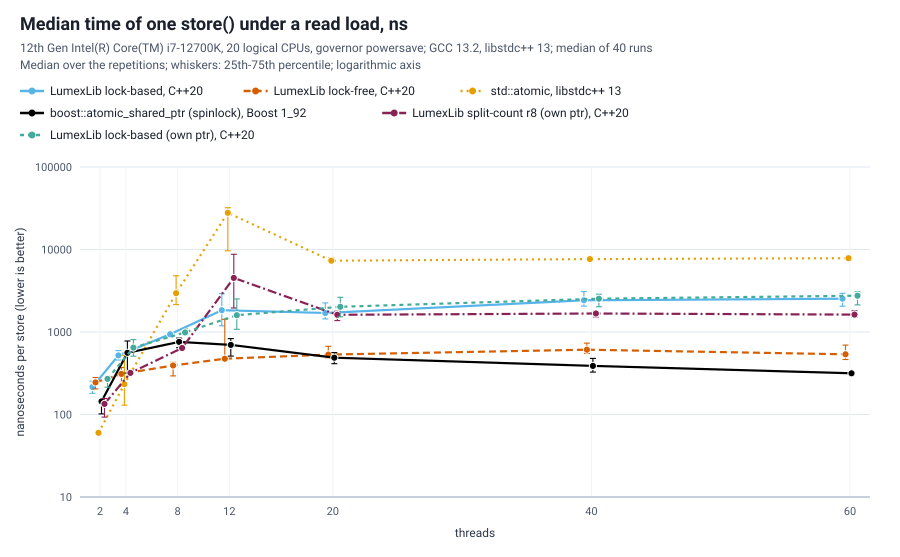

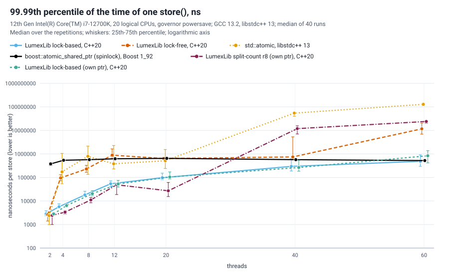

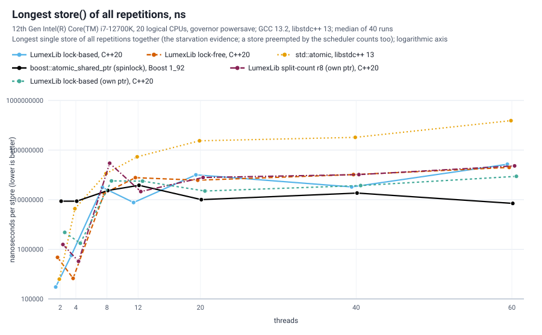

One writer, the other threads load; every store timed. The full tables (median, 90th, 99th, 99.9th and 99.99th percentile, the longest store, the count of stores over 1 ms, the writer's preemptions, the cost of the timer) are in [results/split_count/store_wait_benchmark.md](results/split_count/store_wait_benchmark.md); the pinned run is [store_wait_pinned.md](results/split_count/store_wait_pinned.md). Values are nanoseconds of one call, the median over the 40 repetitions, except where "all repetitions" is said.

| Series | median at 2 / 8 / 20 / 60 threads | 99.99th percentile at 2 / 8 / 20 / 60 | longest store of all repetitions at 2 / 8 / 20 / 60, ms |
| --- | --- | --- | --- |
| split-count r8, own ptr | 134 / 639 / 1614 / 1626 | 2450 / 11082 / 27109 / 24003700 | 1.3 / 54.3 / 28.0 / 48.0 |
| lock-based, own ptr | 270 / 988 / 2020 / 2756 | 2830 / 20436 / 105094 / 837469 | 2.2 / 23.9 / 14.9 / 29.5 |
| box lock-free, immediate | 245 / 392 / 532 / 536 | 2616 / 229412 / 639685 / 11657273 | 0.7 / 13.4 / 24.7 / 44.7 |
| lock-based, std ptr | 216 / 940 / 1702 / 2530 | 2842 / 18200 / 97988 / 487150 | 0.2 / 17.7 / 31.7 / 51.8 |
| `std::atomic<std::shared_ptr>` | 60 / 2954 / 7314 / 7848 | 2392 / 796870 / 514868 / 128793107 | 0.2 / 33.6 / 153.5 / 392.0 |
| Boost | 144 / 758 / 488 / 316 | 377086 / 571739 / 649150 / 522981 | 9.3 / 15.3 / 10.0 / 8.4 |

Stores over 1 ms (of 4 million per cell) and how many of them were followed by an involuntary context switch of the writer since the previous reading (an upper bound of the slow stores a preemption explains, see the note in the table file), at 8 / 20 / 60 threads:

| Series | over 1 ms | with a switch |
| --- | --- | --- |
| split-count r8, own ptr | 4 / 99 / 1362 | 4 / 99 / 1362 |
| lock-based, own ptr | 29 / 78 / 422 | 28 / 78 / 422 |
| box lock-free, immediate | 5 / 265 / 906 | 4 / 61 / 719 |
| lock-based, std ptr | 23 / 72 / 317 | 23 / 71 / 317 |
| `std::atomic<std::shared_ptr>` | 32421 / 420 / 9135 | 336 / 370 / 8772 |
| Boost | 100 / 126 / 37 | 57 / 72 / 33 |

What the numbers show:

- Every one of the 4 million timed stores of every series and thread count finished (no point reached the 60 s safety stop of the harness, no reference was left behind). The longest store seen anywhere was 392 ms (`std::atomic`, 60 threads); for the split-count engine it was 54.3 ms (8 threads), at 2 threads 1.3 ms.
- For the split-count engine and for both lock-based series every store over 1 ms at 8 threads and more was followed by an involuntary context switch of the writer, with at most one exception per cell (lock-based own ptr 1 of 29 at 8 threads, 1 of 48 at 12 and 1 of 138 at 40; lock-based std ptr 1 of 72 at 20): the scheduler took the writer off its CPU. With the writer and every reader pinned to its own CPU the same holds at 20 and 60 threads (pinned run: split-count 9 of 9 and 208 of 208, lock-based own ptr 13 of 13 and 26 of 26, lock-based std ptr 5 of 5 and 23 of 23), and there is no store over 1 ms at 4 and 12 threads for split-count and lock-based std ptr (one for lock-based own ptr at 12 threads, with a switch). Pinning does not prevent the preemption (the machine has other threads), so the pinned run does not remove the long stores; it shows that they come with a switch.
- Not every long store of the other series comes with a switch. `std::atomic` had 32421 stores over 1 ms at 8 threads and 27252 at 12 (0.81 % and 0.68 % of its stores), of which 336 and 768 were followed by a switch; the box engine had 1353 at 12 threads (0.034 %) of which 153; Boost about half. The long waits of these cells are therefore in the engine or in the way the threads wait, not (only) in the scheduler; the cause was not investigated (no counter or assembly listing was taken).
- The distribution is far from its median: the 99.99th percentile is at least 10 times the median of every series at 2 to 20 threads (10 to 18 times for the split-count and lock-based series at 2 threads, 585 times for the box engine at 8, 1330 times for Boost at 20), and the longest store is 4 to 5 orders of magnitude above the median at 8 threads and more (split-count: median 639 ns, longest 54 ms at 8 threads). The 99th percentile at 20 threads is 6.9 us for split-count, 2.1 us for the box engine, 33 us for the lock-based series.
- Non-monotonic cells exist and are not explained: at 12 threads the split-count median is 4532 ns (639 at 8, 1614 at 20), and that of `std::atomic` 27834 ns (2954 at 8, 7314 at 20); the cost of the timer of the split-count series was 21 to 62 ns at 4 to 20 threads against 11 to 18 ns for the others. The cause was not investigated.
- The timer: an empty pair of `steady_clock::now ()` reads costs 11 to 18 ns on the writer thread with the readers running (up to 62 ns in the split-count series at 8 threads); it is part of every time above and matters only for the medians at 2 threads.

Is starvation observed? A writer that does not complete a store was not observed: every store completed, and the longest store of the library's engines was 54.3 ms (split-count), 29.5 ms (lock-based own ptr), 51.8 ms (lock-based std ptr), 44.7 ms (box engine); the waits of the split-count and lock-based engines above 1 ms coincide, with at most one exception per cell, with the scheduler descheduling the writer, so those runs do not show the engine making the writer wait; the box engine and `std::atomic` show waits above 1 ms that do not coincide with a preemption. A bound observed on one machine, with 4 million stores per cell and 40 repetitions, is not a proof of starvation freedom: the engine is lock-free, not starvation-free (see `lumex/core/atomic/VERIFICATION.md`), and a longer or differently loaded run can show a longer wait.

#### Code placement check: the numbers

Same source, built twice: as the other series (`default`) and with `-falign-functions=64 -falign-loops=64` (`aligned`). 12 repetitions, 2 s pauses, five series. Uncontended: ns; contended: ratio to the uint64 compare-exchange (median). Each cell: default / aligned.

`load`

| Series | 1 thread, ns | 8 threads | 16 threads | 20 threads |
| --- | ---: | ---: | ---: | ---: |
| split-count r8, C++11 | 29.0 / 26.9 | 6.3 / 6.6 | 7.8 / 8.2 | 9.1 / 9.6 |
| split-count r8, C++20 | 29.5 / 27.4 | 6.3 / 6.6 | 8.3 / 8.6 | 9.0 / 9.6 |
| split-count r4, C++20 | 29.5 / 27.5 | 6.3 / 6.4 | 8.0 / 8.4 | 9.2 / 9.5 |
| lock-based own ptr, C++11 | 19.2 / 17.9 | 4.7 / 4.9 | 6.5 / 6.8 | 7.6 / 8.2 |
| lock-based own ptr, C++20 | 18.0 / 16.8 | 6.0 / 7.2 | 10.0 / 12.6 | 11.6 / 14.6 |

`store`

| Series | 1 thread, ns | 8 threads | 16 threads | 20 threads |
| --- | ---: | ---: | ---: | ---: |
| split-count r8, C++11 | 19.8 / 18.4 | 3.3 / 3.5 | 3.2 / 3.5 | 3.4 / 3.4 |
| split-count r8, C++20 | 18.4 / 17.6 | 3.5 / 3.5 | 3.4 / 3.9 | 3.5 / 3.6 |
| split-count r4, C++20 | 18.4 / 17.3 | 3.5 / 3.4 | 3.5 / 3.6 | 3.4 / 3.6 |
| lock-based own ptr, C++11 | 22.1 / 20.6 | 7.1 / 7.5 | 9.1 / 10.0 | 9.7 / 11.0 |
| lock-based own ptr, C++20 | 20.9 / 19.1 | 7.2 / 8.2 | 11.4 / 13.7 | 12.9 / 15.2 |

`compare_exchange_strong`

| Series | 1 thread, ns | 8 threads | 16 threads | 20 threads |
| --- | ---: | ---: | ---: | ---: |
| split-count r8, C++11 | 57.5 / 53.3 | 15.5 / 16.5 | 19.7 / 21.1 | 22.1 / 22.7 |
| split-count r8, C++20 | 60.8 / 56.5 | 15.6 / 16.4 | 20.2 / 20.8 | 22.0 / 22.9 |
| split-count r4, C++20 | 61.0 / 56.5 | 15.8 / 16.1 | 19.6 / 20.5 | 21.9 / 22.7 |
| lock-based own ptr, C++11 | 48.6 / 45.3 | 16.3 / 17.4 | 19.6 / 21.5 | 21.1 / 23.8 |
| lock-based own ptr, C++20 | 48.5 / 45.3 | 18.9 / 19.9 | 27.4 / 32.5 | 30.6 / 39.1 |


### Where the split-count engine is faster

Against the lock-based engine over the same pointer (C++20 build, ratios; "x" is the ratio of the two engines' ratios):

- **`store ()` and `exchange ()` under contention.** Split-count stays at 3.0 to 3.6 times the baseline from 2 to 20 threads; lock-based own ptr grows from 3.1 to 12.9 (`store`) and from 3.2 to 13.2 (`exchange`). At 4 threads the engines are 3.5 against 5.8 and 3.5 against 5.6, at 20 threads 3.7 and 3.7 times cheaper. The gap survives the placement check (in the aligned build 3.5 against 8.2 at 8 threads and 3.6 against 15.2 at 20).
- **`compare_exchange_strong ()` with 8 or more threads.** 16.0 against 19.2 at 8 threads, 17.3 against 22.0 at 12, 22.2 against 31.1 at 20. Against the C++11 build of the lock-based engine (the wait table) the two are equal there (16.6, 16.6, 22.5). At 2 threads split-count is slower (13.5 against 10.2).
- **`load ()` with 12 or more threads.** 6.7 against 8.1 at 12 threads and 9.1 against 12.2 at 20. This one is placement dependent: the lock-based C++20 engine goes to 14.6 in the aligned build, the split-count engine stays at 9.6, but the C++11 build of the lock-based engine (8.0 at 20 threads, 7.6 to 8.2 in the two builds of the check) is ahead of split-count there.
- **Against `std::atomic<std::shared_ptr>` (libstdc++ 13) and the std-backed wrapper**, which measure the same: from 8 threads on split-count costs 2.4 times less for `load ()` (6.4 against 15.4), 2.7 times less for `store ()` (3.5 against 9.6), 3.1 times less for `exchange ()` (3.6 against 11.3), 1.9 times less for `compare_exchange_strong ()` (16.0 against 30.0); at 20 threads 3.4, 5.7, 6.5 and 3.1 times less. Oversubscribed (60 threads) the standard type reaches 98 for `load ()` and 194 for `compare_exchange_strong ()`, split-count stays at 9.0 and 20.9.
- **`store ()` and `exchange ()` uncontended**: 18.3 and 19.2 ns, against 20.9 and 21.1 (lock-based own ptr), 20.7 and 20.9 (`std::atomic`) and 45.6 and 56.3 (box lock-free, immediate). That is 12 and 9 % under the lock-based engine in the default build and 8 to 12 % in the check; the box engine is 2.5 and 2.9 times slower (530 and 559 instructions against 64 and 76).
- **Against the box engine**, split-count is cheaper for `store ()` and `exchange ()` at every thread count shown (3.1 against 6.5 at 2 threads, 3.5 against 4.4 at 20; `exchange` 3.6 against 6.6 at 20).
- **Destruction latency with readers.** At 4 threads the last owner of a replaced object is often a reader: split-count destroyed 10.5 % of the objects inside the replacing store, the rest by readers, with median 412 ns, 99th percentile 776 ns, maximum 6.4 us and a peak of 1 object not yet destroyed. The box engine with the immediate policy has a 99th percentile of 892 us, a maximum of 1.1 ms and a peak backlog of 998 objects, 2.7 % of the objects still alive when the loop ended (the cause of the box engine's backlog was not investigated). The lock-based engines have 99th percentiles of 3.6 to 3.7 us (C++20; 7.4 us for the C++11 build over the own pointer), `std::atomic` 4.4 us (maximum 123 us), Boost 63 us (maximum 254 us). The deferred box engine destroys 0.1 % in the call, with a median of 116 us and 146 us (1 and 4 threads) and a backlog of 998 objects by construction.
- **`lock ()` on a weak atomic with many threads.** `weak_load_lock` at 20 threads: 10.7 against 17.2 (lock-based own weak), 17.9 (lock-based weak over `std::weak_ptr`) and 33.7 (`std::atomic<std::weak_ptr>`); `weak_load` alone: 9.3 against 14.2, 14.2 and 22.8.
- **Writer under a read load.** One writer and 19 readers: the writer stores 0.5 million values per second with split-count, 0.3 with the lock-based engine, 0.1 with `std::atomic`, 0.9 with the box engine, 0.2 with Boost. From 2 to 20 threads the writer's rate falls 14 times for split-count (7.0 to 0.5), 15 times for lock-based own ptr (4.4 to 0.3), 63 times for `std::atomic` (6.3 to 0.1), 16 times for Boost (3.1 to 0.2) and 6 times for the box engine (5.2 to 0.9). The writer is not starved: it keeps storing, at 60 threads on 20 CPUs too (`one_writer_stores` ratio 7.1 at 60 threads against 6.6 at 20). The longest wait of one store is measured by the `store_wait` scenario ([below](#time-of-a-single-store-under-a-read-load)).

### Where it is slower

- **`load ()` uncontended**: 29.4 ns against 18.0 (lock-based own ptr), 18.9 (`std::atomic`), 19.1 (box lock-free) and 16.0 (Boost). That is 1.6 times the cost of the lock-based engine; 126 cycles and 111 instructions against 77 and 29. The assembly of `split_count_cell::load` (`objdump -d` of the object file) contains on its main path `lock cmpxchg16b` (the pin), `lock addq` (the reference count) and `lock cmpxchg16b` (taking the tick back): the three locked operations of the load path. The measurement shows the extra cost; it does not split it among the three.
- **`load ()` contended, at few threads.** 6.5 against 3.7 (2 threads) and 6.3 against 4.2 (4 threads) for the lock-based engine, 6.5 against 3.9 for `std::atomic` at 2 threads, and 3.1 to 4 times the box engine's flat 2.0 to 2.3 up to 20 threads (6.3 against 2.0 at 4 threads, 9.1 against 2.3 at 20). With 8 threads against the lock-based engine over the C++11 table wait: 6.4 against 4.6, 1.4 times.
- **Readers beside a writer.** The loads per second of the readers with one writer are 4.5 million at 2 threads (one reader) against 11.0 for the lock-based own ptr and 6.4 for the box engine; with 20 threads 7.2 million against 28.6 for the box engine and 52.7 for Boost; the box engine's readers cost 2.0 to 2.3 times the baseline from 8 threads on, with a writer and without; the split-count readers cost 6 to 9 times the baseline with and without a writer (`load` 6.3 to 9.1, `load_one_writer` 5.8 to 8.8).
- **`compare_exchange_strong ()` uncontended**: 60.9 ns against 48.6 (lock-based own ptr, 25 % more; 25 to 26 % in the check too), 47.5 (Boost); equal to `std::atomic` (60.5) and 23 % under the box engine (79.2). Contended it is 2.1 times the box engine at 20 threads (22.2 against 10.4), 1.5 times at 8 (16.0 against 11.0), and about 5 times the Boost spinlock (22.2 against 4.4 at 20 threads, 16.0 against 3.0 at 8).
- **`load_store` (one load and one store, uncontended)**: 47.8 ns against 39.6 (lock-based own ptr, 21 % more), 42.4 (`std::atomic`, 13 % more), 41.2 (Boost); 24 % under the box engine (62.8).
- **Against `std::atomic` at 2 to 4 threads** `store ()` costs 3.1 and 3.5 against 2.6 and 2.9 (slower), `exchange ()` 2.8 against 3.1 at 2 threads (equal) and 3.5 against 5.4 at 4 (faster), `compare_exchange_strong ()` 13.5 against 11.6 at 2 threads (slower) and 15.4 against 17.7 at 4 (faster), `load ()` 6.5 against 3.9 at 2 threads (slower) and 6.3 against 7.5 at 4 (faster).
- **Against Boost's spinlock** it loses `load ()` (9.1 against 1.2 at 20 threads), `compare_exchange_strong ()` (22.2 against 4.4) and the read-heavy run (7.2 million loads per second against 52.7); it wins `store ()` at 20 threads (3.5 against 7.8, but the Boost quartiles run from 5.2 to 9.1) and the writer's rate with readers (0.5 million stores per second against 0.2). Uncontended Boost is cheaper for `load` and `compare_exchange_strong`, split-count for `store` and `exchange` (18.3 against 24.9, 19.2 against 26.5).
- **`lock ()` on a weak atomic uncontended**: `weak_load_lock` 33.6 ns against 24.4 (lock-based own weak, 38 % more), 27.4 (`std::atomic<std::weak_ptr>`) and 26.1 (box); `weak_load` 25.2 against 14.8 to 16.3. At 2 threads `weak_load_lock` is 6.9 against 4.7 (lock-based own weak) and 4.7 (box); the box engine is the cheapest for it under contention (5.8 at 20 threads against 10.7).

### `reserve` 4 against 8

The two series agree. Of 73 pairs (every operation except the baseline, every thread count of the main sweep) the median of `reserve` 4 lies inside the quartiles of `reserve` 8 in all 73. The largest differences are `one_writer_stores` at 14 threads (6.8 against 4.3) and at 12 threads (3.9 against 3.4); the neighbouring thread counts do not show them (18 threads: 6.7 against 6.9), so they are noise; all the other 71 pairs differ by at most 4 %. Uncontended the two are the same (`load` 29.4 and 29.4 ns, `store` 18.3 and 18.4, `compare_exchange_strong` 60.9 and 60.8), and so is the destruction latency (median 44 and 44 ns, 99th percentile 66 and 64 ns). Contended `store ()`, the case in which a writer finds ticks on the word and the reserve is used, is 3.5 and 3.4 times the baseline at 8 threads and 3.5 and 3.5 at 20. In these scenarios the sweep gives no reason to prefer 4 or 8; it also cannot show a difference that needs more ticks on the word at once than 20 threads produce.

### Reserve in compare_exchange

A successful `compare_exchange` of the split-count engine deposits, like `store` and `exchange`, the reserve `k` (`Policy::cas_reserve ()`, which is `reserve ()` by default, 8 in production) on top of the ticks it sees, and gets the surplus back with the drop of the old word; the strong form keeps its deposit across a retry on an equivalent value (`lumex/core/atomic/README.md`, "The split-count engine"). **The other split-count tables of this README were measured before that change.** The contended `compare_exchange_strong ()` of the split-count engine is now 2 to 10 % cheaper than the tables show; the other operations are unchanged (the measurements below), and the tables were not re-run. A policy that returns 0 from `cas_reserve ()` is the engine as it was; the series `lumex_split_count_nocasres` is built that way, so the comparison can be repeated: `python3 run_benchmark.py --series lumex_split_count,lumex_split_count_nocasres ...`.

The data were measured with the experiment that preceded the change, in which the reserve was a switch of the build. In the files below the series `lumex_split_count` (label "split-count r8") is the engine WITHOUT the reserve of the compare-exchange (today `lumex_split_count_nocasres`) and `lumex_split_count_cas8` (label "split-count r8 + cas reserve 8") is the engine WITH it (today `lumex_split_count`); the machine code of every other operation is the same in the two.

Files: `results/split_count/cas_reserve_ab.{csv,md}` (the 40-repetition run), `cas_reserve_ab_default.{csv,md}` and `cas_reserve_ab_aligned.{csv,md}` (the code placement A/B: the executable built plainly and with `-falign-functions=64 -falign-loops=64`, 24 repetitions, 3 s pauses).

Method of the 40-repetition run: `--series lumex_split_count,lumex_split_count_cas8 --threads 1,2,4,6,8,10,12,14,16,18,20 --repetitions 40 --settle-seconds 30`, GCC 13.2, libstdc++ 13, release, i7-12700K, governor `powersave`, 30 minutes. Ratio to the uint64 compare-exchange of the same block, median with the 25th-75th percentiles of the repetitions (lower is better). Without the reserve / with it:

| Threads | 1 | 2 | 4 | 6 | 8 | 10 | 12 | 14 | 16 | 18 | 20 |
| --- | ---: | ---: | ---: | ---: | ---: | ---: | ---: | ---: | ---: | ---: | ---: |
| without | 7.9 (7.8-8.0) | 14.2 (13.1-15.4) | 16.2 (14.8-16.8) | 16.8 (16.1-18.1) | 17.4 (16.1-18.9) | 17.7 (17.0-18.6) | 18.7 (18.1-19.4) | 19.7 (18.8-20.8) | 20.3 (19.6-22.4) | 21.6 (20.8-23.9) | 22.1 (20.8-23.8) |
| with | 7.8 (7.8-8.0) | 13.4 (12.5-14.5) | 15.2 (14.6-15.8) | 15.2 (14.0-16.0) | 15.6 (14.8-16.7) | 16.9 (16.0-17.5) | 17.2 (16.4-18.0) | 18.6 (17.1-19.8) | 19.9 (18.5-21.3) | 20.8 (19.5-23.0) | 21.1 (19.8-23.9) |
| change of the median | -1 % | -6 % | -6 % | -10 % | -10 % | -5 % | -8 % | -6 % | -2 % | -4 % | -5 % |

The quartiles of the two series overlap at every thread count, so the claim is about the median: 2 to 10 % lower, and lower at each of the ten thread counts from 2 to 20 (at 1 thread the two are the same code path, 7.9 against 7.8). The share of successful compare-exchanges in the benchmark's loop is higher with the reserve (0.15 against 0.23 at 20 threads, 0.20 against 0.28 at 8); that is measured, and its cause was not investigated.

Code placement A/B (24 repetitions; the same two series; ratio, median):

| Build | Series | 2 | 4 | 8 | 12 | 16 | 20 |
| --- | --- | ---: | ---: | ---: | ---: | ---: | ---: |
| default | without | 13.1 | 15.4 | 16.1 | 17.2 | 19.6 | 21.2 |
| default | with | 12.5 | 14.1 | 14.7 | 17.0 | 19.1 | 20.2 |
| aligned to 64 | without | 13.2 | 15.8 | 16.7 | 18.0 | 21.6 | 23.2 |
| aligned to 64 | with | 12.5 | 14.2 | 15.2 | 16.8 | 20.8 | 22.5 |

The reserve is lower at every thread count in both builds (1 to 10 %), so the gain does not come from placement. Other operations in the 40-repetition run: `load`, `store`, `exchange`, `load_one_writer` and `one_writer_stores` agree between the two series within their quartiles at every thread count (the `one_writer_stores` quartiles at 10 to 20 threads are wide in both, 3.5-8.2 against 3.1-9.1 at 10 to 14 threads, and no claim is made). Uncontended: `compare_exchange_strong` 54.3 ns in both (260.7 against 259.7 cycles, 261.5 against 270.5 instructions per operation: the reserve costs nine instructions on the uncontended path and no measurable time), `store` 16.6 against 17.0 ns, `exchange` 17.1 against 17.7 ns, `load` 26.4 against 26.3 ns, which are within the quartiles. The A/B was made on one machine with one compiler.

### What the numbers do not show

- The C++11 build of the engine against the C++20 build is equal in nanoseconds; the ratio differences of the two series are the baseline remark above.
- Lock-based differences below about 15 % depend on code placement.
- Which numbers are noise: the cells whose quartiles overlap (the tables give them), the `one_writer_stores` at 12 and 14 threads, the Boost `store ()` at 20 threads (5.2-9.1), and every number of the C++11 split-count series in ratios.
- The cause of any difference above is named only where an assembly listing or a counter backs it (the three locked operations on the load path; the instruction counts of the box engine's replacing operations); every other cause was not investigated.
- The longest store of the `store_wait` run is a bound observed on this machine (4 million stores per cell, 40 repetitions), not a proof that a store is bounded; a store over 1 ms that comes with a preemption of the writer is a property of the scheduler load of the run, and the stores that do not come with one were not explained.
- One machine, one compiler, one standard library. The engine exists on x86-64 only.

## Machine and build of these results

This section describes the full sweep of 2026-10-03 (the first charts above); the machine and build of the split-count sweep of 2026-10-13 are under [The split-count engine](#machine-and-build).

| | |
| --- | --- |
| CPU | 12th Gen Intel Core i7-12700K, 20 logical CPUs |
| Governor | `powersave` (CPU frequency scaling enabled) |
| OS, kernel | Astra Linux 1.7.11, Linux 6.1.170-1-generic, glibc 2.28 |
| Compiler | GCC 13.2 with libstdc++ 13, Release, LumexLib's `Portable` level: `-O2 -march=x86-64 -mtune=generic` |
| Run | 2026-10-03, 100 runs, 30 s pauses, 100 ms windows, 91 minutes |
| Load | An interactive desktop session ran throughout (KDE on X11 over xrdp; `kwin_x11` used about 70 % of one CPU). Load average 9.5 at the start (sanitizer runs had ended a minute before) and 12.0 / 10.5 / 10.1 at the end, the benchmark's own threads included. |

The baseline rows agree within 3 % at every thread count (0.97 to 1.03 of their mean, table in [results/atomic_benchmark.md](results/atomic_benchmark.md)): the machine did not drift between the blocks, so the ratios are comparable across the series.

## Reading the results

Ratios to the baseline at 1 / 4 / 8 / 20 threads (medians; lower is better):

| Operation | LumexLib lock-based, C++11 | LumexLib lock-based, C++20 | LumexLib default, C++20 | std::atomic, libstdc++ 13 |
| --- | ---: | ---: | ---: | ---: |
| `load ()` | 2.5 / 3.7 / 4.9 / 8.0 | 2.2 / 4.2 / 6.0 / 10.1 | 2.2 / 7.4 / 14.5 / 27.5 | 2.2 / 7.2 / 14.9 / 28.1 |
| `store ()` | 2.9 / 5.5 / 7.4 / 10.4 | 2.4 / 5.8 / 7.8 / 11.6 | 2.6 / 2.7 / 7.9 / 17.2 | 2.6 / 2.8 / 9.1 / 18.8 |
| `exchange ()` | 2.6 / 4.4 / 7.4 / 10.3 | 2.4 / 5.3 / 7.7 / 11.8 | 2.6 / 5.2 / 11.1 / 22.5 | 2.6 / 5.4 / 10.8 / 23.6 |
| `compare_exchange_strong ()` | 6.1 / 14.8 / 17.1 / 22.7 | 5.8 / 14.9 / 18.9 / 27.4 | 7.4 / 17.5 / 29.2 / 59.8 | 7.5 / 17.4 / 30.0 / 65.5 |

- **Wins under contention.** With many threads the lock-based implementation grows much more slowly than libstdc++'s: at 20 threads `load ()` 8.0-10.1 against 28.1, `exchange ()` 10.3-11.8 against 23.6, `compare_exchange_strong ()` 22.7-27.4 against 65.5, `store ()` 10.4-11.6 against 18.8. Its compare-exchanges also succeed more often (56-61 % of the attempts at 20 threads against 45-46 %).
- **Losses.** `store ()` with 2 to 6 threads: libstdc++ stays at 2.6-2.8 up to 4 threads, where the lock-based implementation needs 3.3-5.8, and it is still slightly cheaper at 6 threads (6.2 against 6.7-7.1); from 8 threads on the lock-based implementation is cheaper. `load ()` and `exchange ()` are even at 2 threads.
- **Uncontended**, in nanoseconds: `load ()` 18.7 / 16.8 / 17.1 / 17.1, `store ()` 22.1 / 18.5 / 19.6 / 19.6, `exchange ()` 20.1 / 18.6 / 20.0 / 19.8, `compare_exchange_strong ()` 46.7 / 44.1 / 57.0 / 56.9 (same column order). The lock-based implementation built at C++20 is the cheapest for all four; the same code built at C++11 costs 8-20 % more for `load ()`, `store ()` and `exchange ()`. The cause was not analysed.
- **C++11 against C++20.** Under contention the C++11 build of the lock-based implementation, which sleeps on the wait table, is cheaper than the C++20 build, which sleeps in `std::atomic::wait` (`compare_exchange_strong ()` 22.7 against 27.4 at 20 threads, `load ()` 8.0 against 10.1). The cause was not analysed either.
- **LumexLib's default at C++20 costs nothing over the library's type.** It wraps libstdc++'s `std::atomic<std::shared_ptr<T>>`; its own `wait` uses a counter that only `notify_*` touches, so `load`, `store`, `exchange` and compare-exchange measure the same as libstdc++ itself (within the quartiles).
- **Against the libc++ methods** (other machine and harness, table below): the lock-based compare-exchange at 20 threads (22.7-27.4) is in the range of the libc++ lock-based method (22.4); the libc++ lock-free method measured 19.5.

## The libc++ implementation (reference)

The author's RFC benchmark of the two libc++ methods (lock-free DWCAS with a split reference count, lock-based spin lock in the control block pointer), on another machine (Intel Core i9-12900H, 20 logical CPUs, Clang 22.1.8, Google Benchmark, `--repetitions 100 --interleave --settle-seconds 30`, both CPU governors). The ratios use the same baseline, but the harness and the machine differ, so they are context, not a series of this benchmark.

| Ratio to baseline CAS | 1 | 2 | 4 | 6 | 8 | 10 | 12 | 14 | 16 | 18 | 20 |
| --- | ---: | ---: | ---: | ---: | ---: | ---: | ---: | ---: | ---: | ---: | ---: |
| `store ()`, lock-free | 3.9 | 4.9 | 3.5 | 3.5 | 3.5 | 3.7 | 3.7 | 3.7 | 3.8 | 3.9 | 4.0 |
| `store ()`, lock-based | 3.5 | 4.9 | 7.1 | 8.1 | 9.6 | 10.6 | 11.5 | 11.7 | 12.1 | 12.2 | 12.0 |
| `compare_exchange_strong ()`, lock-free | 9.9 | 10.2 | 8.9 | 9.8 | 10.1 | 10.5 | 10.9 | 11.2 | 12.4 | 16.3 | 19.5 |
| `compare_exchange_strong ()`, lock-based | 7.4 | 15.3 | 15.6 | 16.3 | 19.1 | 20.7 | 21.6 | 21.9 | 22.2 | 22.8 | 22.4 |
| `load ()`, lock-free | 4.7 | 5.1 | 3.9 | 4.4 | 4.4 | 4.8 | 4.7 | 5.1 | 5.8 | 8.5 | 10.2 |
| `load ()`, lock-based | 2.7 | 9.2 | 4.3 | 4.0 | 4.4 | 5.0 | 5.3 | 5.7 | 5.7 | 6.2 | 6.1 |

Uncontended, in nanoseconds (lock-free / lock-based): `load ()` 36.1 / 20.5, `store ()` 30.4 / 28.8, `exchange ()` 38.3 / 27.7, `compare_exchange_strong ()` 83.1 / 58.8. In short: `store ()` and `compare_exchange_strong ()` favour the lock-free method, more so under contention; `load ()` is about even up to 16 threads and loses to the spin lock at 18 and 20; uncontended, the spin lock is cheaper for all four.

## MSVC STL

The same four series on Windows. The charts above stay the libstdc++ run; these are only the MSVC run. The files carry the `msvc_` prefix so the Doxygen image names stay unique (`plot_results.py --prefix msvc_ results/msvc/atomic_benchmark.csv` writes them under that name).

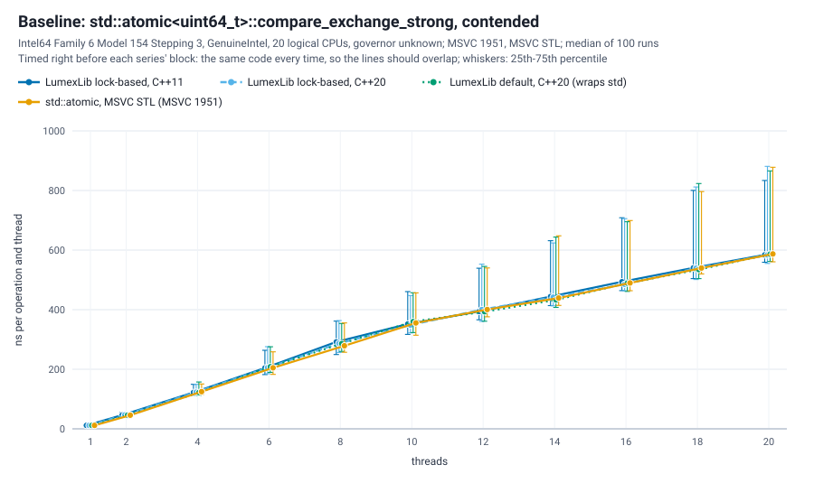

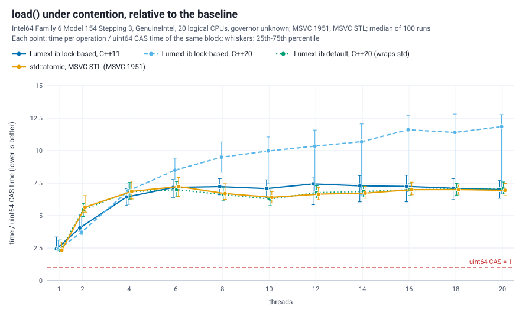

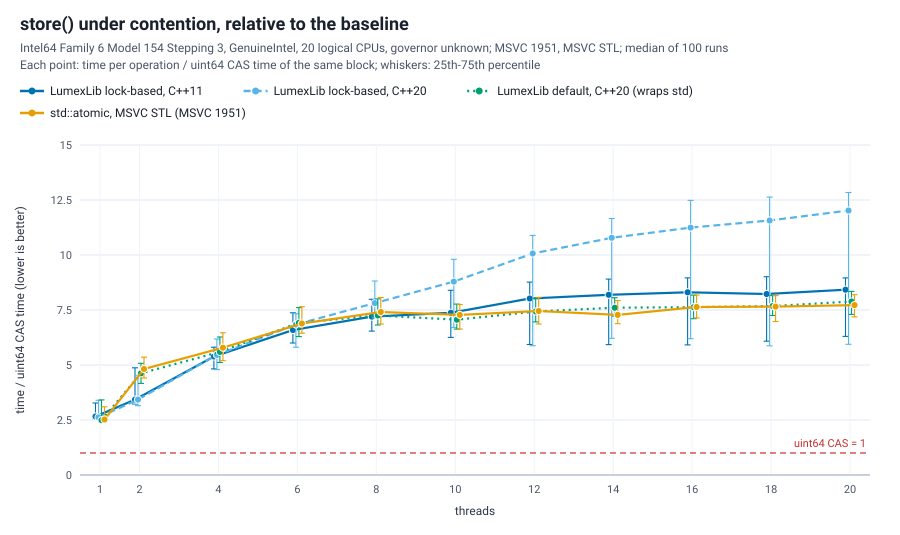


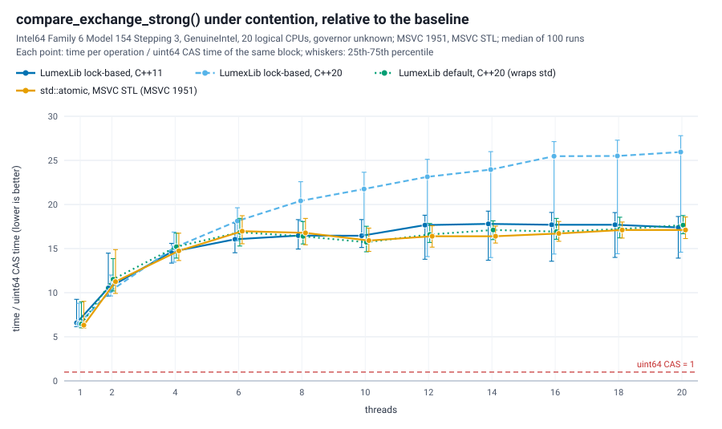

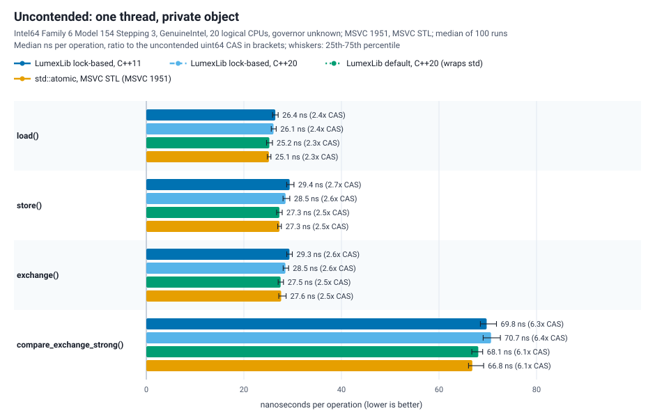

The numbers: [results/msvc/atomic_benchmark.md](results/msvc/atomic_benchmark.md) (medians and quartiles: [results/msvc/atomic_benchmark.csv](results/msvc/atomic_benchmark.csv)).

### Machine and build

| | |
| --- | --- |
| CPU | 12th Gen Intel Core i9-12900H, 20 logical CPUs. The CSV header stores what Python's `platform.processor()` returns: `Intel64 Family 6 Model 154 Stepping 3, GenuineIntel` |
| Power plan | Balanced (Windows has no cpufreq governor; the CSV records `governor=unknown`) |
| OS | Windows 11 Pro, build 10.0.26100. The CSV stores `platform.platform()`: `Windows-10-10.0.26100-SP0`, kernel `10` |
| Compiler | MSVC 19.51 (`_MSC_VER` 1951; the benchmark prints `MSVC 1951`) with the MSVC STL, toolset 14.51.36231, Visual Studio 18 Community, x64. Release, LumexLib's `Portable` level: `/O2 /Oi /Ot /Oy /GF`, no `/arch` switch |
| Language mode | The C++20 units are `/std:c++20`. The C++11 unit is `/std:c++14` (MSVC's lowest mode); the CSV records `201402` and `lock_based_table_wait` |
| Run | 2026-10-03, 100 runs, 30 s pauses, 100 ms windows, 93.8 minutes |
| Load | The CSV records `unknown`: `os.getloadavg` does not exist on Windows. An interactive desktop session ran throughout |

The five atomic suites were run on this build before the sweep: 2232 tests, 0 failed. `LumexAtomicSmartPtrConfigTest.GivenConstantInitialization_WhenTheObjectsAreUsed_ThenTheyWork` skips at `.cxx11` and `.cxx17` (`constinit` needs C++20) and runs at `.cxx20`.

The baseline rows agree within 3 % at every thread count (0.975 to 1.021 of their mean, table in [results/msvc/atomic_benchmark.md](results/msvc/atomic_benchmark.md)): the machine did not drift between the blocks. None of the four series reports `is_lock_free`. The default series selected `std_backed_std_wait`, the C++20 lock-based series `lock_based_std_wait`.

### Reading the results

Ratios to the baseline at 1 / 4 / 8 / 20 threads (medians; lower is better):

| Operation | LumexLib lock-based, C++11 | LumexLib lock-based, C++20 | LumexLib default, C++20 | std::atomic, MSVC STL |
| --- | ---: | ---: | ---: | ---: |
| `load ()` | 2.4 / 6.4 / 7.2 / 7.0 | 2.4 / 6.9 / 9.5 / 11.8 | 2.3 / 6.8 / 6.6 / 7.0 | 2.3 / 6.9 / 6.7 / 6.9 |
| `store ()` | 2.7 / 5.4 / 7.2 / 8.4 | 2.6 / 5.5 / 7.8 / 12.0 | 2.5 / 5.6 / 7.3 / 7.9 | 2.5 / 5.8 / 7.4 / 7.7 |
| `exchange ()` | 2.7 / 5.4 / 7.4 / 8.3 | 2.6 / 5.7 / 8.2 / 11.9 | 2.6 / 5.5 / 7.3 / 7.8 | 2.6 / 5.5 / 7.5 / 7.6 |
| `compare_exchange_strong ()` | 6.6 / 14.6 / 16.5 / 17.4 | 6.5 / 15.1 / 20.4 / 25.9 | 6.5 / 15.2 / 16.4 / 17.7 | 6.3 / 14.7 / 16.8 / 17.1 |

- **At 20 threads the MSVC STL does not blow up the way libstdc++ 13 did.** `load ()` of the MSVC STL, of LumexLib's default and of the lock-based C++11 build is 6.9-7.0, against 28.1 for libstdc++ on the other machine. `store ()` is 7.7-8.4, `exchange ()` 7.6-8.3, `compare_exchange_strong ()` 17.1-17.7. The quartiles of those three overlap. The ratios are not a comparison of the two machines: each is divided by that machine's own baseline.
- **The expensive series under heavy contention is the C++20 lock-based build**, which sleeps in `std::atomic::wait`: at 20 threads `load ()` 11.8, `store ()` 12.0, `exchange ()` 11.9, `compare_exchange_strong ()` 25.9. The lower quartile is wide (`load ()` 6.7-12.8 around the median 11.8), so a quarter of the runs sits with the other three and the median does not. The cause was not analysed.
- **At 2 threads the lock-based builds are cheaper.** `load ()` 3.7-4.0 against 5.5-5.7, `store ()` 3.4 against 4.6-4.8. From 4 threads the four series are close, until the C++20 lock-based series pulls away.
- **Uncontended**, in nanoseconds: `load ()` 26.4 / 26.1 / 25.2 / 25.1, `store ()` 29.4 / 28.5 / 27.3 / 27.3, `exchange ()` 29.3 / 28.5 / 27.5 / 27.6, `compare_exchange_strong ()` 69.8 / 70.7 / 68.1 / 66.8 (same column order). The MSVC STL is the cheapest of the four; the lock-based builds cost a few nanoseconds more. On the libstdc++ machine the lock-based compare-exchange was the cheap one.
- **LumexLib's default at C++20 costs nothing over the MSVC STL.** It wraps `std::atomic<std::shared_ptr<T>>`; the medians stay inside each other's quartiles.
- **Successful compare-exchanges at 20 threads:** 65 % for the C++11 lock-based build, 58 % for the C++20 lock-based build, 76 % for the default and 76 % for the MSVC STL.

## Windows (MSVC)

Run on 2026-10-03, as recorded above. The commands below reproduce it. This run used Ninja from a normal PowerShell: `configure_msvc_vcvars()` imports the x64 toolset before `project()`, so a Developer prompt was not required for the suites or the benchmark. The binary directory was outside the source tree, and the targets built were the five suites and `LumexAtomicBenchmark`, so the `compile_commands.json` copy did not run. The consumer fixtures of the CMake cases still need that developer environment and report Skipped without it. The prompt below remains the way to get `cl` for x64 when CMake is not importing it.

Open an **x64 Native Tools Command Prompt for VS 2022**, or a **Developer PowerShell for VS 2022** started for x64 (`Launch-VsDevShell.ps1 -Arch amd64 -HostArch amd64` from `Common7\Tools` of the Visual Studio installation; `cl` must report "for x64"), and change to the LumexLib checkout. The commands are the same in both shells. The consumer fixtures of the CMake cases need that developer environment and report Skipped without it.

Configure and build with Ninja (single configuration, the compiler of the prompt):

```bat
cmake -S . -B build-msvc -G Ninja -DCMAKE_BUILD_TYPE=Release -DLUMEX_BUILD_TESTS=ON -DLUMEX_BUILD_BENCHMARKS=ON
cmake --build build-msvc --parallel
ctest --test-dir build-msvc -R "^atomic\." --output-on-failure --parallel 8
python benchmarks\atomic\run_benchmark.py --exe build-msvc\bin\LumexAtomicBenchmark.exe --quick --no-plot --out-dir build-msvc\atomic-quick
python benchmarks\atomic\run_benchmark.py --exe build-msvc\bin\LumexAtomicBenchmark.exe --out-dir benchmarks\atomic\results\msvc
```

or with the Visual Studio generator (multi-configuration; `-A x64` selects the platform whatever the prompt):

```bat
cmake -S . -B build-vs -G "Visual Studio 17 2022" -A x64 -DLUMEX_BUILD_TESTS=ON -DLUMEX_BUILD_BENCHMARKS=ON
cmake --build build-vs --config Release -- /m
ctest --test-dir build-vs -C Release -R "^atomic\." --output-on-failure --parallel 8
python benchmarks\atomic\run_benchmark.py --exe build-vs\bin\Release\LumexAtomicBenchmark.exe --quick --no-plot --out-dir build-vs\atomic-quick
python benchmarks\atomic\run_benchmark.py --exe build-vs\bin\Release\LumexAtomicBenchmark.exe --out-dir benchmarks\atomic\results\msvc
```

In each block the third command runs the five atomic suites (`LumexAtomicCxx11Tests`, `LumexAtomicCxx17Tests`, `LumexAtomicCxx20Tests`, `LumexAtomicLockBasedCxx20Tests`, `LumexAtomicWaitTableCxx20Tests`; every CTest name starts with `atomic.` and ends with `.cxx11`, `.cxx17`, `.cxx20`, `.lock_based.cxx20` or `.wait_table.cxx20`). `-R "atomic"` instead also runs `cmake.wiring_atomic`, `cmake.atomic_compile_checks`, `cmake.consumer_atomic_cross_module` and the atomic examples. The fourth command is the smoke run (a few seconds, numbers not kept), the fifth the full sweep (100 runs with 30 s pauses, about an hour and a half on 20 hardware threads), which writes into `results\msvc` and leaves the Linux results alone. `python` is Python 3 (`py -3` where `python` is not on `PATH`); the scripts need only its standard library. To draw both series on one chart, pass both CSVs. `plot_results.py` writes the SVG files and the Markdown table next to the first CSV, so the command below replaces the Linux charts; the committed charts are the two separate series. The labels carry the compiler and the CPU, and the ratios make the machines comparable (the nanoseconds do not):

```bat
python benchmarks\atomic\plot_results.py benchmarks\atomic\results\atomic_benchmark.csv benchmarks\atomic\results\msvc\atomic_benchmark.csv
```

On MSVC the C++11 unit of the benchmark builds at C++14 (MSVC's lowest mode), the default series wraps MSVC's `std::atomic<std::shared_ptr<T>>`, and the `std` series measures it directly.

## Compile time

What it costs to include one atomic shared pointer and use it, measured the way the other benchmarks of this directory tree measure it: `compile_time.cpp` is compiled with `-fsyntax-only -O0` (median of 7, CPU 3, under the build lock of the workstation) per compiler and variant by `run_benchmark.py --compile-time-only`, which writes `results/compile_time.csv` and calls `plot_results.py` for `results/atomic_compile_time.svg` and the table in `results/atomic_benchmark.md`. The `include` unit declares one object; the `use` unit calls `load`, `store`, `exchange`, `compare_exchange_strong` and `is_lock_free`. The variants are the common name, the lock-based and the lock-free engine (C++11 and C++20), the std-backed wrapper, `std::atomic<std::shared_ptr<int>>` and `boost::atomic_shared_ptr<int>`, against a stub (a `std::shared_ptr` behind a `std::mutex`), which is the cost of the headers every variant shares. The units of the LumexLib variants define `LUMEX_ATOMIC_HAS_HAZARD_POINTER=1`, as the CMake target `lumex::atomic` does when the hazard pointer library is built, so the common name is the lock-free engine; the benchmark executable's own reduced and full runs are not affected.

```sh
python benchmarks/atomic/run_benchmark.py --compile-time-only --cpu 3 --compile-repeats 7 \
       --compiler "gcc=g++" --compiler "clang=clang++ -stdlib=libc++" \
       --boost-include /opt/boost-1.92.0/include
```

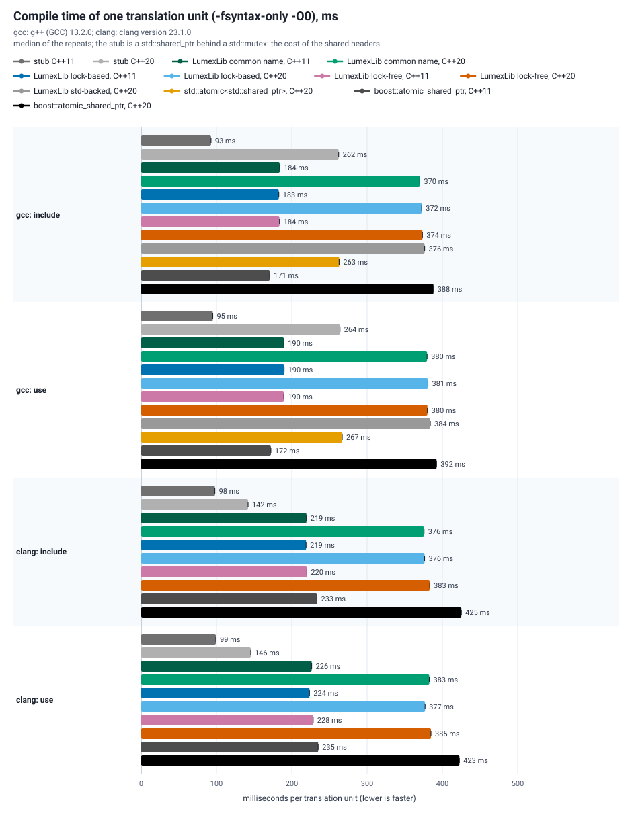

Wall time in milliseconds (`include` unit / `use` unit; the table of every cell is in [results/atomic_benchmark.md](results/atomic_benchmark.md), the raw medians in [results/compile_time.csv](results/compile_time.csv)):

| | stub | LumexLib common name | lock-based | lock-free | std-backed | `std::atomic<std::shared_ptr>` | `boost::atomic_shared_ptr` |
| --- | --- | --- | --- | --- | --- | --- | --- |
| GCC 13.2, C++11 | 93 / 95 | 184 / 190 | 183 / 190 | 184 / 190 | n/a | n/a | 171 / 172 |
| GCC 13.2, C++20 | 262 / 264 | 370 / 380 | 372 / 381 | 374 / 380 | 376 / 384 | 263 / 267 | 388 / 392 |
| Clang 23.1 (libc++), C++11 | 98 / 99 | 219 / 226 | 219 / 224 | 220 / 228 | n/a | n/a | 233 / 235 |
| Clang 23.1 (libc++), C++20 | 142 / 146 | 376 / 383 | 376 / 377 | 383 / 385 | not built | not built | 425 / 423 |

At C++11 the three LumexLib variants are within 1 ms of each other in the `include` unit with both compilers (183 to 184 ms with GCC, 219 to 220 ms with Clang), about 90 ms (GCC) and 121 ms (Clang) over the stub, and `boost::atomic_shared_ptr` costs 171 ms (GCC) and 233 ms (Clang). At C++20 they are within 4 ms with GCC (370 to 374 ms, the std-backed wrapper 376 ms) and within 7 ms with Clang (376 to 383 ms), 108 to 114 ms (GCC) and 234 to 241 ms (Clang) over the stub, and `boost::atomic_shared_ptr` costs 388 ms (GCC) and 425 ms (Clang). `std::atomic<std::shared_ptr>` costs 263 ms (GCC) over a stub of 262 ms. With the libc++ of Clang 23.1 there is no `std::atomic<std::shared_ptr>`, so the std-backed wrapper and the standard variant could not be built there (the compiler's message is printed by `run_benchmark.py`, and the variant is left out). The unit uses the interface the benchmark measures, not `wait` and `notify` or the weak pointer. An earlier full run of the same units, discarded because of this, gave every GCC cell 13 to 15 % higher (stub 106 and 300 ms, common name 210 and 426 ms at C++11 and C++20) and the Clang stub cells 14 to 17 % higher, while the other Clang cells were within 3 % of this run except the common name at C++11 (254 and 239 ms against 219 and 226 ms): the absolute times move by that much from run to run on this machine, and the differences between variants should be read within one run.

## 128-bit compare-and-swap (dwcas)

`LumexDwcasBenchmark` (`bench_dwcas.cpp`, built with `LUMEX_BUILD_BENCHMARKS=ON` next to `LumexAtomicBenchmark`) measures the cost of the 128-bit compare-and-swap of `lumex/core/atomic/dwcas` against a 64-bit one on one shared word. Every thread repeats "read a guess, try to swap in the guess plus one" for the length of the window and counts every attempt, successful or not (each is one locked instruction); the figure is the wall time per attempt and thread, as above. The 64-bit and the 128-bit measurement of one repetition run one after the other in the same process, in alternating order, and the table gives the medians and the median of the per-repetition ratios.

```sh
cmake --build build-bench --target LumexDwcasBenchmark
build-bench/bin/LumexDwcasBenchmark --threads 1,2,4,8 --duration-ms 100 --repetitions 5
```

Reduced run of 2026-10-09 (GCC 13.2 Release, Intel Core i7-12700K, 20 logical CPUs, assembly backend, 5 repetitions of 100 ms; the machine was shared with other builds, so read the ratios, not the nanoseconds):

| Threads | 64-bit, ns | 128-bit, ns | Ratio |
| ---: | ---: | ---: | ---: |
| 1 | 7.6 | 10.0 | 1.31 |
| 2 | 33.3 | 33.7 | 1.01 |
| 4 | 69.8 | 88.9 | 1.34 |
| 8 | 144.2 | 207.4 | 1.44 |

The 128-bit attempt costs 1.0 to 1.4 times the 64-bit one up to 8 threads: both are one locked instruction on one cache line, and the second half is the difference. This is a reduced run, not a sweep: it is one machine, one compiler and five short windows per point.
