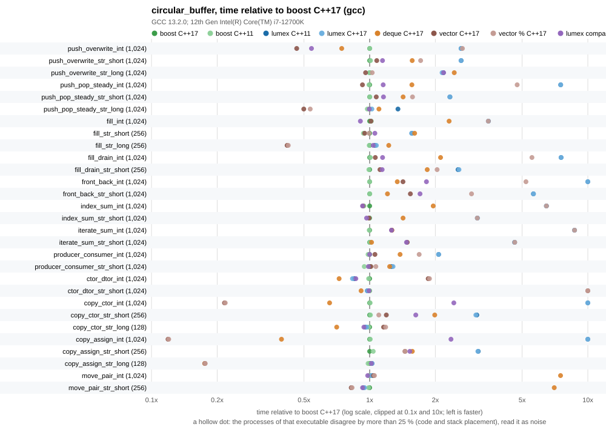

# circular_buffer benchmarks

The ring buffer of this library (`lumex::core::circular_buffer::circular_buffer`) against `boost::circular_buffer` of Boost.CircularBuffer and against what a user writes without a ring library: `std::deque` used as a bounded queue (`pop_front` before `push_back` when full) and `std::vector` with manual index math (head and size, the wrap done by a compare and a subtraction, and a second variant that wraps with `%` the way this library computes its physical index). All five run the same scenarios from the same source. The buffer of this library and `boost::circular_buffer` are measured at C++11 and at C++17; the three plain alternatives at C++17. Only one toolchain was measured: GCC 13.2.0 with libstdc++. Clang with libc++ was not measured (the build supports it: a second build tree with `--build-dir clang=...`), so nothing here says how Clang or MSVC compile the same code.



The numbers behind the chart: [results/circular_buffer_benchmark.md](results/circular_buffer_benchmark.md) (raw data: [results/circular_buffer_benchmark.csv](results/circular_buffer_benchmark.csv), footprint: [results/circular_buffer_footprint.csv](results/circular_buffer_footprint.csv)).

## What the alternatives are

| Variant | What it is |
| --- | --- |
| lumex | `circular_buffer<T>` of this library |
| boost | `boost::circular_buffer<T>` 1.92.0, headers only |
| deque | `std::deque<T>` plus a capacity: `push_back` pops the front first when full. The bounded queue a user gets from the standard library. |
| vector | `std::vector<T>` of `capacity` elements, head and size, `wrap (i) = i >= capacity ? i - capacity : i`. A full buffer overwrites by assignment. Elements are never destroyed by `pop_front` or `clear`, so `T` must be default constructible and a popped `std::string` keeps its buffer. |
| vector % | the same with `wrap (i) = i % capacity`, which is how this library computes its physical index. It exists to show what the division costs. |

`deque`, `vector` and `vector %` are about 100 lines (`bench_circular_buffer_impl.hpp`), keep only the members the scenarios use and are not a published container. They are not a claim about the best possible hand-written ring.

## Method

- One source, `bench_circular_buffer.cpp`, compiled once per implementation and standard with `-DBENCH_RING_IMPL=1..5` (`bench_circular_buffer_impl.hpp` maps it to the buffer under test). Every variant is built with the same flags of the Release profile of the library (`-O2 -DNDEBUG -march=x86-64 -mtune=generic` and the library warnings); there are no sanitizers. The build has no warnings.
- Scenarios (the unit of an operation is in the description column of the results): `push_back` into a full buffer (overwrite) for `int`, a short `std::string` (small-buffer) and an 80-character `std::string` (heap); the steady state of a queue (`push_back`, read `front`, `pop_front`) on a half-full buffer; `clear` and `size` `push_back` into a buffer that never gets full; the same followed by draining with `front` and `pop_front`; `front ()` and `back ()` of a wrapped buffer; a sum over 768 elements of a wrapped buffer by `operator[]` and by iterators; a producer and a consumer on one thread (bursts of 1 to 8 pushes and up to 7 pops per step, 1 024 steps, capacity 256, so the buffer fills and overwrites); construction and destruction of an empty buffer of capacity 1 024; copy construction, copy assignment and a move construction followed by a move assignment back, each for `int` and `std::string`. "Wrapped" means the head is not at the start of the storage: 1.5 times the capacity is pushed and a quarter popped.
- Equal work: before timing, every scenario is run for a few iterations and its checksum is compared with the same scenario run on a reference container (a `std::vector` that erases its first element when full, obviously correct). The checksums are written to the CSV and `run_benchmark.py` compares them across all executables; different checksums stop the run.
- The optimizer is kept from deleting or hoisting the work with empty `asm` statements that read the buffer object (`"m"`) and clobber memory. The scenarios keep the buffer in a local variable; the barrier forces its members to be stored and reloaded at the marked points in every implementation alike (the disassembly of the `push_back` loop of this library shows the stores and reloads of the size and the head every iteration).
- A scenario is calibrated until one run lasts at least 20 ms, then runs once as warm-up and 15 times for the numbers. The CSV keeps the median, the minimum and the maximum time per operation of the 15 repetitions; `run_benchmark.py` runs every executable `--passes` times (here 5), one pass over all executables after the other, and keeps, per scenario, the lowest of the pass medians (the best pass), the highest of them (shown only as the spread: a dagger marks a value whose slowest pass was more than 25 % slower), the smallest minimum and the largest maximum. In this run no value carries a dagger; the largest spread is 1.24x (`move_pair_str_short`, `vector %`).
- The process is pinned to one CPU with `taskset` (`--cpu 3`).
- Every timing run was made under the build lock of the workstation, so the machine was otherwise idle.
- The baseline of the ratios is `boost::circular_buffer` at C++17 (the first column; the first of `boost C++17`, `vector C++17` that was measured when Boost is absent). Every table cell is the absolute time in nanoseconds of the best pass and, in parentheses, the ratio to the baseline (below 1.00 is faster than `boost::circular_buffer`).
- Footprint (`--traits`): `sizeof` of the container and the bytes and calls requested from `operator new` after construction, after 10 and after 1 024 `push_back` (capacity 1 024), for five element types. The executable replaces the global `operator new` with a counting `malloc` wrapper in every variant alike; the count is only switched on in this mode.

## Boost

Boost is optional and header-only: the boost variants need `boost/circular_buffer.hpp` and are skipped, with a message, when CMake finds none. Pass the include directory with `-DLUMEX_BENCH_BOOST_INCLUDE_DIR=<dir>` or point `find_package(Boost CONFIG)` at an installation. Nothing of Boost is linked or vendored. On the workstation of the committed results Boost 1.92.0 is installed in `/opt/boost-1.92.0` (only its headers are used); the system also has Boost 1.67 in `/usr/include`, which was not used.

## Running

```sh
cmake -S . -B build-bench-gcc -DCMAKE_BUILD_TYPE=Release \
      -DCMAKE_CXX_COMPILER=g++ -DLUMEX_BUILD_BENCHMARKS=ON \
      -DLUMEX_BENCH_BOOST_INCLUDE_DIR=/opt/boost-1.92.0/include
cmake --build build-bench-gcc --target LumexCircularBufferBench_lumex_cxx11 \
      LumexCircularBufferBench_lumex_cxx17 LumexCircularBufferBench_boost_cxx11 \
      LumexCircularBufferBench_boost_cxx17 LumexCircularBufferBench_deque_cxx17 \
      LumexCircularBufferBench_vector_cxx17 LumexCircularBufferBench_vector_mod_cxx17
python benchmarks/circular_buffer/run_benchmark.py --build-dir gcc=build-bench-gcc --cpu 3
```

`run_benchmark.py` writes `results/circular_buffer_benchmark.csv`, `results/circular_buffer_footprint.csv` and, through `plot_results.py` (Python standard library only), the Markdown table and the SVG chart. The target `LumexCircularBufferBenchmarkRun` runs the executables of one build tree and writes into that build tree, so it never overwrites the committed results.

## Reading the results

Measured on an Intel Core i7-12700K (Linux 6.1, pinned to one performance core), GCC 13.2.0 with libstdc++, Boost 1.92.0 (headers only), 5 passes, October 2026. 29 scenarios. The full table is in [results/circular_buffer_benchmark.md](results/circular_buffer_benchmark.md).

- **This library is slower than `boost::circular_buffer` in 21 of 29 scenarios by more than 10 % and faster in one; the geometric mean of the time ratio is 2.77** (lumex C++17 against boost C++17; 2.82 for C++11 against C++11). Against the `vector` ring the geometric mean is 2.92 (25 slower, 3 faster), against the `deque` 2.08 (21 slower, 4 faster).
- **The cause of most of it is one `div` instruction per index.** The library computes the physical index as `(head + i) % capacity` with the capacity known only at run time. In the disassembly of the GCC 13.2 build the loops that read or write an element contain a 64-bit `div` per element: one in the `operator[]` and iteration loops, two in `front_back` (a `front ()` and a `back ()`), two in the full-buffer `push_back` loop (the wrap of the head and the physical index), two per element in the copy constructor (the source index and the destination index). `boost::circular_buffer` has no `div` in the same functions, and the `vector %` ring, which is the `vector` ring with `%` instead of the compare, has the same `div` count and nearly the same time as this library where the work is the index alone: `index_sum_int` 1 809 ns for both, `iterate_sum_int` 1 807 against 1 809, `fill_int` 2 415 for both, `front_back_int` 4.71 against 2.36 (two `div` against one). One `div` costs about 2.4 ns here (1 809 ns over 768 elements). The `vector` ring with the compare instead of the division is as fast as Boost (`index_sum_int` 261 ns, `fill_int` 700 ns, Boost 280 and 691).
  - Scenarios dominated by the index, `int` elements: `copy_ctor_int` 15.85x of Boost (3 638 ns against 230 ns; besides two `div` per element the copy appends element by element, where Boost and `std::vector` copy in bulk), `front_back_int` 10.41x, `iterate_sum_int` 8.68x, `fill_drain_int` 7.54x, `push_pop_steady_int` 7.51x, `index_sum_int` 6.46x, `fill_int` 3.50x, `push_overwrite_int` 2.63x, `producer_consumer_int` 2.07x. For `std::string` the element work hides part of it (`index_sum_str_short` 3.12x, `producer_consumer_str_short` 1.28x).
- **Copy assignment of an `int` buffer is 15.32x of Boost** (3 636 ns against 237 ns): `operator=` is copy-and-swap, so it allocates a new block and copies into it element by element every time (the same two `div` per element), where the `vector` ring copies into the existing storage (28 ns). For 128 `std::string` of 80 characters it is at par with Boost (2 364 against 2 305 ns), and both are 5.8x slower than the `vector` ring and the `deque` (405 and 404 ns), which assign into the strings they already hold; allocation counts for 100 such strings: 101 calls to `operator new` per copy assignment for this library and for Boost.
- **Overwriting a string allocates**: `push_back` into a full buffer destroys the oldest element and constructs the new one (this library's `emplace_back`), so an 80-character string costs one `operator delete` and one `operator new` per push (1 000 allocations for 1 000 pushes; Boost 0, it assigns into the oldest string). `push_overwrite_str_long` is 13.34 ns against 6.21 (2.15x); the `vector` ring (5.95 ns) assigns like Boost. The `deque` (15.17 ns) destroys and constructs the string as well.
- **Where this library is on par or ahead of Boost:** move construction plus move assignment (3.38 ns against 3.32, `int`; both are a handful of pointer and size moves; `deque` is 7.5x slower because the move constructor of libstdc++'s `std::deque` is not `noexcept` and allocates a map for the moved-from deque, 2 allocations counted in a probe), construction and destruction of an empty buffer (`ctor_dtor_int` 19.5 ns against 23.4; one `malloc` and one `free` for both, the difference is not investigated and is probably the code around them), copy construction and push/pop of long strings (`copy_ctor_str_long` 0.97x, `push_pop_steady_str_long` 1.02x, where allocation dominates).
- **Plain alternatives:** the `vector` ring with a compare is within 0.46x to 1.08x of Boost in the three `push_overwrite` scenarios and 0.93x in `index_sum_int`, but 1.26x to 1.49x slower in the iterator sums and 1.42x to 1.54x in `front_back` (the wrap is a compare in the accessor, where Boost keeps pointers). It is 32.7x slower in `ctor_dtor_str_short` (683.8 ns against 20.9) because it constructs 1 024 `std::string` up front, so it also needs a default constructible `T`. The `deque` is 0.74x to 2.44x of Boost in the push scenarios, 1.0x to 2.0x in the traversals, 7.5x in `move_pair`, and uses 88 bytes for the object and blocks that grow with the content (the footprint table). It is the only variant that does not allocate the whole capacity up front (576 bytes in two calls when empty, 4 816 bytes in 11 calls at 1 024 `int`).
- **C++11 build against C++17 build of this library:** geometric mean 1.010, one scenario more than 10 % apart: `push_pop_steady_str_long` is 18.38 ns at C++11 and 13.96 ns at C++17 (1.32x). The instruction sequence of that scenario function is the same in both executables (compared with addresses normalized), so this is code placement or the placement of the out-of-line callees, not a property of the library; the callees themselves were not compared.
- **Layout.** `sizeof` of the container is 40 bytes for this library and for Boost, 48 for the `vector` rings and 88 for the `deque`, whatever `T`. The heap block of this library and of Boost is exactly `capacity * sizeof (T)` in one call (4 096 bytes for 1 024 `int`), nothing more.
- **Compile time** was not measured.

## Caveats

- The numbers are for this machine and this compiler, one toolchain (GCC 13.2.0, libstdc++). The cost of the division depends on the CPU: the 64-bit `div` of this CPU is about 2.4 ns; older cores are slower, so the gap to Boost is likely larger there, and a compiler that knows the capacity (a constant) would remove it, but the capacity is a run-time value of the class. None of this was measured on another machine.
- The scenarios measure a buffer in a loop with the optimizer held back by empty `asm` statements. They show the cost of the interface, not of a whole program.
- `deque`, `vector` and `vector %` are written for this benchmark and are not tuned beyond the wrap; a different hand-written ring (a power-of-two capacity with a mask, which needs a different API) would be faster than all of them.
- The unit of the pass scenarios is a whole pass; divide by the element count for a per-element time.
- Boost 1.92.0 was built with the system GCC 8, but only its headers are used.
