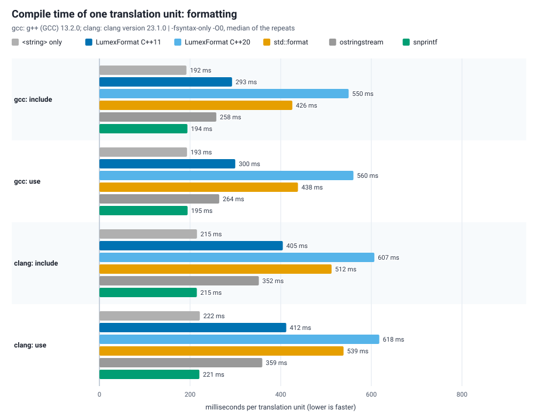

# LumexFormat benchmarks

Throughput of `lumex::core::fmt` (LumexFormat) against `std::format`,
`std::ostringstream`, `std::snprintf` and `std::to_string` on the same
scenarios. Every method of a scenario produces byte-identical text; the
benchmark checks that before timing, so the numbers compare equal work.




The numbers behind the charts: [results/format_benchmark.md](results/format_benchmark.md)
(raw data: [results/format_benchmark.csv](results/format_benchmark.csv),
compile times: [results/compile_time.csv](results/compile_time.csv)).

## Method

- Scenarios: an `int` with `{}`, an `int` with `{:#010x}`, a `double` with
  `{:.3f}` and with `{}` (shortest round trip), a padded `std::string`, a
  typical log line with three fields, ten fields, and `format_to` into a
  reused `std::string`.
- Each (scenario, method) runs a warm-up of 10 % of the iterations, then
  15 repetitions of 200 000 calls; the CSV keeps the median, minimum and
  maximum time per call. `--quick` runs 3 x 20 000 calls for a smoke check.
- The results are only meaningful for a Release build without sanitizers,
  on an otherwise idle machine.
- `to_string (6 digits)` in `double_shortest` is shown for scale only: it
  prints 6 fixed digits, not the shortest text.

## Running

```sh
cmake -S . -B build-bench -DCMAKE_BUILD_TYPE=Release -DLUMEX_BUILD_BENCHMARKS=ON
cmake --build build-bench --target LumexFmtBenchmarkRun
```

`LumexFmtBenchmarkRun` builds `LumexFmtBenchmark`, writes
`results/format_benchmark.csv` and runs `plot_results.py`, which needs only
the Python standard library and writes the two SVG charts and the Markdown
table next to the CSV. Separately:

```sh
build-bench/bin/LumexFmtBenchmark benchmarks/fmt/results/format_benchmark.csv
python benchmarks/fmt/plot_results.py benchmarks/fmt/results/format_benchmark.csv
```

Compile time is measured apart from the run time, with `compile_time.py`
(`compile_time.cpp`, `-fsyntax-only -O0`, median of 7, CPU 3, run under the
build lock of the workstation) on Linux with GCC 13.2.0 and Clang 23.1.0 with
libc++, not with the MSVC of the run-time results: see "Compile time" below.

## Reading the results (MSVC 19.51, x64, Release)

- LumexFormat is 2 to 6 times faster than `std::ostringstream` in every
  scenario.
- Against MSVC's `std::format` it is faster for hexadecimal and padded
  strings and 1.2 to 1.5 times slower for decimal integers, floating point
  and many-field lines (per-field parsing and argument dispatch are not
  tuned the way the standard library is).
- For integers `snprintf` is the fastest formatting call (only
  `std::to_string` beats it, on a plain decimal `int`), without type safety
  or compile-time checks; for `{:.3f}` of a `double` it is 1.4 times slower
  than LumexFormat.

## Compile time (GCC 13.2 and Clang 23.1, Linux)

`compile_time.cpp` includes one way of formatting and uses it: the `include`
unit formats one `int`; the `use` unit formats what the scenarios format (an
`int`, an `int` as padded hex, a `double` with a precision, a padded string, a
line of three fields, and a `format_to` into a `std::string`). The variants
are LumexFormat at C++11 and at C++20, `std::format`, `std::ostringstream`,
`std::snprintf`, and a stub with `<string>` and `<iterator>` only, which is the
cost of the headers every variant shares; all at C++20 except `LumexFormat
C++11`.

```sh
python benchmarks/fmt/compile_time.py --cpu 3 --compile-repeats 7 \
       --compiler "gcc=g++" --compiler "clang=clang++ -stdlib=libc++"
```

`compile_time.py` writes `results/compile_time.csv` and runs `plot_results.py`,
which draws `results/format_compile_time.svg` and adds the table to
`results/format_benchmark.md`. Wall time in milliseconds, median of 7
(`-fsyntax-only -O0`); the `include` unit, then the `use` unit:

| | stub | LumexFormat C++11 | LumexFormat C++20 | `std::format` | `std::ostringstream` | `std::snprintf` |
| --- | ---: | ---: | ---: | ---: | ---: | ---: |
| GCC 13.2, `include` | 192 | 293 | 550 | 426 | 258 | 194 |
| GCC 13.2, `use` | 193 | 300 | 560 | 438 | 264 | 195 |
| Clang 23.1 (libc++), `include` | 215 | 405 | 607 | 512 | 352 | 215 |
| Clang 23.1 (libc++), `use` | 222 | 412 | 618 | 539 | 359 | 221 |

LumexFormat at C++20 takes the longest to compile in all four rows (550 and
560 ms with GCC, 607 and 618 ms with Clang), `std::format` the next (426 and
438 ms, 512 and 539 ms); at C++11 it takes 293 and 300 ms with GCC and 405 and
412 ms with Clang. `std::snprintf` is within 2 ms of the stub. The `use`
unit costs 13 ms or less more than the `include` unit for every variant with
GCC and 27 ms or less with Clang: the cost is in the header, not in the
instantiations of this unit. These are not the compile times of the MSVC
build the run-time results come from.

