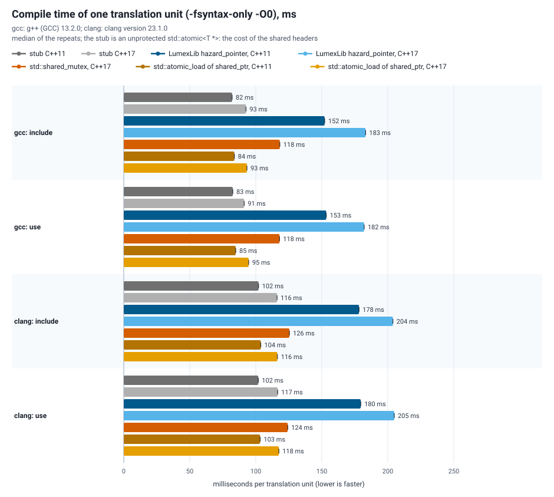

# Hazard pointer benchmarks

What the hazard pointer module of LumexLib costs, measured with the method of `benchmarks/atomic`: every number is a ratio to a `std::atomic<std::uint64_t>` baseline (a relaxed load followed by a `compare_exchange_strong` on one shared word) measured in the same process, with the same threads and right before the series it normalizes.

## What is measured

| Operation | What one operation is |
| --- | --- |
| `make_destroy` | `make_hazard_pointer ()` and the destruction of the holder (a cache hit takes no atomic operation) |
| `protect_reset` | `protect ()` of a shared pointer with a pre-made holder, a read of the object, `reset_protection ()` |
| `protect_kept` | the same without the reset (the next `protect` ends the previous protection) |
| `make_protect_destroy` | make, protect and destroy: what a function pays that uses one holder per call |
| `retire` | `new` of a small object and `retire ()`, including the reclamation passes that `retire` runs inline and the deleter (`delete`); `new_delete` is the allocator alone, for subtraction |
| `read` | a read of a read-mostly pointer, against the alternatives below |
| `readers_writer` | the same while one thread replaces the pointer at full speed; the time is per read |
| `list_walk` | one node of a 64-node list, hand-over-hand with two holders (the single-writer list of P2530R3) against a plain walk |
| `retire_p50`, `p99`, `p999`, `max` | the latency of one `retire ()` call, one thread, in nanoseconds: the passes show up in the tail |

| Series | What it is |
| --- | --- |
| LumexLib hazard_pointer | the module (`lumex::core::hazard_pointer`, seq_cst fences on both sides) |
| plain acquire load | the lower bound of a read: no protection, unsafe for a pointer that is replaced and freed |
| `std::shared_mutex` read lock | `lock_shared ()` / `unlock_shared ()` around the read |
| `std::atomic_load` of a `shared_ptr` | copy and release of a `std::shared_ptr` |
| memory | `new` and `delete` of a small object |
| libcds HP, libc++ pull request engine | only when the build points at a local copy (below) |

Not measured: the asymmetric barrier (a later phase of the module), Folly (it does not build offline here), a `std::` series (no standard library ships `<hazard_pointer>` yet).

## Method

- **Contention**: 1 thread (uncontended) and every even count up to the logical CPUs, all on the same shared object.
- **One measurement**: the threads start together, run the operation for 100 ms and stop together; the result is the wall time per operation and thread.
- **Normalization**: each block starts with the baseline loop with the same threads; each operation of the block is divided by it, which makes series from different moments comparable.
- **Interleaving and repetitions**: the series take turns, starting with a different one in every repetition; the tables give the median of the per-run ratios with the 25th and 75th percentiles (`run_benchmark.py`).
- **Validity**: a block whose baseline measured nothing fails the run.

## Running

```sh
cmake -S . -B build-bench -DCMAKE_BUILD_TYPE=Release -DLUMEX_BUILD_BENCHMARKS=ON
cmake --build build-bench --target LumexHazardPointerBenchmark
python benchmarks/hazard_pointer/run_benchmark.py --exe build-bench/bin/LumexHazardPointerBenchmark --quick --out-dir build-bench/hazard_pointer-quick
```

`--quick` (3 runs, no pause, 20 ms windows) checks the setup; its numbers are not results, so it writes into the build directory. Without it the sweep uses 100 runs, 30 s pauses and 100 ms windows (about two hours on 20 hardware threads) and rewrites `results/`; the target `LumexHazardPointerBenchmarkRun` does that. `--threads 1,2,4,8` and `--repetitions N` narrow it.

Comparison with other engines needs sources that are not part of this repository:

```sh
cmake ... -DLUMEX_HAZARD_POINTER_BENCH_LIBCDS_DIR=<libcds checkout> -DLUMEX_HAZARD_POINTER_BENCH_LLVM_DIR=<dir with hazard_pointer_port.hpp>
```

`adapter_libcds.hpp` wraps `cds::gc::HP` (guards, `retire`, thread attach); `adapter_llvm.hpp` expects a port of the engine of llvm-project pull request 218218 to the namespace `llvm_port` (header `hazard_pointer_port.hpp`). Neither is part of this repository and neither adapter has been compiled against a real copy yet.

## Results of this directory

`results/` holds a reduced run, not the full sweep: 5 repetitions without pauses, 100 ms windows, 1, 2, 4, 8 and 16 threads (about one minute), made on 2026-10-09. The numbers are indicative; the full sweep (`--repetitions 100 --settle-seconds 30`) was not run.

| | |
| --- | --- |
| CPU | 12th Gen Intel Core i7-12700K, 20 logical CPUs, governor `powersave` |
| OS, kernel | Astra Linux 1.7, Linux 6.1.170 |
| Compiler | GCC 13.2, Release, LumexLib's `Portable` level (`-O2 -march=x86-64`), C++17 for the benchmark, the library as C++11 |
| Load | other jobs of the workstation were queued but not running; load average 9.8 at the start and 12.1 at the end (the desktop session and the benchmark's own threads) |

One thread (ns per operation, median of 5): `make_destroy` 3.9, `protect_reset` 5.9 (the plain acquire load is 1.6, a `shared_mutex` read lock 14.8, `std::atomic_load` of a `shared_ptr` 24.7), a hand-over-hand step of the list 6.0 (plain 1.5), `new` + `retire` with the inline passes 45.2 against 8.9 for `new` + `delete`. The latency of one `retire ()` is 30 ns at the median, 51 ns at the 99th percentile and 11 microseconds at the 99.9th: the tail is the reclamation pass that the crossing `retire` runs inline (maximum 31 microseconds in the median run).

Under contention the reader does not share any cache line with the others (each thread has its own slot), so the time per read stays flat while the baseline compare-exchange grows with the thread count: at 16 threads a read costs 0.03 of the baseline CAS, a `shared_mutex` read lock 4.1 and `std::atomic_load` of a `shared_ptr` 5.2. With one writer replacing the pointer at full speed the hazard pointer read is 0.08 of the baseline at 16 threads, `shared_mutex` 3.7 and `shared_ptr` 5.6 (at 2 threads the writer starves the `shared_mutex` readers: 42.7). The cost of the protocol over an unsafe load is the fence of the announcement: 5.9 ns against 1.6 ns on this machine; an asymmetric barrier (a later phase of the module) would take most of it away.

## Compile time

What it costs to include one way of reading a read-mostly pointer that another thread replaces, and to write the read, the replacement and the retirement out: `compile_time.cpp` is compiled with `-fsyntax-only -O0` (median of 7, CPU 3, under the build lock of the workstation) per compiler and variant by `run_benchmark.py --compile-time-only`, which writes `results/compile_time.csv` and calls `plot_results.py` for `results/hazard_pointer_compile_time.svg` and the table in `results/hazard_pointer_benchmark.md`. The `include` unit declares one object (a hazard pointer holder, a `std::shared_lock`, a `std::shared_ptr`); the `use` unit reads under protection, replaces and retires. The variants are the module at C++11 and C++17 (its reader side is header-only, the engine is a compiled library that a syntax-only run does not need), a `std::shared_mutex` read lock (C++17), `std::atomic_load` of a `std::shared_ptr` (C++11 and C++17), and a stub (an unprotected `std::atomic<T *>`), which is the cost of the headers every variant shares. The libcds and libc++-engine series of the run-time benchmark need sources that are not in this repository and are not in the compile-time table.

```sh
python benchmarks/hazard_pointer/run_benchmark.py --compile-time-only --cpu 3 --compile-repeats 7 \
       --compiler "gcc=g++" --compiler "clang=clang++ -stdlib=libc++"
```



Wall time in milliseconds, `include` unit / `use` unit (the table is in [results/hazard_pointer_benchmark.md](results/hazard_pointer_benchmark.md), the raw medians in [results/compile_time.csv](results/compile_time.csv)):

| | stub | LumexLib hazard_pointer | `std::shared_mutex` | `std::atomic_load` of `shared_ptr` |
| --- | --- | --- | --- | --- |
| GCC 13.2, C++11 | 82 / 83 | 152 / 153 | n/a | 84 / 85 |
| GCC 13.2, C++17 | 93 / 91 | 183 / 182 | 118 / 118 | 93 / 95 |
| Clang 23.1 (libc++), C++11 | 102 / 102 | 178 / 180 | n/a | 104 / 103 |
| Clang 23.1 (libc++), C++17 | 116 / 117 | 204 / 205 | 126 / 124 | 116 / 118 |

The module costs 70 ms (C++11) and 91 ms (C++17) over the stub with GCC and 76 ms and 88 ms with Clang in the `include` unit; a `std::shared_mutex` costs 26 ms (GCC) and 9 ms (Clang) and `std::atomic_load` of a `shared_ptr` 2 ms or less. The `use` unit costs the same as the `include` unit within 2 ms for every variant: the cost is in the headers, not in the instantiations of this unit. A measurement of this kind moves by 5 to 15 % from run to run on this machine.
