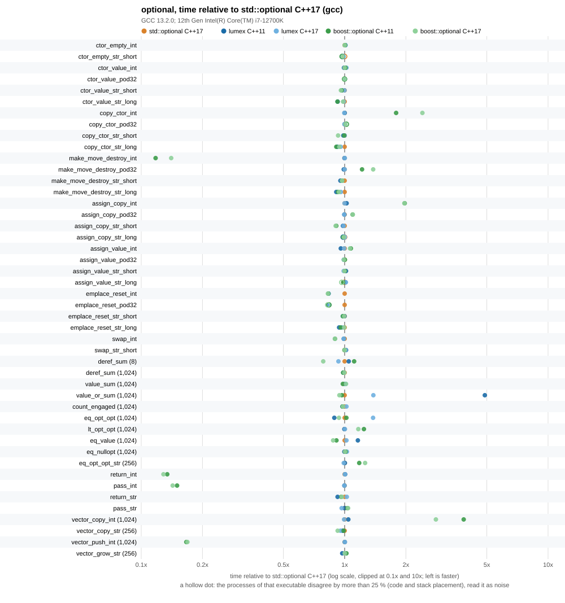
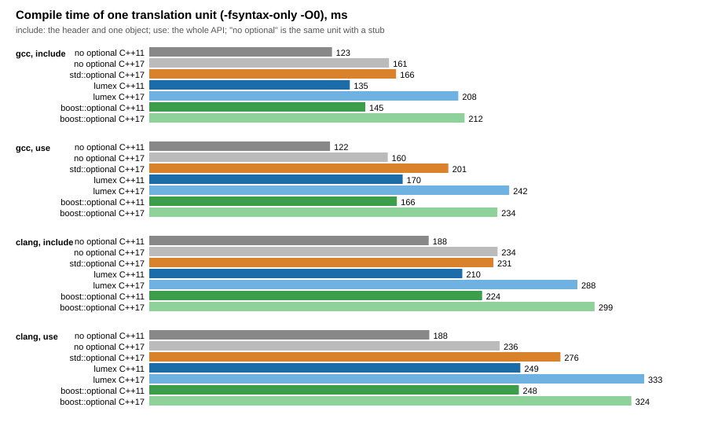

# optional benchmarks

The optional of this library (`lumex::core::optional::opt::optional`) against `std::optional` of the standard library in use and `boost::optional` of Boost.Optional, on the same scenarios and the same source. The optional of this library is measured at C++11 and at C++17 (it is its own class at both and never becomes `std::optional`); `std::optional` at C++17; `boost::optional` at C++11 and at C++17. Only one toolchain was measured: GCC 13.2.0 with libstdc++. Clang with libc++ was not measured (the build supports it: a second build tree with `--build-dir clang=...`), so nothing here says how Clang or MSVC compile the same code.





The numbers behind the charts: [results/optional_benchmark.md](results/optional_benchmark.md) (raw data: [results/optional_benchmark.csv](results/optional_benchmark.csv), layout and traits: [results/optional_traits.csv](results/optional_traits.csv), compile times: [results/compile_time.csv](results/compile_time.csv)).

## Method

- One source, `bench_optional.cpp`, compiled once per implementation and standard with `-DBENCH_OPTIONAL_IMPL=1|2|3` (`bench_optional_impl.hpp` maps it to the optional under test). Every variant is built with the same flags of the Release profile of the library (`-O2 -DNDEBUG -march=x86-64 -mtune=generic` and the library warnings); there are no sanitizers. The build has no warnings.
- Scenarios (the unit of an operation is in the description column of the results): construction empty and from a value, copy construction, construct-move-destroy, copy assignment and value assignment to an engaged optional, `emplace` and `reset`, `swap`, each for `int` (trivial), a 32-byte trivially copyable struct, a short `std::string` (small-buffer) and a 80-character `std::string` (heap); sums by `*o`, `value ()` and `value_or` and counts of engaged elements over 8 and 1 024 `optional<int>`; `==` and `<` between optionals, `==` with a value and with `nullopt`; a `noinline` function that returns an `optional<int>` or `optional<std::string>` and one that takes it by value (the calling convention); copying a `std::vector` of 1 024 `optional<int>` and 256 `optional<std::string>`, `push_back` after `reserve` and `push_back` with reallocations.
- Equal work: before timing, every scenario is run for a few iterations and its checksum is compared with a reference that uses plain values and flags only. The checksums are written to the CSV and `run_benchmark.py` compares them across all executables; different checksums stop the run.
- The optimizer is kept from deleting or hoisting the work with empty `asm` statements that read the objects (`"m"`) and clobber memory, and with values passed through `asm` so that they are not known at compile time. The objects are therefore forced into memory at the marked points: a result that a compiler could keep in registers is stored and loaded. This is the same for all implementations. Only `make_move_destroy_int` depends on it for the store-forwarding finding below; the `return_*` and `pass_*` scenarios call a `noinline` function, which has that stall in GCC 13.2 without any barrier.
- A scenario is calibrated until one run lasts at least 20 ms, then runs once as warm-up and 15 times for the numbers. The CSV keeps the median, the minimum and the maximum time per operation of the 15 repetitions; `run_benchmark.py` runs every executable `--passes` times (here 5), one pass over all executables after the other, and keeps, per scenario, the lowest of the pass medians (the best pass; not the median over passes), the highest of them (shown only as the spread: a dagger marks a value whose slowest pass was more than 25 % slower), the smallest minimum and the largest maximum. Example: the `assign_copy_str_long` baseline is 3.29 ns at its best pass and 4.73 ns at its worst (dagger), so the 3.9x to 4.0x of lumex (13.2 ns, worst 13.4) is 2.8x at the worst pass of the baseline.
- The process is pinned to one CPU with `taskset` (`--cpu 3`).
- Every timing run was made under the build lock of the workstation, so the machine was otherwise idle.
- The baseline of the ratios is `std::optional` at C++17. Every table cell is the absolute time in nanoseconds of the best pass and, in parentheses, the ratio to the baseline (below 1.00 is faster than `std::optional`).
- Layout: the executables write `sizeof`, `alignof` and a few traits of `optional<T>` for ten types (`--traits`).
- Compile time: `compile_time.cpp` is compiled with `-fsyntax-only -O0` in two units, `include` (the header and one declared object) and `use` (construction, observers, modifiers, comparisons, `swap`, vectors of optionals, `std::hash`), next to the same unit with a stub instead of an optional; the median of 7 runs.

## Boost

Boost is optional and header-only: the boost variants need `boost/optional.hpp` and are skipped, with a message, when CMake finds none. Pass the include directory with `-DLUMEX_BENCH_BOOST_INCLUDE_DIR=<dir>` or point `find_package(Boost CONFIG)` at an installation. Nothing of Boost is linked or vendored. On the workstation of the committed results Boost 1.92.0 is installed in `/opt/boost-1.92.0` (only its headers are used); the system also has Boost 1.67 in `/usr/include`, which was not used.

## Running

```sh
cmake -S . -B build-bench-gcc -DCMAKE_BUILD_TYPE=Release \
      -DCMAKE_CXX_COMPILER=g++ -DLUMEX_BUILD_BENCHMARKS=ON \
      -DLUMEX_BENCH_BOOST_INCLUDE_DIR=/opt/boost-1.92.0/include
cmake --build build-bench-gcc --target LumexOptionalBench_lumex_cxx11 \
      LumexOptionalBench_lumex_cxx17 LumexOptionalBench_std_cxx17 \
      LumexOptionalBench_boost_cxx11 LumexOptionalBench_boost_cxx17
python benchmarks/optional/run_benchmark.py --build-dir gcc=build-bench-gcc \
       --compile-time --compiler "gcc=g++" \
       --boost-include /opt/boost-1.92.0/include --cpu 3 --compile-repeats 7
```

`run_benchmark.py` writes `results/optional_benchmark.csv`, `results/optional_traits.csv`, `results/compile_time.csv` and, through `plot_results.py` (Python standard library only), the Markdown table and the SVG charts. The target `LumexOptionalBenchmarkRun` runs the executables of one build tree and writes into that build tree, so it never overwrites the committed results.

## Reading the results

Measured on an Intel Core i7-12700K (Linux 6.1, pinned to one performance core), GCC 13.2.0 with libstdc++, Boost 1.92.0 (headers only), 5 passes, October 2026. 46 scenarios. The full table is in [results/optional_benchmark.md](results/optional_benchmark.md). A small absolute time (a few tenths of a nanosecond) is a handful of instructions and its ratio is coarse: 0.25 ns against 0.46 ns is one extra instruction or two.

- **Overall the optional of this library and `std::optional` are the same speed.** The geometric mean of the time ratio over the 46 scenarios is 1.000 for lumex C++17 against `std::optional` C++17 and 1.015 for lumex C++11; lumex C++17 against `boost::optional` C++17 is 1.135. The number of scenarios where lumex is more than 10 % slower than `std::optional` is 2 (C++17) and 2 (C++11), more than 10 % faster 2 and 3. For the types that are not trivially copyable (`std::string`) the three are within a few percent in almost every scenario.
- **Where lumex is slower than `std::optional`, all placement:**
  - `value_or` over a mixed array of `optional<int>`: 2 698 ns (C++11) and 764 ns (C++17) against 552 ns for 1 024 elements (4.89x and 1.38x). The loop is the same machine code in the `std` and the lumex executables (disassembly of `run_value_or_sum` compared instruction by instruction: only the operand order of one `lea` and one `cmp` differs); the C++11 and the C++17 builds of the same code differ by a factor of 3.5. The branch predictor learns the fixed pseudo-random pattern (two thirds engaged) in some executables and not in others (in the committed results of the previous class the same scenario took 2 715 ns, 535 ns for `std::optional`; the loop was then the same machine code as well, and with both loops in one binary, aligned the same way, both took about 2 750 ns): code placement, not a property of the library.
  - `==` between two mixed `optional<int>` arrays: 654 ns (0.89x) at C++11 and 1 015 ns (1.38x) at C++17 against 736 ns; `==` with a value 684 ns (1.16x) at C++11 and 601 ns (1.02x) at C++17 against 589 ns. The loops of `run_eq_opt_opt` and `run_eq_value` are the same machine code as the standard's in both builds: placement.
- **Where lumex is faster than `std::optional`:**
  - `emplace` followed by `reset` of `optional<int>` and of the 32-byte struct: 0.38 ns and 0.75 ns against 0.46 ns and 0.89 ns (0.83x). The loop is shorter: `std::optional::reset` tests the engaged flag in every iteration (`movzbl`, `test`, `je`) and the reset of this library stores `false` for a trivially destructible type (24 instructions in the scenario against 30 for `int`, 31 against 37 for the struct). `boost::optional` has the same 0.83x.
- **Same as `std::optional` within 10 %** (the other 41 scenarios): construction, copy construction, copy assignment (also of an engaged `optional<std::string>` of 80 characters: 3.59 ns against 3.65 ns, because the value is assigned and the buffer reused), value assignment, `swap`, `==` with `nullopt`, `value ()`, `*o`, counting engaged elements, `vector_copy_int` (213 ns against 204 ns at C++11, 203 ns at C++17: `optional<int>` is trivially copyable, so the vector is copied by a loop of 8-byte moves) and `vector_copy_str`, `vector_grow_str`, and the non-inlined `return_int`, `pass_int`, `make_move_destroy_int` and `push_back` of `optional<int>`. `ctor_empty_str_short` is within 3 %, its baseline is marked unstable.
- **The return and the pass of `optional<int>` cost what they cost for `std::optional<int>`.** `return_int` 5.3 ns, `pass_int` 4.4 ns, `make_move_destroy_int` 5.4 ns and `push_back` after `reserve` 4.6 us per 1 024 elements, where `boost::optional` takes 0.7 ns, 0.7 ns, 0.6 to 0.7 ns and 0.77 us (0.12x to 0.17x). The assembly of `run_return_int` is the same in the `std` and in the lumex executable except for the address of the callee, so the cause is the one found for `std::optional<int>`: GCC 13.2 at -O2 builds a trivially copyable `optional<int>` that is returned or passed in a register with a 4-byte store of the value and a 1-byte store of the flag and reloads it with one 8-byte load that cannot be forwarded from the store buffer (`LD_BLOCKS.STORE_FORWARD`: about one blocked load per call, 75.7 million for `return_int` in the `std` executable against 465 in the executable of the earlier, not trivially copyable class of this library, 22.8 against 2.8 cycles per call; counters from an independent check of the earlier measurement; the new class was not measured with the counter). This happens in any non-inlined call with this compiler, not when the call is inlined; other compilers were not measured. The earlier class of this library was not trivially copyable and was returned through memory, so it did not hit the stall and was 7x faster in these scenarios; the new class, being trivially copyable like `std::optional`, does.
- **C++11 build against C++17 build of lumex:** geometric mean 1.015 (lumex C++11 over lumex C++17); the code is the same at both standards except for the conversions to and from `std::optional`, and the differences (`eq_opt_opt` 0.64x, `value_or_sum` 3.53x) are placement.
- **Layout.** `sizeof (optional<T>)` is equal to `std::optional<T>` and `boost::optional<T>` for all ten types measured (`int` 8, `double` 16, 32-byte struct 40, `std::string` 40, `std::unique_ptr<int>` 16, `std::shared_ptr<int>` 24). The properties now equal `std::optional`'s: `optional<int>`, `optional<double>` and the 32-byte struct are trivially copyable, trivially destructible and standard layout, `optional<std::string>` and the other class types are not trivially copyable and not trivially destructible (they are standard layout). `boost::optional<int>` is trivially destructible but not trivially copyable.
- **The compile time** is the price in some cases. Over the same unit with a stub instead of an optional (`-fsyntax-only -O0`): the `include` unit costs +5 ms for `std::optional` C++17, +12 ms for lumex C++11, +47 ms for lumex C++17 and +22 ms (C++11) and +51 ms (C++17) for `boost::optional`; the `use` unit costs +41 ms for `std::optional` C++17, +49 ms for lumex C++11, +82 ms for lumex C++17, +45 ms and +74 ms for Boost. At C++17 the header of this library includes `<optional>` (for the conversions) on top of `<functional>`, `<stdexcept>`, `<string>` and the rest, which is why it is slower than `std::optional` alone there. The header is larger than before (the monadic operations, the layers of special members, the own `INVOKE`): the `include` unit cost +7 ms (C++11) and +41 ms (C++17) and the `use` unit +32 ms and +66 ms with the previous class. The difference is 5 to 10 % from run to run and a few tens of milliseconds.

## The previous class of this library

The class was rewritten with the storage and the special member functions of `std::optional` (trivial when `T`'s are, `constexpr`, assigning copy assignment, a moved-from source that keeps its value, converting constructors, monadic operations). The earlier class, measured in the same session with the same flags (the previous header on the include path, 5 passes, all variants together), against `std::optional` C++17 (the ratio of the time, C++11 builds; the C++17 builds differ by at most a few percent):

| scenario | previous class | now |
| --- | --- | --- |
| `copy_ctor_int` | 2.0x (0.49 ns against 0.25 ns) | 1.01x |
| `assign_copy_int` | 2.0x | 1.03x |
| `assign_copy_pod32` | 1.21x | 0.98x |
| `make_move_destroy_pod32` | 1.20x | 0.99x |
| `assign_copy_str_long` (80 characters) | 3.9x (13.9 ns against 3.6 ns) | 1.01x |
| `vector_copy_int` (1 024) | 2.8x (575 ns against 205 ns) | 1.04x |
| `return_int`, `pass_int`, `make_move_destroy_int`, `vector_push_int` | 0.13x, 0.14x, 0.15x, 0.12x | 1.01x, 1.00x, 1.00x, 1.00x |
| geometric mean, all 46 scenarios | 0.927 (C++11), 0.937 (C++17) | 1.015, 1.002 |

The first six rows are fixed. The row of `return_int` and the others is not a loss of speed in the code: it is the store-forwarding stall of `std::optional<int>`, which the earlier class, not being trivially copyable, did not have, and the new one has. The figures of this table come from a separate run of the same executables, so they differ by about one percent from the table above.

## Caveats

- The numbers are for this machine and this compiler, one toolchain (GCC 13.2.0, libstdc++). They are not a promise about Clang, MSVC, other CPUs or other versions: run the benchmark there (`Running`).
- The scenarios measure an optional in a loop with the optimizer held back by empty `asm` statements. They show the cost of the interface, not of a whole program.
- `==`, `<` and `value_or` scenarios use a fixed pseudo-random pattern (two thirds engaged); branch behaviour depends on the data.
- Boost 1.92.0 was built with the system GCC 8, but only its headers are used.
- The compile times are the median of 7 runs of one unit on an idle machine.
