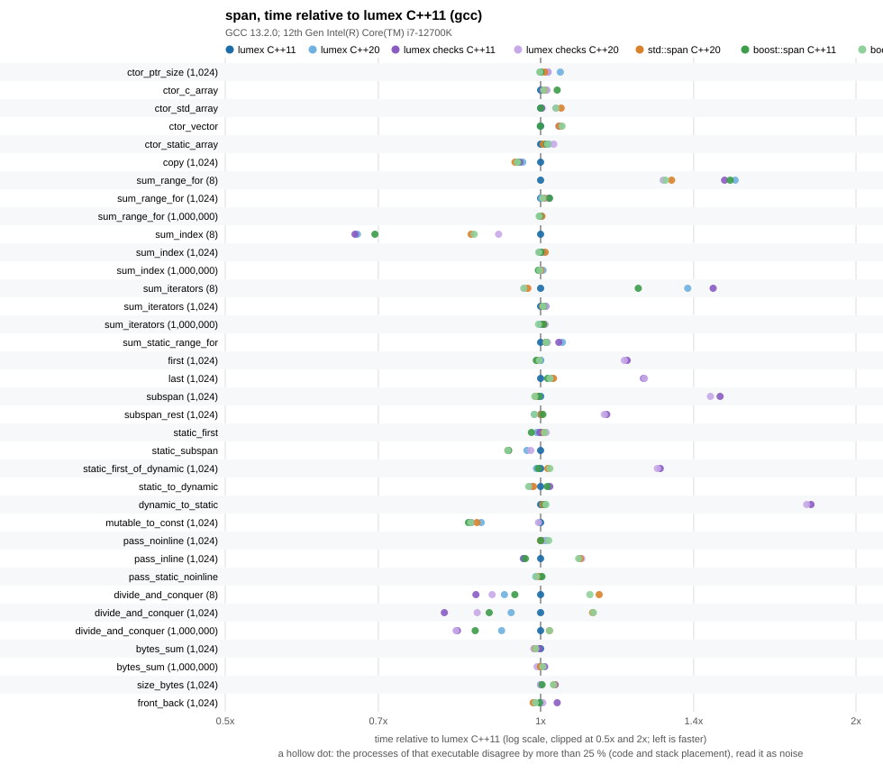
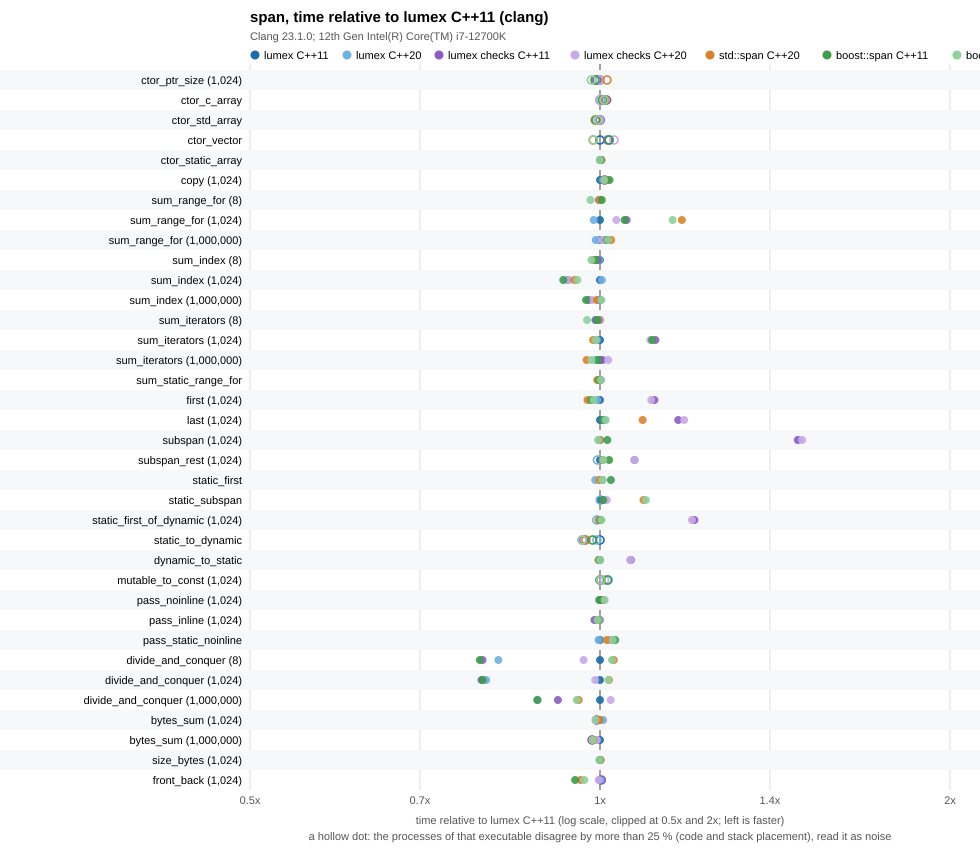
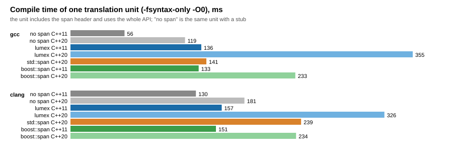

# span benchmarks

The span of this library (`lumex::core::span::view::span`) against `std::span` of the standard library in use and `boost::span` of Boost.Core, on the same scenarios and the same source. The span of this library is measured at C++11 and at C++20 with its precondition checks off (`lumex`) and on (`lumex checks`, `LUMEX_SPAN_CHECKS=1`, a violated check calls the inline handler of the span module); `std::span` at C++20; `boost::span` at C++11 and at C++20. A standard library needs its own compiler, so there are two toolchains:

- **GCC** with libstdc++ (`std::span` of libstdc++),
- **Clang** with libc++ (`std::span` of libc++).







The numbers behind the charts: [results/span_benchmark.md](results/span_benchmark.md) (raw data: [results/span_benchmark.csv](results/span_benchmark.csv), compile times: [results/compile_time.csv](results/compile_time.csv)).

## Method

- One source, `bench_span.cpp`, compiled once per implementation and standard with `-DBENCH_SPAN_IMPL=1|2|3` (`bench_span_impl.hpp` maps it to the span under test). Every variant of a toolchain is built with the same flags of the Release profile of the library; there are no sanitizers.
- The two lumex variants are the same source with `BENCH_SPAN_IMPL=1` (checks fixed to 0 in `bench_span_impl.hpp`, whatever the build type) and `BENCH_SPAN_IMPL=4` (checks fixed to 1), so the difference between them is the cost of the checks and nothing else.
- Scenarios (the unit of an operation is in the description column of the results): construction from a pointer and a count, a built-in array, a `std::array`, a `std::vector` and a static-extent array; copy; sums by range-for, by `operator[]` and by iterators over 8, 1 024 and 1 000 000 ints and over a static extent; `first`, `last`, `subspan` with run-time and `first<N>`, `subspan<O, N>` with compile-time counts; static to dynamic, dynamic to static and mutable to const conversions; passing a span by value to a `noinline` and to an inlined function; a recursive sum with `first` / `subspan` halves down to one element (many tiny spans); `as_bytes` sums; `size_bytes`; `front` and `back`; and, for the span of this library at C++20 only, conversions from a `std::span<int>`, to a `std::span<int>` and from a `span<byte const>` to a `std::span<std::byte const>` (`from_std_span`, `to_std_span`, `bytes_to_std_span`; the other implementations do not have the pair of types, so these rows have no ratio and are listed apart).
- Equal work: before timing, every scenario is run for a few iterations and its checksum is compared with a reference that uses raw pointers only. The checksums are written to the CSV and `run_benchmark.py` compares them across all executables of all toolchains; different checksums stop the run.
- The optimizer is kept from deleting or hoisting the work with empty `asm` statements that read the spans (`"m"`) and clobber memory, and with values passed through `asm` so that sizes and pointers are not known at compile time (`_ReadWriteBarrier` and a volatile on MSVC).
- A scenario is calibrated until one run lasts at least 20 ms, then runs once as warm-up and 15 times for the numbers. The CSV keeps the median, the minimum and the maximum time per operation of the 15 repetitions; `run_benchmark.py` runs every executable `--passes` times (default 5), one pass over all executables after the other, and keeps, per scenario, the lowest median of any pass (the best pass), the highest median (to mark unstable cells), the smallest minimum and the largest maximum. `--quick` runs one pass with 3 short repetitions as a smoke check.
- The process is pinned to one CPU with `taskset` (`--cpu`) when available.
- Compile time: `compile_time.cpp` includes the span header and uses the whole API; `run_benchmark.py --compile-time` measures the wall time of `-fsyntax-only -O0` of that unit per compiler and variant (median of the repeats), next to the same unit with a stub instead of a span.
- The results are only meaningful for a Release build without sanitizers, on an otherwise idle machine.

## Boost

Boost is optional and header-only: the boost variants need `boost/core/span.hpp` (Boost 1.78 or later) and are skipped, with a message, when CMake finds none. Pass the include directory with `-DLUMEX_BENCH_BOOST_INCLUDE_DIR=<dir>` or point `find_package(Boost 1.78 CONFIG)` at an installation (`CMAKE_PREFIX_PATH`, `Boost_DIR`). Nothing of Boost is linked or vendored. On the workstation of the committed results Boost 1.92.0 is installed in `/opt/boost-1.92.0` (built with the system GCC 8; only its headers are used).

## Running

```sh
cmake -S . -B build-bench-gcc -DCMAKE_BUILD_TYPE=Release \
      -DCMAKE_CXX_COMPILER=g++ -DLUMEX_BUILD_BENCHMARKS=ON \
      -DLUMEX_BENCH_BOOST_INCLUDE_DIR=/opt/boost-1.92.0/include
cmake --build build-bench-gcc
# the same with clang++ (libc++) in build-bench-clang
python benchmarks/span/run_benchmark.py \
       --build-dir gcc=build-bench-gcc --build-dir clang=build-bench-clang \
       --compile-time --compiler "gcc=g++" --compiler "clang=clang++ -stdlib=libc++" \
       --boost-include /opt/boost-1.92.0/include --cpu 3
```

`run_benchmark.py` writes `results/span_benchmark.csv`, `results/compile_time.csv` and, through `plot_results.py` (Python standard library only), the Markdown table and the SVG charts. The target `LumexSpanBenchmarkRun` runs the executables of one build tree and writes into that build tree, so it never overwrites the committed results; the committed results need both toolchains as above.

## Reading the results

Measured on an Intel Core i7-12700K (Linux 6.1, pinned to one performance core), GCC 13.2.0 with libstdc++ and Clang 23.1.0 with libc++, Boost 1.92.0 (headers only), `-O2 -DNDEBUG` (the flags of the Release profile of the library), 5 passes, in October 2026. The full tables are in [results/span_benchmark.md](results/span_benchmark.md); the main findings:

- **The code of the scenarios is the same in every implementation.** The benchmark's translation unit was compiled to an object file per variant (the flags of the build) and the instructions of every `run_*` and `consume_*` function compared (addresses normalized). Of the 30 `run_*` and `consume_*` functions compared between `lumex C++20`, `std::span C++20` and `boost::span C++20` (the three conversions to and from `std::span` are empty stubs in the other implementations and always differ), 27 are the same instructions in `lumex` and `boost::span` with both toolchains, and 23 with GCC and 24 with Clang in `lumex` and `std::span`. The differences are of no consequence: with GCC the operands of one `cmp` swapped (`sum_range_for`, `sum_iterators`, `bytes_sum`) and two `punpck` instructions exchanged (`sum_static_range_for`); with Clang register choice and the order of two stores (`ctor_vector`, `sum_iterators`) and one extra `lea` in `last`. `lumex C++11` against `boost::span C++11` is the same instructions in 29 of 30 (`bytes_sum` has no counterpart there) and `lumex C++11` against `lumex C++20` in 29 of 32 (the three conversion functions again). So a span of this library costs what `std::span` and `boost::span` cost in these scenarios, and there is nothing for a ratio to measure except where the compiler placed the loop.
- **Ratios between the columns are placement, not the span.** The columns of one row nevertheless differ, in both directions: at the same standard the span of this library against `std::span` has a geometric mean of 0.991 with GCC and 0.979 with Clang over the 36 common scenarios (single rows 0.78x to 1.42x with GCC and 0.78x to 1.06x with Clang); against `boost::span` at C++20 0.993 and 0.982; `lumex C++11` against `boost::span C++11` 1.008 and 1.015. The loops are the same bytes (above) and the difference follows code alignment and the stack address, not the span. The cleanest case of this run is `sum_range_for` of 8 elements with GCC: the same instructions take 1.95 ns in `lumex C++11` and 2.99 ns in `lumex C++20`, and 2.60 ns in `std::span`. Earlier runs of this benchmark showed the same effect and traced part of it: with every function aligned to 64 bytes (`-falign-functions=64`) the GCC rows of `ctor_ptr_size`, `divide_and_conquer` (within 4 %), the short sums and `mutable_to_const` agreed between the implementations, and Clang's `static_to_dynamic` (a store and a reload through the stack) took between 0.43 and 0.71 ns in one executable depending on the size of the environment, which moves the stack (ASLR off, 8 bytes more flip it, for `std::span` as for this library). Why the stack address matters was not established; that the reload of the stored pair depends on where it lands is a hypothesis, not a measurement. Single ratios of one run that do not reproduce in the next are not properties of the library. The sub-nanosecond loops (a few instructions) swing most; the rows of 1 000 000 elements and `bytes_sum` stay within 3 % in this run with both toolchains. A dagger in the tables marks the cells whose slowest pass was more than 25 % slower than the best. Do not read a single row of a sub-nanosecond scenario as a property of a span.
- **The precondition checks cost a compare and a branch where they run, and nothing where they do not.** With `LUMEX_SPAN_CHECKS=0` the members are the code they were before the checks existed: a translation unit that calls every member behind `noinline` functions (`operator[]`, `front`, `back`, `at`, `first`, `last`, `subspan` in both forms, every constructor, the conversions, `as_bytes`, a range-for) produced the same instructions as the header without the macro in 18 of 18 configurations, each built with `-DNDEBUG` and with `-DLUMEX_SPAN_CHECKS=0` (GCC 13.2 and Clang 23.1 with libc++, C++11, 17 and 20, `-O0`, `-O2`, `-O3`; `objdump -d` of the object files compared after the address column was removed). With the checks on, 25 of the 32 `run_*` and `consume_*` functions of the benchmark are the same instructions as with them off (the sums, the constructors from arrays and vectors, the copies, the conversions between extents, passing by value, `size_bytes`); the seven that differ are the seven scenarios that contain a check, and each of them is a `cmp` and a conditional jump to a cold call of `detail::check_failed` (for `run_first` with GCC 13 the loop gains `cmp %rax,0x8(%rsp)` and `jb` to the call, and the function gets a stack frame; the handler is declared `noreturn`; the numbers below were measured with `lumex_assert_handler` as the handler, which is the same call to a `noreturn` function, and were not re-measured). In time (best pass, `lumex checks` against `lumex` of the same standard, C++20; the rows of C++11 are within 0.02 ns of these):

| scenario | GCC 13.2 | Clang 23.1 libc++ |
| --- | --- | --- |
| `first (size / 2)` | 0.50 to 0.60 ns (1.20x) | 0.50 to 0.56 ns (1.11x) |
| `last` | 0.60 to 0.74 ns (1.23x) | 0.56 to 0.65 ns (1.17x) |
| `subspan (size / 4, size / 2)` | 0.50 to 0.73 ns (1.46x) | 0.50 to 0.74 ns (1.49x) |
| `subspan` to the end | 0.64 to 0.74 ns (1.17x) | 0.60 to 0.64 ns (1.08x) |
| `first<N>` of a dynamic span | 0.30 to 0.40 ns (1.30x) | 0.33 to 0.40 ns (1.21x) |
| `span<int, 16>` from a `span<int>` (explicit) | 0.17 to 0.30 ns (1.78x) | 0.23 to 0.25 ns (1.06x) |
| `front` and `back` | 0.33 to 0.34 ns (1.02x) | 0.35 to 0.34 ns (0.99x) |

  The sums by range-for, by iterators and by `operator[]` are the same instructions with and without the checks (the loop of `sum_index` has no check left in the generated code; presumably the loop condition makes it redundant, which was not examined further); their ratios in the table of results (0.66x to 1.50x for the sums of 8 elements with GCC, 1.10x to 1.12x for `sum_iterators` of 1 024 with Clang) are placement, as above. Over the scenarios whose instructions are identical the geometric mean of `lumex checks` over `lumex` is 1.000 with GCC and 1.022 with Clang at C++20 (0.991 and 0.984 at C++11); over the seven with a check it is 1.29 with GCC and 1.15 with Clang. The cost is a fraction of a nanosecond per call that checks, which is a few percent of any call that does work; it is paid only by the build that turns the checks on (the default without `NDEBUG`).
- **Nothing to repair in the span for speed.** The things that could make a span slower are absent or checked: it is trivially copyable (passed in two registers; `pass_noinline` and `pass_static_noinline` run the same in all variants), every observer is `noexcept`, the iterators are pointers (the three sums are equal on 1 024 and 1 000 000 elements), a static extent stores no size (`sizeof` 8 against 16). `boost::span` has its checks as `BOOST_ASSERT` (off with `NDEBUG`; read from the header) and `std::span` of libstdc++ with `_GLIBCXX_ASSERTIONS`; the span of this library has its own switch, `LUMEX_SPAN_CHECKS`, on by default without `NDEBUG` and aborting in every build mode when on.
- **Conversions to and from `std::span` cost a copy of two words.** In the C++20 executable of this library `from_std_span`, `to_std_span` and `bytes_to_std_span` (a `span<byte const>` to a `std::span<std::byte const>`) take 0.30, 0.31 and 0.30 ns with GCC and 0.24, 0.25 and 0.24 ns with Clang, against 0.25 ns (GCC) and 0.24 ns (Clang) for `copy`. There is no counterpart in the other two implementations (there is no pair of types to convert between), so these rows have no ratios.
- **The compile time is the price, and the cost is two standard headers at C++20.** One translation unit that includes the header and uses the whole API costs, over the same unit with a stub instead of a span (`-fsyntax-only -O0`, median of 7): GCC 13.2 at C++11 +80 ms for this library and +77 ms for `boost::span`; at C++20 +236 ms for this library, +22 ms for `std::span` and +114 ms for `boost::span`; Clang 23.1.0 at C++11 +27 ms against +21 ms for Boost, at C++20 +145 ms against +58 ms for `std::span` and +53 ms for Boost (the machine was faster than in the earlier run, whose baselines were 56 ms against 90 ms with GCC, so the absolute numbers moved by a third; the ratios did not). The header alone, included after `<array>` and `<vector>` at C++20, costs +223 ms with GCC and +136 ms with Clang; including `<memory>` and `<ranges>` alone (what the header adds from C++20: `std::to_address` for the iterator constructors, and the opt-ins `enable_borrowed_range` and `enable_view`) costs +218 ms and +126 ms, `<span>` +3 ms and +2 ms (one unit per header, median of 9, [results/header_cost.csv](results/header_cost.csv); the other compile times are in `compile_time.csv`). Before the precondition checks and the iterator detection existed the same measurement gave +211 ms and +130 ms for the header, so the two additions (`LumexAssert.hpp`, which the module already pulled in through the macro headers, and the iterator specializations) are inside the noise of 5 to 10 %. So the C++20 cost is `<memory>` and `<ranges>`; `std::span` is almost free because `<span>` does not include them. Up to C++17 `<memory>` is not included: `address_of` replaces `std::addressof`. The same unit compiled with `-O2 -c` produces no code for any variant (the whole unit folds to a constant: with GCC `size -A` shows 0 bytes of `.text` and 72 or 77 bytes of `.text.startup`, which is `main`; with Clang 3 bytes of `.text`; the same for every span and for the stub; measured before the checks existed and not repeated), so the header-only span has no code-size row: its cost is compile time.

## Caveats

- The numbers are for this machine and these compilers. They are not a promise about MSVC, other CPUs or other versions: run the benchmark there (`Running`).
- Boost 1.92.0 was built with the system GCC 8, but only its headers are used (`boost/core/span.hpp`), so the Boost libraries and their compiler do not matter. `boost::span` has no `as_bytes` before C++17, so `bytes_sum` has no `boost::span C++11` entry.
- The scenarios measure a span in a loop with the optimizer held back by empty `asm` statements. They show the cost of the interface, not of a whole program, and a fraction of a nanosecond is a handful of instructions.
- `std::span` is measured at C++20 only (where it exists); `boost::span` and this library at C++11 and C++20.
- The compile times are the median of 7 runs of one unit on a machine that was idle, and differ by 5 to 10 % from run to run; the stub baseline of Clang moved from 236 to 210 ms between two runs.
- The scenarios are compiled at `-O2` (the flags of the library add `-O3` and then `-O2`; the last one wins), generic `-march=x86-64`.
- Behavior of the span with the `-ffunction-sections` layout of the library flags: the alignment findings above are for these executables and will move with any change of the code in the translation unit.
