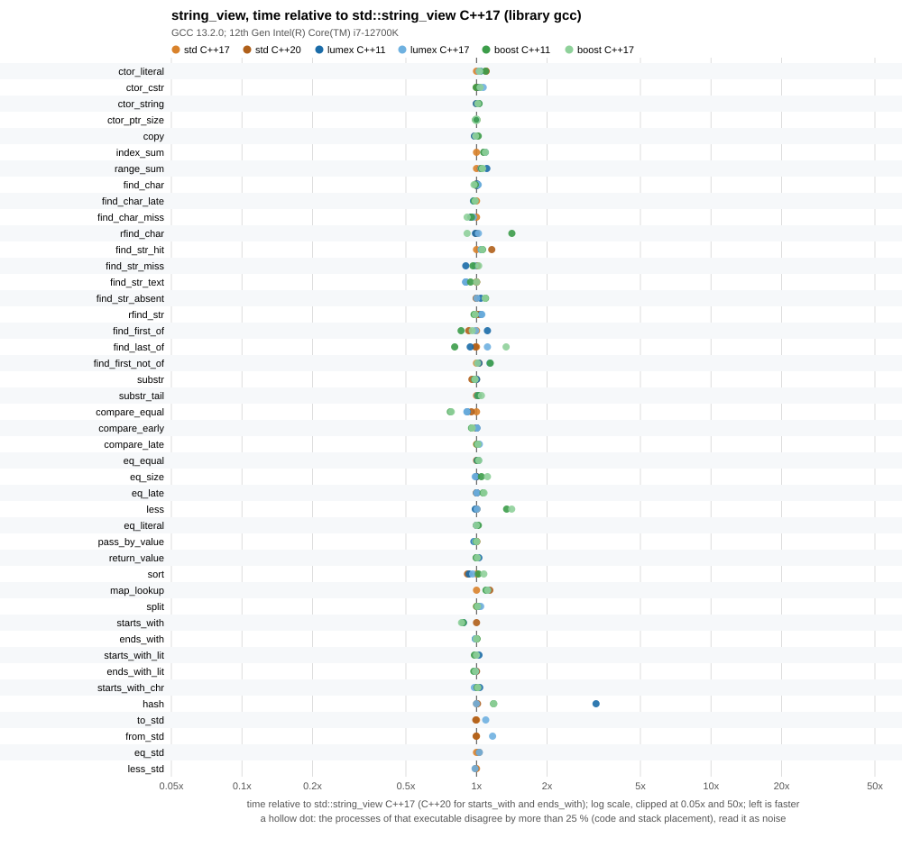
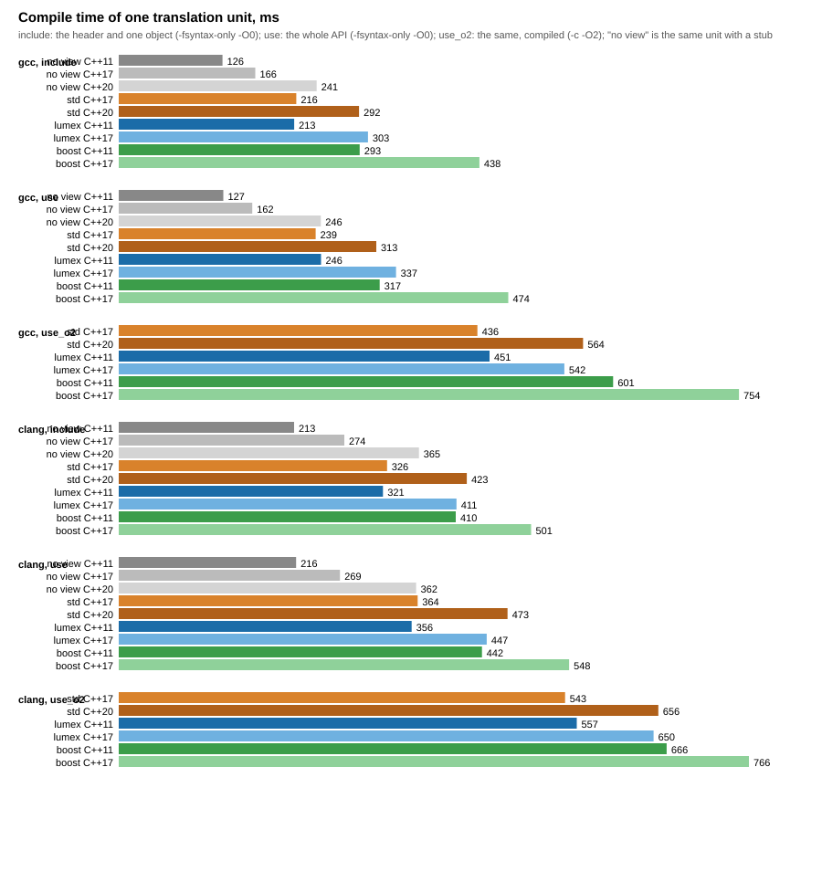

# string_view benchmarks

The string view of this library (`lumex_string_view`, `lumex::core::string_view::view`) against `std::string_view` of the standard library in use and `boost::string_view` of Boost.Utility, on the same scenarios and the same source. The view of this library is measured at C++11 and at C++17 (it is its own class at both and never becomes `std::string_view`); `std::string_view` at C++17 and at C++20 (`starts_with` and `ends_with` exist from C++20 only); `boost::string_view` at C++11 and at C++17. The view is header-only, so there is one build tree and one kind of build. Only one toolchain was measured: GCC 13.2.0 with libstdc++. Clang with libc++ was not measured (the build supports it: a second build tree with `--build-dir clang=...`), so nothing here says how Clang or MSVC compile the same code.





The numbers behind the charts: [results/string_view_benchmark.md](results/string_view_benchmark.md) (raw data: [results/string_view_benchmark.csv](results/string_view_benchmark.csv), layout and traits: [results/string_view_traits.csv](results/string_view_traits.csv), compile times: [results/compile_time.csv](results/compile_time.csv)). The measurements of the earlier version of the view, which had a compiled library, are kept next to them as `*_before_rework.csv` (see "Before the rework").

## Method

- One source, `bench_string_view.cpp`, compiled once per implementation and standard with `-DBENCH_STRING_VIEW_IMPL=1|2|3` (`bench_string_view_impl.hpp` maps it to the view under test). Every variant is built with the flags of the Release profile of the library (`-O2 -DNDEBUG -fomit-frame-pointer -march=x86-64 -mtune=generic -g -ffunction-sections -fdata-sections` and the library warnings, linked with `--gc-sections`, `-fPIE`); there are no sanitizers. The build has no warnings.
- Scenarios (the unit of an operation is in the description column of the results): construction from a literal, a `char const *`, a `std::string` and pointer plus size; copy; the sum of the characters by `operator[]` and by range-for; `find` and `rfind` of a character and of a view, in short strings (30 to 33 characters, path-like) and in a text of 4 096 characters; `find_first_of`, `find_last_of`, `find_first_not_of`; `substr`; `compare`, `==` and `<` between views and with a literal; `starts_with` and `ends_with` with a view, a literal and a character; hashing; a `noinline` function that takes a view by value and one that returns a view; `std::sort` of 256 views; lookups in a `std::map` of 256 views; splitting a text of 4 096 characters at `,`; the conversions to and from `std::string_view` and the comparison with it. 44 scenarios in all. Each loop works on a corpus of 256 strings built at run time and every number is per operation.
- Equal work: before timing, every scenario is run for a few iterations and its checksum is compared with a reference that runs the same source on `std::string` objects; a mismatch stops the program. `run_benchmark.py` compares the checksums across all executables; different checksums stop the run. This makes the benchmark also a differential test of the views against `std::string` on 44 operations.
- The optimizer is kept from deleting or hoisting the work with empty `asm` statements that read the objects and clobber memory. The corpus is built at run time, so no length or character is a compile-time constant, except in the scenarios that use a string literal on purpose (`ctor_literal`, `eq_literal`, `starts_with_lit`, `ends_with_lit`).
- A scenario is calibrated until one run lasts at least 20 ms, then runs once as warm-up and 15 times. `run_benchmark.py` runs every executable `--passes` times (here 5), one pass over all executables after the other, and keeps the lowest median (the best pass) with the slowest pass beside it; a dagger marks a value whose slowest pass was more than 25 % slower (3 of the table's values).
- The process is pinned to one CPU with `taskset` (`--cpu 3`). Every timing run, the build and the compile-time measurement were made under the build lock of the workstation, but other programs of the desktop were running, so the absolute compile times are larger than in the earlier run.
- The baseline of the ratios is `std::string_view` at C++17 (at C++20 for `starts_with` and `ends_with`). `std::string_view` at C++17 and at C++20 run the same machine code for most scenarios, so the ratio between those two columns is the noise of the machine: `map_lookup` is 26.16 ns at C++17 and 29.81 ns at C++20 (1.14), `find_str_hit` 5.09 and 5.91 (1.16). A difference of 10 to 15 % between two numbers is within it.
- Layout: the executables write `sizeof`, `alignof` and a few traits of the narrow and the wide view (`--traits`).
- Compile time: `compile_time.cpp` is compiled in three units, `include` (the header and one declared object, `-fsyntax-only -O0`), `use` (the whole API, `-fsyntax-only -O0`) and `use_o2` (the same use compiled with `-c -O2`, with the `.text` of the object), next to the same unit with a stub instead of a view; the median of 7 runs. The unit of `std::string_view` at C++17 leaves out `starts_with` and `ends_with`.

## Boost

Boost is optional and header-only: the boost variants need `boost/utility/string_view.hpp` and are skipped, with a message, when CMake finds none. Pass the include directory with `-DLUMEX_BENCH_BOOST_INCLUDE_DIR=<dir>` or point `find_package(Boost CONFIG)` at an installation. Nothing of Boost is linked or vendored. On the workstation of the committed results Boost 1.92.0 is installed in `/opt/boost-1.92.0` (only its headers are used; hashing uses `boost/container_hash/hash.hpp`, also headers); the system also has Boost 1.67 in `/usr/include`, which was not used.

## Running

```sh
cmake -S . -B build-bench -DCMAKE_BUILD_TYPE=Release \
      -DCMAKE_CXX_COMPILER=g++ -DLUMEX_BUILD_BENCHMARKS=ON \
      -DLUMEX_BENCH_BOOST_INCLUDE_DIR=/opt/boost-1.92.0/include
cmake --build build-bench --target LumexStringViewBench_lumex_cxx11 \
      LumexStringViewBench_lumex_cxx17 LumexStringViewBench_std_cxx17 \
      LumexStringViewBench_std_cxx20 LumexStringViewBench_boost_cxx11 \
      LumexStringViewBench_boost_cxx17
python benchmarks/string_view/run_benchmark.py --build-dir gcc=build-bench \
       --compile-time --compiler "gcc=g++" \
       --boost-include /opt/boost-1.92.0/include --cpu 3 --compile-repeats 7
```

`run_benchmark.py` writes `results/string_view_benchmark.csv`, `results/string_view_traits.csv`, `results/compile_time.csv` and, through `plot_results.py` (Python standard library only), the Markdown table and the SVG charts. The target `LumexStringViewBenchmarkRun` runs the executables of one build tree and writes into that build tree, so it never overwrites the committed results. `--filter <text>` on an executable runs the scenarios whose name contains the text.

## Reading the results

Measured on an Intel Core i7-12700K (Linux 6.1, pinned to one performance core), GCC 13.2.0 with libstdc++, Boost 1.92.0 (headers only), 5 passes, October 2026. A small absolute time (a few tenths of a nanosecond) is a handful of instructions and its ratio is coarse.

- **Overall `lumex_string_view` is on par with `std::string_view`.** The geometric mean of the time ratio of lumex C++17 to `std::string_view` C++17 over 44 scenarios is 1.012 (lumex C++11: 1.031 over the 40 scenarios it has); lumex is more than 10 % slower in 4 scenarios and more than 10 % faster in 2. `boost::string_view` over `std::string_view` is 1.024. Before the rework the same ratio was 1.55 (shared library) and 1.53 (static library), with 33 scenarios more than 10 % slower.
- **The literal is free again.** `ctor_literal` 0.58 ns against 0.57 for `std::string_view`, `eq_literal` 0.29 against 0.29, `starts_with_lit` 0.46 against 0.46, `ends_with_lit` 0.57 against 0.57 (it was 3.49x, 5.66x, 8.14x and 6.91x). The constructor from `char const *` is inline and its length is `__builtin_strlen`, which the compiler folds for a literal and calls as `strlen` otherwise (`ctor_cstr` 2.99 ns against 2.80, 1.07x).
- **`find` of a view no longer scans every position.** The first character is looked up with `char_traits::find` (`memchr`) and the rest compared only there. `find_str_absent` (first letter not in the text) 29.02 ns for `std::string_view` and 29.08 ns for lumex (it was 969.6 ns, 33.9x), `find_str_text` (the first letter at every 16th position) 1332 ns against 1482 (0.90x; the earlier 1.19x), `find_str_hit` 1.05x, `find_str_miss` 0.99x.
- **Where lumex is more than 10 % off `std::string_view` (C++17 column) and why.**
  - `from_std` 1.17x (0.87 against 0.74 ns), the conversion constructor from `std::string_view`: the disassembly of the loop shows that GCC copies the 16 bytes of the standard view with one SSE load and store (`movdqu`, `movaps`) and the view of this library with two 8-byte moves and a reload of each (`mov (%rax),%rcx`, `mov 0x8(%rax),%rax`, two stores); the standard view keeps `{length, pointer}` and ours `{pointer, length}`. That is a code difference, a fraction of a nanosecond.
  - `find_first_not_of` 1.14x (boost 1.14x as well), `find_last_of` 1.11x (but lumex C++11 0.94x and boost C++11 0.81x): the loops have the same instructions in another order (the exit test of the inner loop moves, a register is renamed; compared with `objdump` on `run_find_first_not_of`); they were not measured with hardware counters, so whether the difference is more than placement is not established.
  - `map_lookup` 1.11x: `std::string_view` itself is 26.16 ns at C++17 and 29.81 ns at C++20 for the same code, so the difference is the noise of the machine.
  - `hash` at C++11 3.23x (15.07 against 4.66 ns): below C++17 the hash is a byte-wise FNV-1a over the code units, deterministic on every platform, against the hash of libstdc++. At C++17 the hash is `std::hash<std::string_view>` itself (1.00x).
- **Where lumex is faster:** `starts_with` of a view 0.87x (against `std::string_view` at C++20; boost 0.86x) and `find_str_text` 0.90x. Boost shows the same `starts_with` figure (0.86x), and the cause was not investigated.
- **Same as `std::string_view` within 10 %:** the rest, among them construction from pointer and size, copy, `pass_by_value`, `return_value`, iteration, `substr`, `compare`, `==`, `<`, `sort`, `split`.
- **The C++11 and the C++17 builds of the view are the same code** (geometric mean 1.023, dominated by `hash`).
- **Layout.** `sizeof` of every view is 16 bytes (a pointer and a size) for the narrow and the wide view in all three libraries; all are trivially copyable, trivially destructible and standard layout, and none is trivially default constructible. `lumex_string_view` and `std::string_view` convert into each other at C++17, `boost::string_view` does neither.
- **The compile time** of the header is a cost. Over the same unit with a stub instead of a view (`-fsyntax-only -O0`, machine busy, so larger than in the earlier run): the `include` unit costs +85 ms for lumex C++11, +134 ms for lumex C++17, +54 ms for `std::string_view` C++17, +53 ms at C++20, and +159 ms (C++11) and +271 ms (C++17) for Boost. The header is a class template with its algorithms, so including it costs more than the earlier header that only declared them (+62 ms and +100 ms) and more than `<string_view>`. The `use_o2` unit has 5381 bytes of `.text` with lumex C++11 and 5539 with lumex C++17, against 5779 for `std::string_view` C++17 (without `starts_with` and `ends_with`), 7019 at C++20 and 8845 and 8939 for Boost; it compiles in 433 and 562 ms against 464 (std C++17), 545 (std C++20), 585 and 744 (Boost).

## Before the rework

The view used to have a compiled library (`LumexCore_string_view`, exported with `LUMEX_STRING_VIEW_API`) and the benchmark built it twice, as a shared and as a static library, with a "lumex inlined" variant that compiled the two `.cpp` files into the benchmark's translation unit. That version was 1.55x (shared) and 1.53x (static) of `std::string_view` over 44 scenarios, 33.9x on `find` of a view whose first letter is absent from the text, and 3.5x to 8.1x on string literals; the inlined variant was 1.10x. The raw results are in `results/string_view_benchmark_before_rework.csv`, `results/library_before_rework.csv` (the 35288-byte shared library and its 94 exported functions) and `results/compile_time_before_rework.csv`. The compiled library, the shared/static comparison and the inlined variant are gone with the rework: the "lumex" variant is now the header-only class itself.

Before/after, ratio to `std::string_view` C++17 of the same run, best pass (the before values are the shared-library build):

| Scenario | before | after |
| --- | ---: | ---: |
| construct from a literal | 3.49 | 1.03 |
| construct from a `char const *` | 1.34 | 1.07 |
| construct from a `std::string` | 1.32 | 1.02 |
| `find ('/')` | 1.93 | 1.02 |
| `find` of a view, hit in a short string | 1.70 | 1.05 |
| `find` in a text of 4 096, first letter common | 1.19 | 0.90 |
| `find` in a text of 4 096, first letter absent | 33.9 | 1.00 |
| `substr (8, 12)` | 1.36 | 0.98 |
| `compare` of equal strings | 1.17 | 0.91 |
| `==` of equal strings | 1.35 | 1.02 |
| `==` with a literal | 5.66 | 1.00 |
| `starts_with` a literal | 8.14 | 0.99 |
| `std::sort` of 256 views | 1.47 | 0.96 |
| `std::map` lookup of a view | 1.94 | 1.11 |
| split a text of 4 096 | 1.27 | 1.04 |
| geometric mean of 44 scenarios | 1.55 | 1.012 |

## Caveats

- The numbers are for this machine and this compiler, one toolchain (GCC 13.2.0, libstdc++). They are not a promise about Clang, MSVC, libc++, other CPUs or other versions: run the benchmark there (`Running`). In particular libc++ and MSVC's STL implement the searches differently from libstdc++, and the view's `find` of a view relies on `char_traits::find`, so how fast it is depends on how the library implements that.
- The scenarios measure a view in a loop with the optimizer held back by empty `asm` statements. They show the cost of the interface, not of a whole program. The corpus is short path-like strings (30 to 33 characters) and one text of 4 096 characters over 16 letters; strings of other lengths and alphabets can reorder close results, and the long-text search results depend on the letter frequencies.
- The wide view (`lumex_wstring_view`) is the same template with `wchar_t`; it was compiled and its layout was measured, but none of the timings use it.
- `starts_with` and `ends_with` are measured against `std::string_view` at C++20, the other scenarios against C++17.
- `hash` uses each library's own hash (`std::hash` for lumex from C++17 and for `std::string_view`, FNV-1a for lumex at C++11, `boost::hash` for Boost); only their speed is compared.
- The compile times are the median of 7 runs of one unit on a machine that was not idle; the `std C++17` unit leaves out `starts_with` and `ends_with` and so does a little less work than the others.
