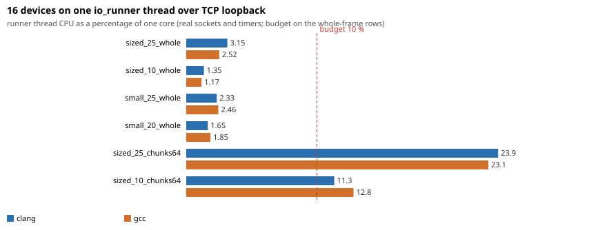

# transport benchmarks

What the frame codecs, the protocol messages and the dialogue of `lumex/applied/transport` cost, and whether they stay inside the budgets of the plan (codecs, `describe`, the log call below the threshold, one exchange on the mocks and over TCP, many devices on one `io_runner`, and the compile time of a `protocol::client<P>`). Six executables and one compile-time script, each with its own CSV; `plot_results.py` turns them into [results/transport_benchmark.md](results/transport_benchmark.md) (the numbers and the budget verdicts) and the charts below. The numbers were taken on GCC 13.2 and Clang 23.1 (libstdc++), Release (`-O2 -g -DNDEBUG`), C++11, on a 12th Gen Intel Core i7-12700K under Linux 6.1, with the one-minute load average of the rows between 1.02 and 2.81 (checked against every `loadavg` column of `results/`). The load includes the benchmark itself (one busy thread, about 1.0) and the desktop session of the machine (it alone has been seen near 1.7); no other build or test job ran during the timed runs, because they hold the build lock. Every row carries its own `loadavg`.





## The clock of each benchmark

A simulator on the virtual clock (`testing::virtual_clock`) measures no latency: nothing waits, so the number is the CPU cost of the work. That is what most of these benchmarks want, and each CSV row says which clock it ran on (column `clock`):

| Benchmark | Clock | What the number is |
| --- | --- | --- |
| `LumexTransportBenchCodec`, `Protocol`, `Logging` | none | Wall time of CPU work (`steady_clock`); no timer, thread or transport takes part. |
| `LumexTransportBenchDialogue` `*_virtual` | virtual | The CPU cost of one exchange: engine and simulator on the virtual clock, one thread polls the context; no timer ever fires. |
| `LumexTransportBenchDialogue` `ping6_real_timers` | real | The same with the engine on real Asio timers (the request timer is armed and cancelled on the steady clock); the simulator is still on the virtual clock. |
| `LumexTransportBenchDialogue` `*_sync_thread` | real | The synchronous call `client.PING (...)` from one thread while another runs the context: the CPU cost plus the hand-off between the threads. |
| `LumexTransportBenchDialogue` `ping6_sync_tcp_loopback` | real | The same synchronous call with the client on an `io_runner` over a real TCP connection on the loopback interface; a thread of the benchmark answers each request at once. The cost of the sockets and of two thread hand-offs, still not the latency of a device. |
| `LumexTransportBenchSockets` | real | The CPU time of the runner thread (`CLOCK_THREAD_CPUTIME_ID`) per second of wall time, as a percentage of a core, with 16 `client<P>` on one `io_runner` over TCP loopback sockets and real timers, a peer thread writing a whole frame per write (or 64-byte chunks in the rows that say so). The 16-device budget is judged on these rows. |
| `LumexTransportBenchDevices` | virtual | **CPU on mocks.** The wall time that the single runner thread needs per second of virtual time, as a percentage of a core, while a task on the runner moves the clock in steps of 10 ms as fast as the thread can run. It is the CPU of the work (device, mock, framing, engine, decode, handler) with no timer wait, no system call and no wake-up, so it is not the load the work puts on a core in real time and **no budget verdict comes from it**. |

The reply of the simulator is ready at once, so no benchmark here says anything about the latency of a real device or link. The invented table that all of them run on is `bench_transport_tables.hpp` (a one-byte key; rows named by size and rate only).

## What is measured

- **Codecs** (`bench_codec.cpp`): SLIP, COBS, delimiter, length prefix, header and Modbus RTU, for payloads of 16, 100 and 2420 bytes (Modbus RTU up to 100: an ADU holds 252). Per codec and size: `encode`, `decode` of the whole frame in one chunk and `decode` of the same frame in chunks of 64 bytes (a USB serial read). Unit: ns per frame, the note has MB/s of payload.
- **Messages and `describe`** (`bench_protocol.cpp`): the encode and the decode of a reply message of 6, 100 and 2420 bytes, the match of a frame against the run-time index, and `describe` (the log line of a frame) of a 6-byte request and of replies of 6, 100 and 2420 bytes.
- **The log call below the threshold** (`bench_logging.cpp`): `LUMEX_TRANSPORT_LOG` with a message built by a concatenation, with the threshold above the record; against a call that builds the message first, an atomic load and a branch, a record of a denied component and an enabled record to a counting sink.
- **One exchange on the mocks and over TCP** (`bench_dialogue.cpp`): `client<P>` over a SLIP-framed mock stream against `device_simulator<P>`, a 6-byte request and a 6-byte reply, and a request with a 2420-byte reply. Async on the virtual clock and on real timers, and the synchronous call on another thread; the synchronous 6-byte call is also made over a real TCP connection on the loopback interface (`ping6_sync_tcp_loopback`).
- **Many devices on one `io_runner`, real sockets and timers** (`bench_sockets.cpp`, Linux only): 16 `client<P>` on one `io_runner` thread, each over its own TCP connection on the loopback interface to a peer socket of the benchmark; a peer thread paces the frames of a device that streams, the devices staggered over one period. Four loads with a whole frame per write (2420 bytes at 25 Hz and at 10 Hz, an assumed rate; 16 bytes at 25 Hz and at 20 Hz), measured in 3 passes of 10 s after a second of warm-up. The figure is the CPU time of the runner thread. Two more rows write the same 2420-byte messages in chunks of 64 bytes (a USB serial read) on a shared tick of 1 ms; they are published and carry **no budget**: at 25 Hz the stream is saturated (a message takes 38 ticks, longer than its 40 ms period) and the peer delivers fewer messages than the rate asks, which the note of the row states. The note of every row also has the messages per second, the CPU per message and the voluntary context switches of the runner thread.
- **CPU on mocks** (`bench_devices.cpp`): the same 16 devices behind mock streams on the virtual clock, with a `client<P>` subscribed to the row the device streams: 2420 bytes at 10 Hz (an assumed rate), 2420 bytes at 25 Hz, 16 bytes at 20 Hz, 16 bytes at 25 Hz and a mix of 6, 5 and 5 devices. Each load runs twice: with the clients and with a reader that discards the bytes (`*_devices_only`), so the cost of the client side is the difference. It shows where the CPU goes; it is not the load in real time and has no verdict.
- **Compile time of a client** (`compile_time.cpp`, `compile_time.py`): one translation unit with the headers only, with a client over the 7-row invented table and one method, and with a client over a layer of the largest test table (device M: 20 rows in the text layer `device_m1`, 15 in the binary layer `device_m2`) with one generated method instantiated per row of the layer. A fourth unit calls the synchronous form of each method of `device_m1` (no completion handler). Three modes: syntax only, `-O0 -g -c` and `-O2 -g -DNDEBUG -c`; the wall time (median of 3) and the peak memory of the compiler process (from the `wait4` rusage of that process alone). A group of repeats whose load average is above `--max-load` (2.0) is repeated after a pause.

## Equal work and the check of the benchmarks themselves

- Every loop keeps its inputs and results alive with `bench::keep_object`, `bench::keep_value` and `bench::hide` (empty `asm` statements that read the value and clobber memory), so a call cannot be deleted or hoisted. Every case first checks its result: a codec round-trips its payload, a message encodes back to the same bytes, `describe` names the row, the simulator's request count must equal the calls made and the engine's statistics must count the same requests, the handlers of the device benchmarks must have received at least 97 % of the messages the rates promise (`bench_sockets`: of the whole-frame loads; the chunked loads at least 80 %), the discarding reader of `*_devices_only` at least 97 % of the bytes of those messages, a codec decode must deliver exactly one frame per call, and the threaded and TCP dialogue cases check the client's request count as the polled ones do.
- **The fast path is falsified first.** `LumexTransportBenchLogging` begins with 200000 calls of the macro and of a call that formats before it asks `log_enabled`, below the threshold, and stops unless the eager call built the message every time, the macro never, and the eager call is at least 5 times slower (about 57 times on GCC, 62 on Clang at the committed run).
- **The round trip is falsified too.** Each case of `LumexTransportBenchDialogue` is run again with `sleep_for (50 us)` in the handler of the simulator (in the peer thread for the TCP case), and the run stops unless that variant is at least 40 us slower (the committed run: every variant lies between 118 and 187 us, its base between 6 and 29 us).
- **The header codec's 44 ns is a zero-copy view.** The `header` codec decodes a whole frame into a view of its input and copies nothing, so its MB/s at 2420 bytes (50000 and more) does not compare with the codecs that copy the payload (SLIP, COBS, delimiter, length prefix, Modbus RTU).

## Budgets

Question 14 of the plan with the user's decisions of 5 November 2026, measured on the committed run (details and the load of each row in [results/transport_benchmark.md](results/transport_benchmark.md), which computes every verdict from the CSV files):

| Budget | GCC 13.2 | Clang 23.1 | Verdict |
| --- | --- | --- | --- |
| Log call below the threshold: under 2 ns | 0.94 ns | 0.86 ns | met |
| Dialogue round trip on mocks under 50 us | 6.1 us async, 15.4 us sync call | 6.3 us async, 14.9 us sync call | met |
| `describe` of a 100-byte frame under 5 us | 0.87 us | 0.88 us | met |
| Codecs at least 100 MB/s | slowest at 2420 bytes: COBS encode, 462 MB/s | slowest: delimiter decode, 531 MB/s | met |
| 16 devices on one `io_runner` thread under 10 % of a core, **real sockets and timers, a whole frame per write** | 2.52 % (2420 bytes at 25 Hz), 1.17 % (2420 bytes at 10 Hz), 2.46 % (16 bytes at 25 Hz), 1.85 % (16 bytes at 20 Hz) | 3.15 %, 1.35 %, 2.33 %, 1.65 % | met |
| Compile time per called row of the largest table (device M, 20 and 15 rows): syntax under 0.1 s, code generation under 1 s | syntax 0.035-0.047 s; `-O0 -g` 0.24 s; `-O2 -g` 0.50-0.51 s | 0.043-0.044 s; 0.12 s; 0.57-0.62 s | met |
| Peak memory of that translation unit under 1.5 GB | at most 997 MB | at most 1205 MB | met |

The per-row figure is the time over a unit with the headers only, divided by the rows called (one generated method per row of the layer); the synchronous form (`device_m1_sync_20_methods`) is within the same bounds (GCC 0.046 / 0.25 / 0.57 s per row, 1029 MB; Clang 0.042 / 0.12 / 0.40 s, 527 MB). A unit that calls one method of the 7-row invented table pays the fixed cost of the first instantiation of a client (GCC: +0.12 s syntax, +1.2 s `-O0 -g`, +2.9 s `-O2 -g` over the headers), which is not a per-row figure and has no verdict.

Rows with no budget: the chunked loads of `LumexTransportBenchSockets` (2420 bytes in 64-byte chunks: 23 % of a core at 25 Hz on both toolchains, a saturated stream that delivers 87 % of the promised messages; 11-13 % at 10 Hz, all delivered) and everything of `LumexTransportBenchDevices` ("CPU on mocks", 0.1-0.7 % of a core: the CPU of the work with no timer wait, system call or wake-up, so it is not the load in real time).

What the real-socket load leaves out: no serial driver or hardware (a TCP loopback socket stands in for the port); no requests, keepalive or watchdog beside the streams; the handler only counts; the chunks of all 16 devices are batched on one shared 1 ms tick, so the chunked figures are likely a lower bound; the figure is CPU and not wake-up latency; and the peer thread that writes the frames shares the machine (its time is not counted).

The peak memory of a unit on GCC 13 is 528 MB (syntax only), 771 MB (`-O0 -g`) and 998 MB (`-O2 -g`) for the 20-row layer; the plan's figure of 885 MB lies between the last two, and the build flags decide which one a translation unit meets.

## Running

```sh
cmake -S . -B build-bench-gcc -DCMAKE_BUILD_TYPE=Release \
      -DCMAKE_CXX_COMPILER=g++ -DLUMEX_BUILD_BENCHMARKS=ON
cmake --build build-bench-gcc --target LumexTransportBenchmarks
# the same with clang++ in build-bench-clang
python3 benchmarks/transport/run_benchmark.py \
        --build-dir gcc=build-bench-gcc --build-dir clang=build-bench-clang
python3 benchmarks/transport/compile_time.py \
        --compiler gcc=g++ --compiler clang=clang++ --repeats 3
python3 benchmarks/transport/plot_results.py
```

`run_benchmark.py` runs the executables under `timeout` (and `prlimit --as` where it exists), repeats a run in which a row shows a load average above `--max-load` (2.0) after a pause (`compile_time.py` does the same with 3.0, because a compile adds 1.0 to the average), writes `results/<benchmark>_<toolchain>.csv` and calls `plot_results.py` (Python standard library only), which writes the Markdown table with the verdicts and the SVG charts. Each executable also runs alone: `LumexTransportBenchDialogue out.csv [--quick] [--filter text] [--list]`. The benchmarks are built only with `LUMEX_BUILD_BENCHMARKS=ON` (OFF by default) and where the transport compiles the dialogue engine and the testing doubles; the targets carry the warning set of the repository like every other target (`LUMEX_WERROR=ON` builds clean on GCC 13 and Clang 23). `run_benchmark.py` and `compile_time.py` are Linux only and say so at start. The timings mean something only in a Release build without sanitizers on a quiet machine.
