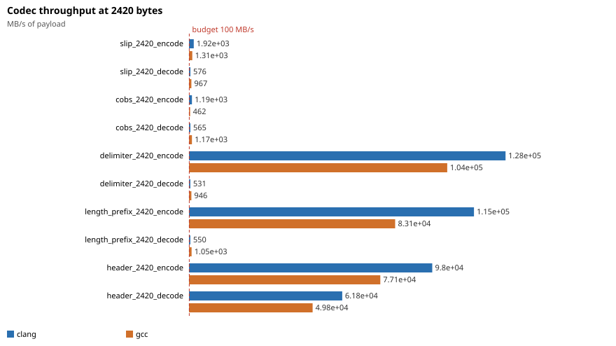
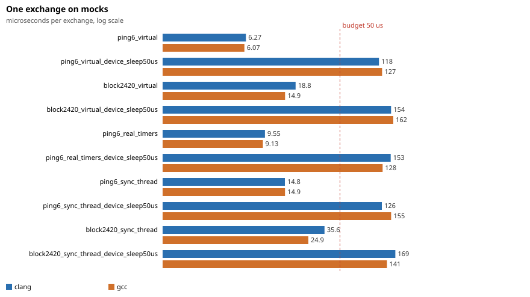
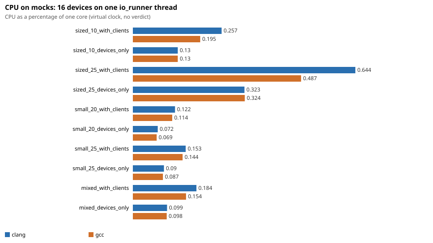
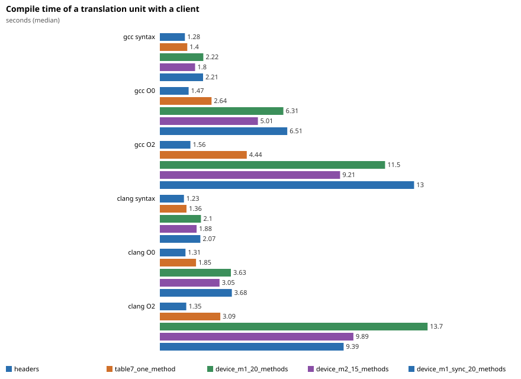

# transport benchmarks

What the frame codecs, the protocol messages and the dialogue of `lumex/applied/transport` cost, and whether they stay inside the budgets of the plan (codecs, `describe`, the log call below the threshold, one exchange on the mocks, many devices on one `io_runner`, and the compile time of a `protocol::client<P>`). Five executables and one compile-time script, each with its own CSV; `plot_results.py` turns them into [results/transport_benchmark.md](results/transport_benchmark.md) (the numbers and the budget verdicts) and the charts below. The numbers were taken on GCC 13.2 and Clang 23.1 (libstdc++), Release (`-O2 -g -DNDEBUG`), C++11, on a 12th Gen Intel Core i7-12700K under Linux 6.1, with the load average between 1.6 and 2.0 (the desktop and another job of the machine; every row carries its own `loadavg`).









## The clock of each benchmark

A simulator on the virtual clock (`testing::virtual_clock`) measures no latency: nothing waits, so the number is the CPU cost of the work. That is what most of these benchmarks want, and each CSV row says which clock it ran on (column `clock`):

| Benchmark | Clock | What the number is |
| --- | --- | --- |
| `LumexTransportBenchCodec`, `Protocol`, `Logging` | none | Wall time of CPU work (`steady_clock`); no timer, thread or transport takes part. |
| `LumexTransportBenchDialogue` `*_virtual` | virtual | The CPU cost of one exchange: engine and simulator on the virtual clock, one thread polls the context; no timer ever fires. |
| `LumexTransportBenchDialogue` `ping6_real_timers` | real | The same with the engine on real Asio timers (the request timer is armed and cancelled on the steady clock); the simulator is still on the virtual clock. |
| `LumexTransportBenchDialogue` `*_sync_thread` | real | The synchronous call `client.PING (...)` from one thread while another runs the context: the CPU cost plus the hand-off between the threads. |
| `LumexTransportBenchDevices` | virtual | The wall time that the single runner thread needs per second of virtual time, as a percentage of a core, while a task on the runner moves the clock in steps of 10 ms as fast as the thread can run. It is the load the same work puts on one core in real time, without the idle wake-ups of real timers, the system calls of a serial port or a socket, and the device's own latency. |

The reply of the simulator is ready at once, so no benchmark here says anything about the latency of a real device or link. The invented table that all of them run on is `bench_transport_tables.hpp` (a one-byte key; rows named by size and rate only).

## What is measured

- **Codecs** (`bench_codec.cpp`): SLIP, COBS, delimiter, length prefix, header and Modbus RTU, for payloads of 16, 100 and 2420 bytes (Modbus RTU up to 100: an ADU holds 252). Per codec and size: `encode`, `decode` of the whole frame in one chunk and `decode` of the same frame in chunks of 64 bytes (a USB serial read). Unit: ns per frame, the note has MB/s of payload.
- **Messages and `describe`** (`bench_protocol.cpp`): the encode and the decode of a reply message of 6, 100 and 2420 bytes, the match of a frame against the run-time index, and `describe` (the log line of a frame) of a 6-byte request and of replies of 6, 100 and 2420 bytes.
- **The log call below the threshold** (`bench_logging.cpp`): `LUMEX_TRANSPORT_LOG` with a message built by a concatenation, with the threshold above the record; against a call that builds the message first, an atomic load and a branch, a record of a denied component and an enabled record to a counting sink.
- **One exchange on the mocks** (`bench_dialogue.cpp`): `client<P>` over a SLIP-framed mock stream against `device_simulator<P>`, a 6-byte request and a 6-byte reply, and a request with a 2420-byte reply. Async on the virtual clock and on real timers, and the synchronous call on another thread.
- **Many devices on one `io_runner`** (`bench_devices.cpp`): 16 simulated devices, each with a mock stream and a `client<P>` subscribed to the row the device streams, on one `io_runner` thread: 2420 bytes at 10 Hz (the subscription rate of a spectrum, assumed 10 Hz), 2420 bytes at 25 Hz, 16 bytes at 20 Hz, 16 bytes at 25 Hz and a mix of 6, 5 and 5 devices. Each load runs twice: with the clients and with a reader that discards the bytes (`*_devices_only`), so the cost of the client side is the difference.
- **Compile time of a client** (`compile_time.cpp`, `compile_time.py`): one translation unit with the headers only, with a client over the 7-row invented table and one method, and with a client over a layer of the largest test table (device M: 20 rows in the text layer `device_m1`, 15 in the binary layer `device_m2`) with one generated method instantiated per row of the layer. Three modes: syntax only, `-O0 -g -c` and `-O2 -g -DNDEBUG -c`; the wall time (median of 3) and the peak memory of the compiler process (from the `wait4` rusage of that process alone).

## Equal work and the check of the benchmarks themselves

- Every loop keeps its inputs and results alive with `bench::keep_object`, `bench::keep_value` and `bench::hide` (empty `asm` statements that read the value and clobber memory), so a call cannot be deleted or hoisted. Every case first checks its result: a codec round-trips its payload, a message encodes back to the same bytes, `describe` names the row, the simulator's request count must equal the calls made and the engine's statistics must count the same requests, the handlers of the device benchmark must have received at least 97 % of the messages the rates promise.
- **The fast path is falsified first.** `LumexTransportBenchLogging` begins with 200000 calls of the macro and of a call that formats before it asks `log_enabled`, below the threshold, and stops unless the eager call built the message every time, the macro never, and the eager call is at least 5 times slower (57.7 times on GCC, 61.1 on Clang at the committed run). The built messages are counted in a `volatile` counter.
- **The round trip is falsified too.** Each case of `LumexTransportBenchDialogue` is run again with `sleep_for (50 us)` in the handler of the simulator, and the run stops unless that variant is at least 40 us slower (the committed run: 118 to 170 us instead of 6 to 36 us).

## Budgets

Question 14 of the plan, measured on the committed run (details and the load of each row in [results/transport_benchmark.md](results/transport_benchmark.md)):

| Budget | GCC 13.2 | Clang 23.1 | Verdict |
| --- | --- | --- | --- |
| Log call below the threshold: under 2 ns | 0.94 ns | 0.86 ns | met |
| Dialogue round trip on mocks under 50 us | 6.1 us async, 14.9 us sync call | 6.3 us async, 14.8 us sync call | met |
| `describe` of a 100-byte frame under 5 us | 0.87 us | 0.88 us | met |
| Codecs at least 100 MB/s | slowest at 2420 bytes: COBS encode, 464 MB/s | slowest: delimiter decode, 531 MB/s | met |
| 16 devices at 25 Hz on one `io_runner` thread under 10 % of a core | 0.48 % (2420 bytes), 0.14 % (16 bytes) | 0.64 %, 0.15 % | met |
| A client over the largest table adds under 2 s (GCC 13) | syntax only +1.06 s; `-O0 -g` +5.51 s; `-O2 -g` +11.35 s | +1.02 s; +2.64 s; +14.15 s | met for the front end, **missed** once code is generated |

The last row counts every row of the layer in one translation unit (20 methods, 0.28 s per row at `-O0 -g`, 0.57 s at `-O2 -g` on GCC, 0.05 s per row for the front end alone); a consumer that calls a handful of rows pays a fraction of it. The peak memory of that unit on GCC 13 is 528 MB (syntax only), 771 MB (`-O0 -g`) and 997 MB (`-O2 -g`); the plan's figure of 885 MB for the same table lies between the last two, and the build flags decide which one a translation unit meets.

## Running

```sh
cmake -S . -B build-bench-gcc -DCMAKE_BUILD_TYPE=Release \
      -DCMAKE_CXX_COMPILER=g++ -DLUMEX_BUILD_BENCHMARKS=ON
cmake --build build-bench-gcc --target LumexTransportBenchmarks
# the same with clang++ in build-bench-clang
python3 benchmarks/transport/run_benchmark.py \
        --build-dir gcc=build-bench-gcc --build-dir clang=build-bench-clang
python3 benchmarks/transport/compile_time.py \
        --compiler gcc=g++ --compiler clang=clang++ --repeats 3
python3 benchmarks/transport/plot_results.py
```

`run_benchmark.py` runs the executables under `timeout` (and `prlimit --as` where it exists), repeats a run in which a row shows a load average above `--max-load` (2.0) after a pause, writes `results/<benchmark>_<toolchain>.csv` and calls `plot_results.py` (Python standard library only), which writes the Markdown table with the verdicts and the SVG charts. Each executable also runs alone: `LumexTransportBenchDialogue out.csv [--quick] [--filter text] [--list]`. The benchmarks are built only with `LUMEX_BUILD_BENCHMARKS=ON` (OFF by default) and where the transport compiles the dialogue engine and the testing doubles; the targets carry no warning flags of the repository (as the tests and examples), because the protocol headers still hold `-Wfloat-equal` findings in a translation unit that includes them. The timings mean something only in a Release build without sanitizers on a quiet machine.
