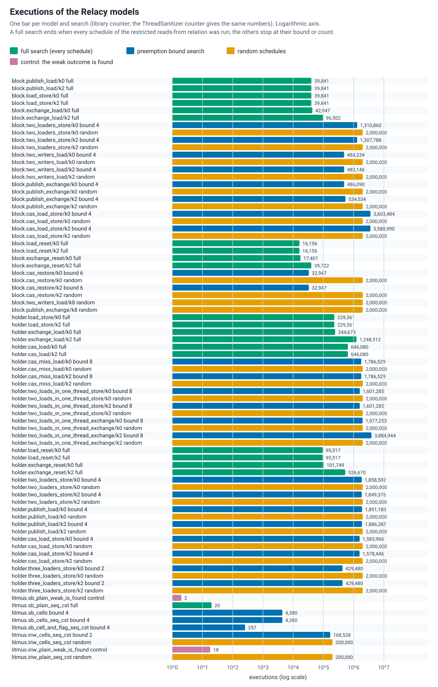
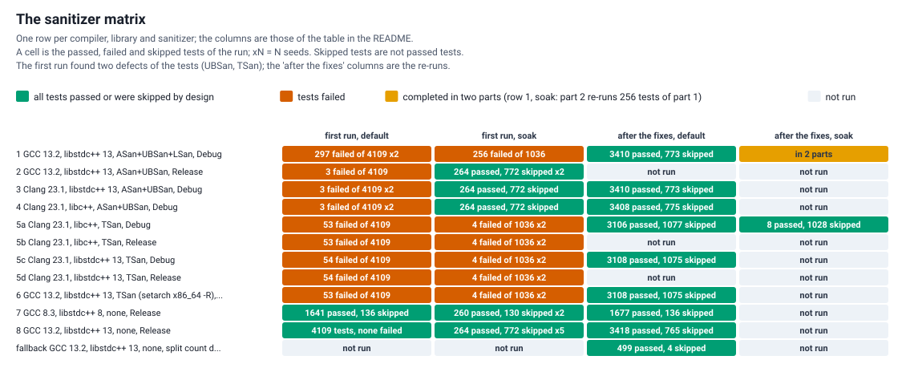
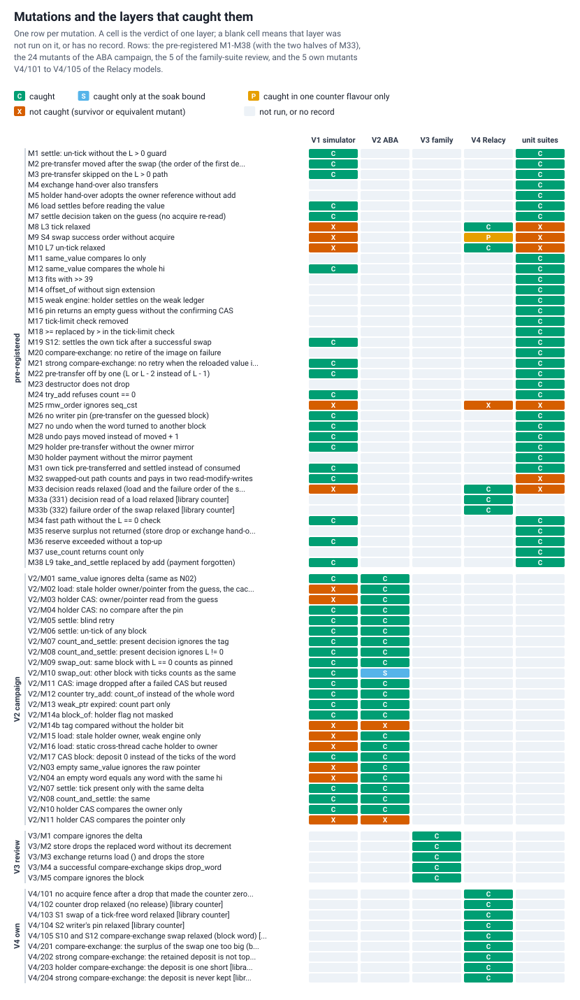

# Verification of the split-count engine {#lumex_atomic_verification}

This page records how the split-count engine (`atomic_shared_ptr_lock_free_split_count<T>` and `atomic_weak_ptr_lock_free_split_count<T>`; the protocol is described in the README of the module, section "The split-count engine", and implemented by `lumex/core/atomic/smart_ptr/split_count/LumexSplitCountCell.hpp`) was checked: what is claimed and what is not, which layer of checking looks at which property, what each layer ran, what it found, and what it cannot show. It describes the state of the repository at the time of writing.

How to read it:

- Every number is a result of a run of the tests of this repository, a row of a data file in `benchmarks/atomic/results/verification/` or a figure of the benchmark results in `benchmarks/atomic/`. Where a record is missing the text says "not recorded"; a number is never filled in from memory or rounded up.
- "Caught" means that a test, an oracle or a model reported the defect that was put into the code. A survivor is a mutation that nothing reported; it is listed with the reason where the reason is known.
- A mutation is a deliberate defect put into a copy of the engine (or of a model of it) to find out whether a layer notices it. A layer that catches many mutations is evidence that its checks are sharp, not a proof that the engine has no defect.
- The runs were made on one workstation: Intel Core i7-12700K (20 logical CPUs), Astra Linux 1.7, kernel 6.1.170, GCC 13.2.0 with libstdc++ 13 (the main compiler), GCC 8.3.0 (the C++11 floor), Clang 23.1.0 with libc++ and with libstdc++. The 128-bit compare-and-swap is the inline-assembly backend (`lock cmpxchg16b`) unless a run says it used the built-in backend (`LUMEX_DWCAS_BACKEND=3`, `__atomic_*` on a 128-bit integer), the only backend ThreadSanitizer can see.

## What is claimed, and what is not

The words are those of the README: a *tick* is a pin of a loader on the installation of a value in the word (`L`), `count` and `ext` are the two halves of the strong counter of a control block (`ext` counts owners in transit), and the *owners* of a block at an instant are the live smart pointers that name it, the non-empty slots that name it and the loads that are linearized but not yet returned.

| Id | Property | Statement |
| --- | --- | --- |
| S1 | No use after free | No control block, holder or managed object is read, written or counted after its disposal. A block that has a pin on it (a tick in the word, or a unit paid into `ext` by the writer that swapped the word) is not disposed. |
| S2 | Single disposal | The object and the control block of a smart pointer are disposed once. A holder (the block that stores an alias whose offset does not fit in 40 bits) is installed in at most one word, at most once, and a load of a holder word returns the owner, never the holder. |
| C1 | The counter rule | `use_count () = count + ext` for the strong group, and `ext` is never negative. |
| G1 | Never below | At every instant `use_count ()` is not below the number of owners. So `use_count () == 1` means that the caller is the sole owner. It never waits. |
| G2 | Bounded above | `use_count ()` equals the number of owners except inside three windows, each tied to an operation in flight on the atomic that holds the value: (i) a `store` or a successful compare-exchange between its swap and the drop of the old value (+1); (ii) a writer between its pre-transfer and the end of its call (the ticks it found plus its reserve); (iii) a load whose pin has already counted itself, until its payment (+1). Outside the windows, in particular at rest, it is exact. |
| I4 | Balance at rest | When no operation is in flight, every word has no tick, every `ext` is zero and every `count` equals the live pointers plus the words that name the block. Every tick ends exactly once, and every deposit is paid or returned (the ledger identities). |
| LIN | Linearizability | `load`, `store`, `exchange` and both compare-exchanges are linearizable with the linearization points of the protocol: the successful swap for a writer, the load a failing compare-exchange performs, the count step of a live load. A strong compare-exchange does not fail while the stored value is equivalent to `expected`. |
| ABA | No ABA | The engine has no tag and no epoch. A block that was freed, created again at the same address and installed is simply the live block; a stale handle that names only an address does not match a new object; two values are equivalent only when both the owner and the stored pointer are equal. |
| PRG | Progress | The operations are lock-free: a failed compare-exchange of the word means another thread's successful read-modify-write. The only wait is the back-off at the limit of `L` (24 bits; unreachable in practice, lowered in the tests). `use_count ()` never waits; `use_count_settled ()` waits by design. |
| W | The weak engine | The same cell over the weak ledger; a weak load does not change `use_count ()`; a weak holder keeps the control block, never the object. |
| ORD | Memory orders | The orders written in the code (the tick, the decision reads, the un-tick, the swaps, the counter drop) are the ones the Relacy models of the covered paths need: weakening any of them was reported by a model, except M9 under the library counter (masked) and M25 (argued unnecessary). The evidence is a bounded search over Relacy's restricted reads-from relation on a transcription of the code; it is not a proof of sufficiency. |
| WAIT | Waiting | `wait` returns only after `notify_one ()` or `notify_all ()`; the modifying operations do not notify, as in the other engines. |

What is not claimed:

- Wait-freedom or starvation-freedom. A writer can lose its swap again and again under a read-heavy load; only the rate of stores under that load was measured (section "Benchmarks").
- That `use_count ()` is exact while an operation on the same atomic is in flight (the windows of G2), or that a count read without a lock is stable: it is a never-below bound, not a snapshot.
- Correctness on a platform that was not run: the engine does not exist off x86-64; the recorded Windows work is a clang-cl run and an MSVC build (section "What the verification does not show"), not a result of every layer; the Relacy models were built with GCC and Clang only; a CPU without CMPXCHG16B terminates the program at the first use.
- That the code is free of defects. Tests, simulations and models find the defects they are shaped to find. A search of a model under the C++11 memory model is bounded, and its random part is evidence, not proof.
- Anything about `wait` and `notify` beyond the tests (they are in no model), and about the torn read of the two halves of the word beyond the tests of the torn policy (the models do not tear).

## The properties and the layer that checks each

Layers: **U** the dedicated unit and stress suites; **V1** the simulated-scheduler explorer with its ghost model; **V2** the ABA scenarios of the explorer; **V3** the broad atomic suites run over the split-count engine; **V4** the Relacy models of the memory orders; **V5** the sanitizer matrix (ASan, UBSan, LSan, TSan over the suites above). Benchmarks (V6) check no property and are summarized at the end.

`yes`: the layer has an oracle, an assertion or a model check on the property. `part`: partly, with the note under the table. `-`: the layer does not look at it.

| Property | U | V1 | V2 | V3 | V4 | V5 |
| --- | --- | --- | --- | --- | --- | --- |
| S1 no use after free | yes | yes | yes | yes | yes | yes |
| S2 single disposal | yes | yes | yes | yes | yes | yes |
| C1 `ext` never negative | part (j) | yes | yes | - | yes | - |
| G1 never below | yes | yes | yes | part (a) | yes | - |
| G2 exact outside the windows | yes | yes | yes | - | part (b) | - |
| I4 balance at rest, ledgers | yes | yes | yes | part (c) | yes | - |
| LIN linearizability | part (d) | yes | yes | yes | - | - |
| ABA | part (e) | part (f) | yes | yes | - | - |
| ORD memory orders | - | - | - | - | yes | part (g) |
| PRG progress | part (h) | part (i) | part (i) | yes (k) | - | - |
| W weak engine | yes | yes | yes | yes | - | yes |
| WAIT waiting | yes | - | - | yes | - | yes |
| Holders (far aliases) | yes | yes | yes | - | yes | yes |
| Torn speculative reads | yes | - | - | - | - | - |
| Reentrant deleters | yes | - | - | - | - | - |

- (a) The family suites read `use_count ()` only at rest or after the threads were joined, where it is exact; the never-below checker is in U.
- (b) The models check G1 and `count + ext >= owners` at every step and the equalities of I4 at the end; the equality outside the windows at every step is checked by the explorer.
- (c) The family suites check the balance of the objects (a constructor and destructor ledger and the allocator balance), not the tick ledger.
- (d) U checks the exactness observers and the stress identities; the histories are checked by V1 and V3.
- (e) U re-installs the same block with another offset (exactness scenario d) and compares holder words.
- (f) V1 has the re-installation scenarios (a block created again at the same address, S09 to S14, RI, RIC); V2 is the layer made for ABA.
- (g) ThreadSanitizer sees the built-in backend only, and only the schedules that happen; it reports a race on plain data when an edge is missing.
- (h) U checks the peak of `L` against the tick limit; it has no check for livelock.
- (i) The explorer reports an operation that does not finish alone within a bounded number of steps (PROGRESS) and a state where no thread can move (DEADLOCK); it measures no time.
- (k) The progress suites of the family require a minimum number of successful swaps under concurrent loads (the compare-exchange livelock test).
- (j) U has the debug assertion `ext >= 0` in `use_count ()` (active in builds without `NDEBUG`, the Debug rows of the sanitizer matrix) and the identities at rest; it has no oracle that reads `ext` at every step.

## The unit and stress suites (U)

**What runs.** `lumex/tests/core/atomic/smart_ptr/split_count/` (CTest prefix `atomic.smart_ptr.split_count.`) holds one executable per standard and per variant: the default backend at C++11, 17 and 20; the built-in backend (`builtin`) at C++11 and 20; the forced wait table at C++20; the build with the engine disabled (`no_split_count`) and with the family alias switched to it (`prefer_split_count`), both at C++11 and 20. Each executable registers the tests of its standard and the lower ones.

The engine is run under test policies, the `Policy` template parameter of the cell, which are empty inline functions in production:

- a *ledger policy* counts the events `tick`, `untick`, `consumed`, `transfer`, `untransfer` and `settle_ext` and the peak of `L`, and takes the reserve and the tick limit as parameters;
- a *gate policy* holds a thread at any protocol point (for example after its tick and before its count) so that a window of G2 is observed at a fixed place;
- a *torn policy* makes every k-th speculative read of the word return the low half of the current word with the high half of the value the thread guessed before;
- the replaced global allocation functions count the calls and the blocks not yet freed (a leaked holder or control block shows without a leak checker) and can make the next call of a thread throw `std::bad_alloc`.

**Tests and fixtures** (the registered tests of the C++11 executable, 386; the soak fixtures are registered only in a tree configured with soak tests and have the CTest label `soak`):

| Fixture (file `LumexSplitCount<Name>.cxx11.tests.cpp`) | Tests | What it checks |
| --- | ---: | --- |
| Smoke | 15 | load, store, exchange, compare-exchange, a holder round trip, `sizeof` 32, `is_always_lock_free`, `value_type` |
| Word | 8 | the codec of the slot word, table-driven: `fits` at both edges of the 40-bit window, offsets round trip, holder word, empty word, ticks, `same_value`, the constants |
| Semantics | 11 | every operation crossed with every kind of value (empty, empty-owner alias, delta zero, member alias, base-class conversion, negative delta, out-of-window alias, `nullptr` alias of a live owner, the four edges of the window), single thread, every memory order |
| Holder, HolderNoMemory | 7 + 1 | the holder never escapes, is created once per install, owns one reference on the owner; compare-exchange on a holder word; allocation failure of a holder ends the program (death test) |
| Weak | 6 | the weak engine over every kind of weak value, crossed with load, store, exchange and compare-exchange; the strong count never changes |
| Ledger | 21 | the identities `ticks == unticks + settles + consumed` and `transfers - untransfers == settles`, every object destroyed, every block back to its count with `ext == 0`, the peak of `L` within the limit; fixed schedules for the undo of a writer whose block was swapped out and for the tick limit |
| Torn | 6 | the semantics table and the ledger shapes again on the torn policy with k = 1, 2, 3, 5, 7 |
| Exact | 12 | the exactness oracles: K = 1, 2, 3 loads held after the tick and the value replaced by `store`, `exchange` or compare-exchange; the same on a holder word (the mirror on the owner); a live installation; the same block re-installed with another offset; the weak engine; a randomized never-below checker; exactness at rest; windows (i) and (ii); the waiting accessor; the reserve |
| Deleter | 11 | deleters that use the atomic object they are destroyed from, at every place where an object can die inside a call |
| Wait | 10 | `wait` returns only after a notify and a change; the wait-table variant |
| Constinit | 2 | static storage: constant initialization and destruction at exit with the right counts |
| FamilyAlias | 13 | the family alias pair, both branches, and the lock-based engine over the family pointers |
| SimTest, SimAbaTest | 92, 43 | the simulator and the ABA scenarios at their quick budget (sections V1 and V2) |
| SimSoakTest, SimAbaSoakTest | 88, 40 | the same at the soak budget (soak) |

At C++17 the executable adds `Orders` (2 tests: every legal pair of success and failure order of a compare-exchange, including a failure order stronger than the success order as P0418R2 allows; and the inline variable `is_always_lock_free` used in a way that needs its definition, which must link), at C++20 `Constinit` (1), `Orders` (2) and `Wait` (2: `std::latch`, `std::jthread` with a stop token).

**Bounds.** The stress shapes (the shared engine, the tick limit lowered to 2, holders of two owners mixed with in-window aliases, the weak engine with weak holders) run at 1, 2, 4, 8 and 24 threads, five repetitions each, with the reserve 0, 4 and 8 (0 takes the top-up path on every attempt). Seeds, thread counts and work scale are set with `LUMEX_TEST_SEED`, `LUMEX_TEST_THREADS` and `LUMEX_TEST_SCALE`; a failure prints the replay line.

**Results.** GCC 13.2.0, Release, `ctest -j4` on the default selection of the sanitizer matrix (`-R 'atomic\.smart_ptr\.split_count\.|\.(split_count_engine|lock_based_lumex)\.cxx' -LE soak`) in a tree that also has the Relacy cases: 4205 tests, 0 failed, 765 skipped by design, 222 s. Of these 2155 are tests of the dedicated executables (1392 passed, 763 skipped), 2028 are tests of the family executables of the section "The broad suites" (2026 passed, 2 skipped) and 22 are the Relacy cases. Of the 763 skips of the dedicated executables, 738 are simulator and ABA scenario tests, which run the full set only in the C++11 executables that use the default backend and a small set at bound 1 in the others, and 25 are the placeholders of the `no_split_count` executables (`GivenAPlatformWithoutTheEngine...`); the two skips of the family executables are the `constinit` case below C++20. The same selection without the Relacy cases is the 4183 tests of the sanitizer matrix.

Executables and registered tests (soak fixtures included in the count, 128 per executable that has the engine):

| Executable | Registered tests | of which soak |
| --- | ---: | ---: |
| `LumexAtomicSplitCountCxx11Tests`, `...BuiltinCxx11Tests`, `...PreferSplitCountCxx11Tests` | 386 each | 128 each |
| `LumexAtomicSplitCountCxx17Tests` | 388 | 128 |
| `LumexAtomicSplitCountCxx20Tests`, `...BuiltinCxx20Tests`, `...WaitTableCxx20Tests`, `...PreferSplitCountCxx20Tests` | 391 each | 128 each |
| `LumexAtomicSplitCountNoSplitCountCxx11Tests`, `...Cxx20Tests` | 35, 38 | 2 each (placeholders) |

**Mutations.** The mutations of the pre-registered list that were assigned to these suites (table "The pre-registered mutations") were run one at a time; the record is one statement, that all mutations marked for the suites are caught. The catching test of each mutation is not recorded. The changelog of the release states that three of the pre-registered mutations, M32, M33 and M25, are not caught by these suites, because they depend on the windows of G2 and on the memory model; they are the job of the simulator and the models.

**Limits.** The suites run on x86-64, where the hardware is stronger than the C++11 model: a missing acquire or release edge usually has no effect there, so U cannot see ORD (V4 and ThreadSanitizer on the built-in backend do). Timing-dependent windows are reached by the gate policy at fixed places and by many repetitions elsewhere; a stress test is probabilistic and a pass says nothing about a window that was not hit.

## The simulator (V1)

`LumexSplitCountSim.hpp` runs the real engine under a policy whose hooks are the scheduling points of a cooperative scheduler, and checks a reference (ghost) model of the protocol beside it.

**Method.**

- *Policy and baton.* One real `std::thread` per scenario thread; one mutex, one condition variable and an integer `turn` let exactly one thread run, so every execution is sequentially consistent and determined by its list of decisions. Every `Policy::at`, every `Policy::note` (after the note is recorded), the back-off and the start of each operation are scheduling points. A *step* is what a thread does between two of its points; a *boundary* is the moment all threads are paused; the oracles are evaluated at boundaries.
- *Search.* A stateless depth-first search over the decisions with a preemption bound (the CHESS rules: switching away from an enabled thread costs one preemption; the first choice and a switch at a finished, blocked or backing-off thread are free). Every schedule is executed from scratch with a new arena, new cells and new threads.
- *Replay.* A failing schedule prints its decision string, run-length coded (`0x4.1x9.0x3.2` is thread 0 four times, thread 1 nine times, ...). `LUMEX_SIM_REPLAY=<scenario>@<policy>:<decisions>` replays exactly that schedule and prints one line per step; `LUMEX_SIM_ONLY=<scenario>@<policy>@<bound>` runs one scenario at one bound; the random schedules pick uniformly among the enabled threads with the fixed seed 20261010.
- *Memory.* Object blocks come from a slot arena through `allocate_shared` with a test allocator, holders from a second arena through the replaced global allocation functions; a freed slot is filled with a pattern and, under AddressSanitizer, poisoned, so a use after free shows as a report, a changed pattern or a wrong value. An object carries a magic number that the destructor changes, so a second disposal is seen.
- *The ghost model* follows every pin (tick tags), every deposit and debt of every writer and the lifetime of the argument of every operation in flight, and from it the owners of a block are computed by the linearization rule of the protocol: live pointers, slots, arguments in flight, exchange results, compare-exchange `current` values and loads that are owners already.
- *Oracles* (the names printed after `oracles=` in a report):

| Oracle | What it checks, at every boundary unless stated |
| --- | --- |
| SAFETY | no use of a freed slot, no double disposal or double free, no allocation the engine should not make; every value held names a live slot; a block with owners, pins or deposits is live and its object is alive iff `count + ext > 0` |
| WORD | per cell: `L` equals the number of tags, `L` within the tick limit, the word decodes to the ghost value, no write of the word outside a tick, un-tick or swap step |
| NONNEG | `count >= 0` and `ext >= 0` on every live group |
| E-ID, C-ID, BAL | the counter identities: `ext` equals the units deposited by the writers in flight plus the pins owed (ticks swapped out whose unit is not yet paid); `count` equals the counted owners plus the lagging decrement of window (i); `use_count` equals the owners plus the windows |
| G1, G2 | never below the owners; equal to the owners when no window is open |
| W2BOUND, DEP-SHORT | a writer deposits at most what it needs plus the reserve (a compare-exchange: no reserve); at a swap the deposit covers the ticks that leave |
| PATH, NOTE, OP-END | every step stops at an allowed point of the protocol (the loader's decision and the writer's decision are the essential rows); notes follow their steps; at the end of an operation no pin, deposit or lag is left |
| LOCK, EXPIRED | `lock ()` returning empty and `expired ()` returning true had no owner at the boundary before the step |
| LIN | at the end of a schedule, per cell, every load and every failed compare-exchange has a history entry equivalent to its result whose interval meets the call, in non-decreasing order per thread; an exchange returns the value before its swap; a successful compare-exchange replaced a value equivalent to `expected`; a strong compare-exchange that failed returned a value not equivalent to its `expected` (CAS-STRONG) |
| I4, LEDGER, PEAK | at the end: no tick, `ext` zero, every `count` equal to the pointers and slots, every holder installed in exactly one cell; the two ledger identities; the peak of `L` within the limit |
| OUTCOME, COVERAGE | the outcome of the schedule is in the expected set of the scenario; after a complete search of a scenario marked so, every expected outcome was seen |
| PROGRESS, HANG, DEADLOCK, TIME, LEAK | an operation not finished alone within 300 points, or a schedule over 4000 points; a baton wait over 10 s; no thread can move; a wall-time budget; after teardown every slot is free and no object lives |

- *Policies.* R8: reserve 8, tick limit 2^24 - 1 (production); R0: reserve 0 (the top-up on every attempt); L2: reserve 8, tick limit 2; L1: tick limit 1 (the back-off at the limit).

**Scenarios.** 44 scenarios of the simulator (73 with the ABA scenarios of the next section), 88 runs (scenario and policy): S01 to S16 (two to six threads: loaders, one or two writers, keepers of old blocks, a compare-exchange; S09 to S11 and S14 create the block again at the same address); H1 to H5 (holder words: a replacement, two new holders, an exchange, a compare-exchange with a holder-shaped `expected`, a block-shaped `expected` that does not match the holder word); W1 to W3 (the weak engine: a weak load and `lock ()` against the last release, a weak holder, two writers); LK and EX (`lock ()` and `expired ()` against the last release); RI and RIC (the same block re-installed with another offset); UW, UW2 and GF (two writers: the undo of a writer whose block was swapped out; a block freed between a writer's guess and its pin); TU (reserve 0 forces the top-up), TL (tick limit 2, three loaders: the back-off), TB (tick limit 1: a loader and the writer both back off); SC and SCL (a compare-exchange against a store and against a loader); HC and HM (a holder compare-exchange against another alias of the same owner, which does not match, and a matching one under tick limit 2, which backs off); XB (an exchange of a block word with a member alias); E1 (an empty pointer that stores a pointer); WX, WC and WCW (the weak engine: exchange, strong and weak compare-exchange); SW (the weak form of compare-exchange on the shared engine). The table below shows, for each scenario, the policies it runs, the preemption bound and the number of schedules of the quick run and of the soak run for the policy of the row (the first of its list), and the outcomes seen at soak.

**Budgets.** Quick (the default run): up to three threads, preemption bound 2; four threads, bound 1; five or six threads, 200 random schedules only (CH1 and CH2 also run a search at bound 1); a few scenarios set their own quick bound: TU 3 (above the rule's 2, because its top-up needs three preemptions), DA2 2 (above the rule's 1 for four threads), BA4, HA1, HA2, HA3 and WH2 (three threads) 1, below the rule's 2, CD1 and CD2 (four threads) 1, equal to the rule, and CH1 and CH2 1; the quick search of a five or six thread scenario that runs one (CH1, CH2) is capped at 10,000 schedules. Soak: up to three threads, bound 3; more, bound 2, with a cap of 600,000 schedules and 5,000 random schedules for five or six threads. Wall-time limits: 120 s per quick test and 1800 s per soak test, multiplied by `LUMEX_SIM_TIME_SCALE` and capped at 280 s and 3500 s.

| Scenario | Engine | Threads | Policies | Quick run (schedules) | Soak run (schedules) | Outcomes seen at soak |
| --- | --- | ---: | --- | --- | --- | --- |
| S01 | shared | 2 | R8 R0 (row shown: R8) | bound 2: 153 | bound 3: 768 | 2 of 2 |
| S02 | shared | 3 | R8 R0 (row shown: R8) | bound 2: 2,700 | bound 3: 37,234 | 4 of 4 |
| S03 | shared | 2 | R8 R0 (row shown: R8) | bound 2: 452 | bound 3: 3,811 | 4 of 4 |
| S04 | shared | 4 | R8 R0 (row shown: R8) | bound 1: 816 | bound 2: 19,734 | 8 of 8 |
| S05 | shared | 3 | R8 R0 (row shown: R8) | bound 2: 568 | bound 3: 2,980 | 2 of 2 |
| S06 | shared | 5 | R8 R0 (row shown: R8) | random only: 200 schedules | bound 2: 154,860 + 5,000 random | 4 of 4 |
| S07 | shared | 3 | R8 R0 (row shown: R8) | bound 2: 3,092 | bound 3: 35,554 | 4 of 4 |
| S08 | shared | 6 | R8 R0 (row shown: R8) | random only: 200 schedules | bound 2: 600,000 + 5,000 random (capped) | 8 of 8 |
| S09 | shared | 3 | R8 R0 (row shown: R8) | bound 2: 891 | bound 3: 5,261 | 3 of 3 |
| S10 | shared | 3 | R8 R0 (row shown: R8) | bound 2: 2,314 | bound 3: 21,472 | 6 of 6 |
| S11 | shared | 4 | R8 R0 (row shown: R8) | bound 1: 1,106 | bound 2: 23,128 | 9 of 9 |
| S12 | shared | 4 | R8 R0 (row shown: R8) | bound 1: 564 | bound 2: 8,258 | 4 of 4 |
| S13 | shared | 4 | R8 R0 (row shown: R8) | bound 1: 1,036 | bound 2: 29,836 | 8 of 8 |
| S14 | shared | 5 | R8 R0 (row shown: R8) | random only: 200 schedules | bound 2: 281,934 + 5,000 random | 18 of 18 |
| S15 | shared | 5 | R8 R0 (row shown: R8) | random only: 200 schedules | bound 2: 354,720 + 5,000 random | 8 of 8 |
| S16 | shared | 5 | R8 R0 L2 (row shown: R8) | random only: 200 schedules | bound 2: 292,230 + 5,000 random | 8 of 8 |
| H1 | shared | 2 | R8 R0 (row shown: R8) | bound 2: 85 | bound 3: 337 | 2 of 2 |
| H2 | shared | 3 | R8 R0 (row shown: R8) | bound 2: 2,700 | bound 3: 37,250 | 4 of 4 |
| H3 | shared | 2 | R8 R0 (row shown: R8) | bound 2: 123 | bound 3: 514 | 2 of 2 |
| H4 | shared | 3 | R8 R0 (row shown: R8) | bound 2: 1,742 | bound 3: 20,342 | 5 of 5 |
| H5 | shared | 2 | R8 R0 (row shown: R8) | bound 2: 163 | bound 3: 719 | 1 of 1 |
| W1 | weak | 3 | R8 R0 (row shown: R8) | bound 2: 686 | bound 3: 4,004 | 3 of 3 |
| W2 | weak | 2 | R8 R0 (row shown: R8) | bound 2: 85 | bound 3: 337 | 2 of 2 |
| W3 | weak | 3 | R8 R0 (row shown: R8) | bound 2: 1,088 | bound 3: 10,666 | 6 of 6 |
| LK | shared | 3 | R8 R0 (row shown: R8) | bound 2: 706 | bound 3: 4,492 | 4 of 4 |
| EX | shared | 3 | R8 R0 (row shown: R8) | bound 2: 568 | bound 3: 2,980 | 4 of 4 |
| RI | shared | 3 | R8 R0 (row shown: R8) | bound 2: 1,874 | bound 3: 21,770 | 4 of 4 |
| RIC | shared | 3 | R8 R0 (row shown: R8) | bound 2: 1,310 | bound 3: 12,658 | 5 of 5 |
| UW | shared | 3 | R8 R0 (row shown: R8) | bound 2: 1,088 | bound 3: 10,666 | 6 of 6 |
| UW2 | shared | 3 | R8 R0 (row shown: R8) | bound 2: 1,675 | bound 3: 19,108 | 6 of 6 |
| GF | shared | 3 | R8 R0 (row shown: R8) | bound 2: 1,088 | bound 3: 10,666 | 6 of 6 |
| TU | shared | 3 | R0 | bound 3: 20,524 | bound 3: 20,524 | 4 of 4 |
| TL | shared | 4 | L2 | bound 1: 996 | bound 2: 34,344 | 8 of 8 |
| SC | shared | 2 | R8 R0 (row shown: R8) | bound 2: 89 | bound 3: 415 | 3 of 3 |
| SCL | shared | 2 | R8 R0 (row shown: R8) | bound 2: 86 | bound 3: 298 | 2 of 2 |
| TB | shared | 3 | L1 | bound 2: 2,280 | bound 3: 23,914 | 4 of 4 |
| HC | shared | 3 | R8 L2 (row shown: R8) | bound 2: 3,936 | bound 3: 58,304 | 1 of 1 |
| HM | shared | 3 | L2 | bound 2: 2,670 | bound 3: 34,194 | 4 of 4 |
| XB | shared | 2 | R8 R0 (row shown: R8) | bound 2: 89 | bound 3: 364 | 2 of 2 |
| E1 | shared | 3 | R8 R0 (row shown: R8) | bound 2: 840 | bound 3: 8,048 | 4 of 4 |
| WX | weak | 3 | R8 R0 L2 (row shown: R8) | bound 2: 1,922 | bound 3: 23,064 | 4 of 4 |
| WC | weak | 3 | R8 R0 L2 (row shown: R8) | bound 2: 1,310 | bound 3: 12,658 | 5 of 5 |
| WCW | weak | 3 | R8 R0 L2 (row shown: R8) | bound 2: 1,310 | bound 3: 12,817 | 6 of 6 |
| SW | shared | 3 | R8 R0 (row shown: R8) | bound 2: 1,886 | bound 3: 20,364 | 5 of 5 |

**Results.**

- Self-tests of the explorer on toy threads (no engine): the number of schedules at preemption bounds 0, 1, 2 and 3 equals the count of an independent model for threads with (2, 2), (1, 1, 1) and (2, 2, 2) yields (2, 6, 14, 18; 6, 24, 60, 90; 6, 42, 192, 552); a toy lost update is found at one preemption and not at zero, and the printed decisions replay it; a search run twice gives the same schedule counts, step counts and trace hashes (scenario S02); the outcome table of every scenario has the number of entries it states.
- Quick run, C++11 executable with the default backend: 135 tests (92 of the simulator and 43 of the ABA scenarios) pass in 20 s. Every test prints a SIM-STATS line (scenario, policy, bound, schedules, random schedules, steps, seconds, outcomes seen of expected, capped); the lines of the run, with the repeated lines of the determinism test counted once, add up to 146,578 schedules, 2,800 random schedules and 3,960,020 steps (`sim_scenarios.csv`).
- Soak run, the same executable, `LUMEX_TEST_SOAK=1`, default seed: 88 simulator tests pass in 951 s and 40 ABA tests in 94 s. The lines (a scenario that starts with a complete pass at a lower bound prints two) add up to 5,504,738 schedules, 70,000 random schedules and 193,505,838 steps. The search is complete (not capped) for every scenario but S08, which stopped at its cap of 600,000 schedules (policies R8 and R0) and was completed by 5,000 random schedules. In every soak line all expected outcomes were seen (the outcomes of S03 are 3 of 4 at the quick bound and 4 of 4 at the soak bound, an example of why the bound matters).
- The simulator tests also ran under ASan and UBSan (rows 1 to 4 of the sanitizer matrix). After the two fixes of the tests the default selection was run again on rows 1, 3 and 4 (no failure), and the simulator soak tests on row 1 (256 of the 1028 execute the simulator, the rest are skipped by design; no failure and no UBSan or ASan report); row 2 and the soak runs of rows 3 and 4 were not run again.
- Every one of the mandatory mutations of the engine is caught (table "The pre-registered mutations", column V1); the oracle, the schedule number and the decision string of each catch are not recorded.

**Limits (what the explorer cannot see).**

- Weak memory. The simulation is sequentially consistent: one thread runs at a time and the mutex of the baton is a full fence between steps. Every `memory_order` argument is invisible to it; the orders are the business of V4 and of ThreadSanitizer.
- Interleavings inside a step. Threads interleave only at the hook points; the owner mirror and the holder read-modify-writes in `deposit`, `withdraw` and `pay`, the guess, the acquire re-read and the `add` of the count step, `take_image` with the holder creation, `adopt` and the destruction of by-value arguments, and every counter-internal CAS loop are atomic here. A mutation that only reorders code inside such a stretch is invisible unless it crashes within the step.
- Torn guesses: the guess is exact here (U has the torn policy).
- The constructor, the destructor, `wait` and `notify` are not interleaved.
- Lock-freedom and starvation are seen only as a bound on the steps of an operation that runs alone.
- Bounded search: a defect that needs more preemptions than the bound (3 for up to three threads, 2 above) or more operations than the scenarios have is out of reach; the scenarios have two to six threads, at most eight operations per thread and six arena slots.

## The ABA scenarios (V2)

An ABA needs a state in which a guess, a pin or a handle names an address, the address is freed and reused, and the stale holder of the name acts. The scenarios of this layer are run by the explorer of the previous section, with the same oracles, and fall into the groups below (29 scenarios, 40 runs):

| Group | Scenarios | What happens |
| --- | --- | --- |
| Address reuse between a loader's guess and its tick | AR1, AR2, AR3, AR4 | the guessed block is freed and created again at the same address with another offset (AR1, AR2), as a holder word (AR3), or a holder is replaced by a holder whose block takes the freed slot (AR4); the same offset is the case of S09 to S11 and S14 of the previous layer |
| The same live block returns | DA, DA2, BA4, DAC, RW | `A -> A.m -> A` during a load (DA; DA2 with the two stores split between two writers of consecutive generations), four stores with two loaders (BA4), a compare-exchange expecting `A` against a word that goes `A -> A.m -> A` (DAC: it may match `A`, never `A.m`), a writer pinned on `A` while a second writer swaps `A` out and installs it again with another offset (RW) |
| Cancel before drain | CD1, CD2, CD3, RX | a store, a compare-exchange or an exchange whose pinned swap fails because another writer swapped first while loaders hold ticks: the deposit is undone and the own tick paid; RX: two loads of one loader against two writers, the ticks of the first load meet two swaps and the second load a third word |
| `lock` and `expired` against the last release | LKX, LKC, EXX, EXC | the last strong release driven by an exchange or a compare-exchange |
| Holders reused | HA1, HA2, HA3, HA4, WH1, WH2 | a freed holder (strong or weak) is reused by the next installation, under a loader's guess and under a compare-exchange that pins the holder word; in HA4 the new holder has the same owner and another stored pointer |
| The writer's guess | WR | a writer guesses the word `A` (no ticks); another writer stores `B`, the keeper frees `A`, and `A` is created again at the same address and stored, so the first writer's guess matches again |
| Empty `expected` | CE1, CE2, CE3 | a compare-exchange with an empty expected value against an empty pointer that stores a pointer, a block word and a holder word: none matches, whatever the ticks of the loader are |
| Thread churn | CH1, CH2 | generations of threads on one atomic; a generation ends before the next one starts, so these two are not ABA scenarios: they show that the engine keeps nothing per thread |

The 40 runs are 29 under policy R8 and 11 under R0 (AR1, AR3, DA, CD3, LKX, LKC, EXX, EXC, HA3, WH1, CH1); the table shows the policies of the run list. Only the first, the holder and the writer's guess groups reuse an address; the other groups free none and are there for the states around an ABA (a block that returns, cancelled deposits, the last release, empty expected values, churn).

| Scenario | Engine | Threads | Policies | Quick run (schedules) | Soak run (schedules) | Outcomes seen at soak |
| --- | --- | ---: | --- | --- | --- | --- |
| AR1 | shared | 3 | R8 R0 (row shown: R8) | bound 2: 891 | bound 3: 5,264 | 3 of 3 |
| AR2 | shared | 3 | R8 | bound 2: 891 | bound 3: 5,264 | 3 of 3 |
| AR3 | shared | 3 | R8 R0 (row shown: R8) | bound 2: 891 | bound 3: 5,264 | 3 of 3 |
| AR4 | shared | 3 | R8 | bound 2: 891 | bound 3: 5,261 | 3 of 3 |
| DA | shared | 3 | R8 R0 (row shown: R8) | bound 2: 2,700 | bound 3: 37,234 | 4 of 4 |
| BA4 | shared | 3 | R8 | bound 1: 192 | bound 3: 76,026 | 4 of 4 |
| CD1 | shared | 4 | R8 | bound 1: 816 | bound 2: 19,760 | 18 of 18 |
| CD2 | shared | 4 | R8 | bound 1: 892 | bound 2: 22,492 | 13 of 13 |
| CD3 | shared | 3 | R8 R0 (row shown: R8) | bound 2: 1,108 | bound 3: 11,096 | 6 of 6 |
| LKX | shared | 3 | R8 R0 (row shown: R8) | bound 2: 730 | bound 3: 4,811 | 4 of 4 |
| LKC | shared | 3 | R8 R0 (row shown: R8) | bound 2: 730 | bound 3: 4,246 | 4 of 4 |
| EXX | shared | 3 | R8 R0 (row shown: R8) | bound 2: 592 | bound 3: 3,243 | 4 of 4 |
| EXC | shared | 3 | R8 R0 (row shown: R8) | bound 2: 580 | bound 3: 2,676 | 4 of 4 |
| HA3 | shared | 3 | R8 R0 (row shown: R8) | bound 1: 144 | bound 3: 37,250 | 9 of 9 |
| HA1 | shared | 3 | R8 | bound 1: 145 | bound 3: 43,829 | 10 of 10 |
| HA2 | shared | 3 | R8 | bound 1: 138 | bound 3: 40,007 | 8 of 8 |
| WH1 | weak | 2 | R8 R0 (row shown: R8) | bound 2: 153 | bound 3: 768 | 3 of 3 |
| WH2 | weak | 3 | R8 | bound 1: 145 | bound 3: 43,829 | 10 of 10 |
| CH1 | shared | 6 | R8 R0 (row shown: R8) | bound 1: 216 + 200 random | bound 2: 2,528 + 5,000 random | 4 of 4 |
| CH2 | shared | 5 | R8 | bound 1: 48 + 200 random | bound 2: 457 + 5,000 random | 4 of 4 |
| RW | shared | 3 | R8 | bound 2: 1,677 | bound 3: 19,160 | 8 of 8 |
| RX | shared | 3 | R8 | bound 2: 2,250 | bound 3: 29,370 | 12 of 12 |
| DA2 | shared | 4 | R8 | bound 2: 6,604 | bound 2: 6,604 | 4 of 4 |
| DAC | shared | 2 | R8 | bound 2: 89 | bound 3: 415 | 3 of 3 |
| HA4 | shared | 3 | R8 | bound 2: 2,863 | bound 3: 43,829 | 10 of 10 |
| CE1 | shared | 2 | R8 | bound 2: 33 | bound 3: 63 | 1 of 1 |
| CE2 | shared | 2 | R8 | bound 2: 163 | bound 3: 719 | 1 of 1 |
| CE3 | shared | 2 | R8 | bound 2: 163 | bound 3: 719 | 1 of 1 |
| WR | shared | 3 | R8 | bound 2: 294 | bound 3: 908 | 2 of 2 |

**The control.** A toy lock-free stack over a pointer compare-and-swap whose freed nodes are reused at once (the classic Treiber stack) is run by the same explorer. The explorer finds the ABA schedule at one preemption (not at zero) and prints a decision string that replays it; the same stack with a version in the top word, or without the reuse, does not fail. The honest limit of the control: the state space of the toy is three schedules and bound one already exhausts it, so the control shows that the explorer preempts, that the oracle sees a corrupted stack and that the decision string replays; it does not show that the scenarios of the engine would find an ABA in the engine. That is what the mutants below test.

**The mutants.** 24 mutants of the engine, each run on copies of the engine headers placed first on the include path (the engine in the tree is untouched). A mutant is *V2 quick* when a scenario of this layer catches it in the default run, *V2 soak* when only the soak bound does, *V1* when a scenario of the previous layer catches it, *equivalent* when no test can tell it from the engine and the reason is an argument about the code, and a *survivor* when nothing catches it.

| Mutant | Mutation | V1 scenarios | V2 scenarios | Caught by | Class |
| --- | --- | --- | --- | --- | --- |
| M01 | same_value ignores delta (same as N02) | caught | caught | V2 DAC; V1 RIC | caught at quick |
| M02 | load: stale holder owner/pointer from the first guess | not caught | caught | V2 HA1 HA3 HA4 WH1 WH2 | caught at quick |
| M03 | holder CAS: owner/pointer read from the guess | not caught | caught | V2 HA1 HA4 WH2 | caught at quick |
| M04 | holder CAS: no compare after the pin | caught | caught | V2 HA1 HA2 HA4 WH2; V1 HC | caught at quick |
| M05 | settle: blind retry | caught | caught | V2 36 tests (AR1 and others); V1 84 tests | caught at quick |
| M06 | settle: un-tick of any block | caught | caught | V2 HA4 (soak: CD1@2); V1 24 tests | caught at quick |
| M07 | count_and_settle: present decision ignores the tag | caught | caught | V2 HA4 (soak: CD1@2); V1 26 tests | caught at quick |
| M08 | count_and_settle: present decision ignores L != 0 | caught | caught | V2 DA BA4 RW DAC DA2 and others; V1 27 tests | caught at quick |
| M09 | swap_out: same block with L == 0 counts as pinned | caught | caught | V2 RW (oracle PATH); V1 S08 UW2 | caught at quick |
| M10 | swap_out: other block with ticks counts as the same | caught | soak bound only | V2 soak RX@3 HA1@3 HA2@3 WH2@3 (PATH); V1 S08 S14 | caught at the soak bound (V2), at quick by V1 |
| M11 | CAS: image dropped after a failed CAS but reused | caught | caught | V2 CD2 LKC EXC DAC; V1 18 tests | caught at quick |
| M12 | counter try_add: count_of instead of the whole word | caught | caught | V2 LKX LKC; V1 LK | caught at quick |
| M13 | weak_ptr expired: count part only | caught | caught | V2 EXX EXC; V1 EX | caught at quick |
| M14a | block_of: holder flag not masked | caught | caught | V2 AR3 AR4 HA1 CH2 and others; V1 15 tests | caught at quick |
| M14b | tag compared without the holder bit | not caught | not caught | no test in any set; the pinned block keeps its address, the holder bit is never observable where addresses are compared | equivalent mutant |
| M15 | load: stale holder owner, weak engine only | not caught | caught | V2 WH1 WH2 | caught at quick |
| M16 | load: static cross-thread cache holder to owner | not caught | caught | V2 HA1 HA2 HA3 HA4 WH1 WH2 CH2 | caught at quick |
| M17 | CAS block: deposit 0 instead of the ticks of the word | caught | caught | V2 CD2 LKC EXC; V1 18 tests | caught at quick |
| N03 | empty same_value ignores the raw pointer | not caught | caught | V2 CE1 | caught at quick |
| N04 | an empty word equals any word with the same hi | not caught | caught | V2 CE2 CE3 | caught at quick |
| N07 | settle: tick present only with the same delta | caught | caught | V2 DA2 (soak: DA@3); V1 RI RIC | caught at quick |
| N08 | count_and_settle: the same | caught | caught | V2 DA2 (soak: DA@3); V1 RI RIC | caught at quick |
| N10 | holder CAS compares the owner only | caught | caught | V2 HA4; V1 HC | caught at quick |
| N11 | holder CAS compares the pointer only | not caught | not caught | vocabulary gap: in the simulator a far pointer is determined by its owner, so owner equality and pointer equality never differ | survives |

Result: 21 mutants caught at the quick bound, one (M10) only at the soak bound of this layer (the scenarios of V1 catch it at their quick bound), one equivalent mutant (M14b) and one survivor (N11). The scenarios of V1 alone catch 16 of the 24 at their quick bound; the 8 that they miss are caught by this layer (6) or not at all (M14b and N11), so the layer finds what V1 does not.

- M10 is not "V1 only": the soak bound of this layer catches it (HA1, HA2, WH2 and RX at bound 3, oracle PATH).
- M14b is equivalent, not an artifact of the arenas: the loader's tick keeps the pinned block alive, so no holder or block can start at the same address while a tick of the old one is pending, and the holder bit is never observable at a place where an address is compared. No test catches it in any set.
- N11 (the holder compare-exchange compares the pointer only) survives: in the simulator the far pointer is determined by its owner (the owner address plus 2^41 plus 8 times an alias number), so owner equality and pointer equality never differ. It is a gap of the vocabulary of the scenarios (a scenario would need an alias flavor with the same stored pointer under different owners). The family suites of the next section compare every pair of identities, including aliases of one owner under two pointers and the same pointer under two owners, but they were not run against this mutant.
- N02 is the same mutation as M01 (`same_value` ignoring the offset).
- The scripts that produced the mutants were run from a temporary directory and are not in the repository; the mutation column of the table is the record of what was changed.

**Limits.** The limits of V1 apply (sequential consistency, bounded search, atomic stretches). In addition, an address is reused only where a scenario makes it reuse; the arenas have six slots; a thread that holds a guess across a reuse exists only in the scenarios that put it there.

## The broad suites over the split-count engine (V3)

The atomic test suites that existed for the other engines (ABA, linearizability, structures, lifecycle, progress, wait stress, falsification, kinds, configuration, wait and notify, soak) were written against an engine alias. A layer in `lumex/tests/core/atomic/LumexAtomicTestPointerFamily.hpp` (`pf`) names the shared and weak pointers the suites hold their values in: the standard pointers by default, the library's own `lumex::core::smart_ptr` pointers when `LUMEX_ATOMIC_TEST_POINTER_FAMILY_LUMEX` is defined. The suites spell `pf::shared_ptr` and so on instead of `std::shared_ptr`, by a fixed replacement table (using-declarations, not aliases, so a name behaves as the entity it stands for).

**Variants.** In each of the three directories (`atomic/`, `atomic/smart_ptr/`, `atomic/sync/`) two variants run the same sources over the library's pointers, at C++11 and C++20: `split_count_engine` (the split-count engine) and `lock_based_lumex` (the lock-based engine over the same pointers, the like-for-like twin). In a ThreadSanitizer tree the `split_count_engine` variant is built with the built-in backend (`lumex/tests/core/atomic/LumexAtomicFamilySplitCount.cmake`). A variant whose engine the build lacks keeps the family when it can and runs the lock-based engine, reporting a skip that names it (`LumexAtomicEngineFallbackTest`).

**What the suites check** (from the README of the module): nodes come from an allocator that returns the address of the node just destroyed (object and control block), a stale handle that names only that address must not match the new node, `A -> B -> A` with the same owner matches and with an equal new object does not, aliasing pointers follow the pointer-and-owner rule for every triple, `weak.lock ()` races the last strong release, `expired ()` is monotone; a Treiber stack, a Michael-Scott queue and a Harris-Michael list of shared nodes run with 1, 2, 4, 8 and more threads than cores under four schedules (tight, yielding, jittered, cold caches) and are checked by multiset, per-producer FIFO, net inserts, a constructor and destructor ledger and the allocator balance; short histories go to a Wing-Gong search (register with compare-exchange, stack, queue, set). Every checker is a template over the engine and is itself falsified: the self-tests run it on broken copies (a compare-exchange that locks twice or not at all, equivalence of the pointer or the owner only, a store that keeps the old value, a stale load, a naive lock-free box that frees at once, a box published with relaxed orders) and require a report.

**Counts** (registered tests of the executables, from `--gtest_list_tests`; the default variants are the standard pointers over the standard engines):

| Directory | Default variant, C++11 / C++20 | `split_count_engine`, C++11 / C++20 | `lock_based_lumex`, C++11 / C++20 | Difference to the default |
| --- | --- | --- | --- | --- |
| `atomic/` | 4 / 4 | 4 / 4 | 4 / 4 | 0 |
| `atomic/sync/` | 13 / 13 | 13 / 13 | 13 / 13 | 0 |
| `atomic/smart_ptr/` | 499 / 512 | 488 / 496 | 488 / 496 | 11 / 16 |

The difference is exactly the tests marked `Std-only` in the sources, which cannot run over the library's pointers:

| Test | Count | Why it is Std-only |
| --- | ---: | --- |
| `LumexAtomicSmartPtrLockFree.cxx11` (all of it, C++11 and C++20) | 11 | the engine under test is the hazard-pointer box engine, not the pointer family |
| `LumexAtomicSharedPtrKindsTest.GivenMakeSharedForAnArray...` (C++20) | 1 | `make_shared` for arrays (C++20) is not provided by the library's pointer family |
| `LumexAtomicWeakPtrKindsTest...ThenPerEngine` (C++20) | 1 | names the engines over the standard pointers |
| `LumexAtomicSmartPtrAbaCxx20Test` (2 tests, C++20) | 2 | the differential run against `std::atomic<std::shared_ptr>` and an array address reused by `allocate_shared` |
| `LumexAtomicSmartPtrConfigTest.GivenTheStandardType...ThenOutcomesMatch` (C++20) | 1 | the differential run is against `std::atomic<std::shared_ptr<T>>` and the standard-pointer engines |

So no family engine is checked against `std::atomic<std::shared_ptr>` in a differential run; that stays with the standard-pointer suites.

**Results.** The variants are part of the default selection of the sanitizer matrix: they pass on every row that was run after the two fixes (table in the next section). In the run of the previous section, 2026 of the 2028 family tests passed and 2 were skipped.

**The mutants of the review.** An independent review of these suites applied five mutations of the split-count cell (as copies placed first on the include path), built the Aba, Linearizability, Structures and Lifecycle suites of the `split_count_engine` variant at C++11 (the unmutated build passes all 35 of their tests) and recorded which tests fail:

| Suite and test | M1 compare ignores the offset | M2 store drops the replaced word without its decrement | M3 exchange returns `load ()` and drops the store | M4 a successful compare-exchange skips `drop_word` | M5 compare ignores the block |
| --- | --- | --- | --- | --- | --- |
| Aba, every pair of identities | FAIL | pass | FAIL | pass | FAIL |
| Aba, aliasing pointers of several owners (walk) | FAIL | pass | FAIL | FAIL | FAIL |
| Aba, `A -> B -> A` with the same owner | pass | FAIL | pass | FAIL | FAIL |
| Aba, stalled holder of `expected` | pass | FAIL | pass | FAIL | FAIL |
| Aba, dead node's address reused | pass | FAIL | pass | pass | pass |
| Aba, same owner stored again | pass | FAIL | pass | pass | pass |
| Aba, reuse pool, allocator boundaries, weak owner | pass | FAIL | pass | FAIL (most) | FAIL (most) |
| Linearizability, short recorded histories | FAIL | pass | FAIL | pass | FAIL |
| Linearizability, read-modify-write on aliasing values (walk) | FAIL | pass | FAIL | FAIL | FAIL |
| Linearizability, exchanging unique tokens | pass | pass | FAIL | pass | pass |
| Linearizability, monotone loads | pass | FAIL | pass | pass | pass |
| Linearizability, compare-exchange version chain (lost update) | pass | pass | pass | FAIL | FAIL |
| Linearizability, stack, queue and list histories | pass | pass | pass | FAIL | FAIL |
| Structures, Treiber, Michael-Scott, Harris list, forced ABA (shared) | pass | pass | pass | FAIL | FAIL |
| Lifecycle (replaced value released, owner balance, ...) | pass | FAIL (7 of 7) | FAIL (2) | FAIL (5) | FAIL (2) |

Aba and Linearizability together catch every mutant in the family variant. Structures catches M4 and M5 but not M1, M2 and M3: it uses unaliased nodes, stores into empty atomics and calls `exchange` only at teardown, and it is equally blind on the standard-pointer engines. The tagged and the raw stack in the forced-ABA test are engine-independent controls.

The findings of the review that were kept: a silent fallback to the standard engine when the family or the split-count engine is missing (fixed: the family is kept and a skip names the engine that ran); `pf::use_count_settled` is unused by the suites (documented); the expired-alias expectation for the family engines is "no exchange", because the family `weak_ptr` keeps its stored pointer, which is right for both family engines.

**Limits.** The suites are the layer with the largest and most varied programs (real threads, real allocation, up to more threads than cores), and the layer with the weakest oracles about the internals: they see only what the public interface shows. They run on x86-64, so they do not see missing orders. They read `use_count ()` only at rest, so they say nothing about G1 or G2 in flight.

## The Relacy models (V4)

[Relacy](https://github.com/dvyukov/relacy) is a race detector for the C++11 memory model: it runs the threads of a small program as fibers, explores the schedules and, for a load of an atomic, some of the stale values the memory model allows, and reports data races on plain variables, failed assertions and use of freed memory. The models of `lumex/tests/core/atomic/smart_ptr/split_count/relacy/` check the memory orders of the engine, which the sequentially consistent explorer cannot. Relacy is vendored in `3rdparty/relacy` (commit 2c87447b5, the headers unmodified except that the line endings are LF, and the license) and used only by these models.

**What a model is.** `LumexSplitCountRelacyModel.hpp` transcribes the shared-engine cell step by step with the orders of the code (`pin`, `count_and_settle`, `settle`, `swap_out`, `store`, `exchange`, both compare-exchanges, the deposit, withdrawal and payment helpers and the holder mirror) on Relacy atomics. Three programs hold the models: `Block` (block words), `Holder` (holder words) and `Litmus` (store buffering and independent reads for the `seq_cst` question). Each model has two to four threads over one cell and a pool of control blocks; the reserve `k` is a template parameter (0 and 2; two models also 8).

| Program | Models | What they check |
| --- | --- | --- |
| `Block` | `publish_load` | a publisher stores a new block, a reader loads and reads it (L3 and S1: the object written before the release swap is visible after the tick) |
| | `load_store`, `exchange_load` | a loader against a store, or against an exchange that hands the old value over (L5 to L9 against S1 to S7; the last owner disposes) |
| | `two_loaders_store`, `two_writers_load` | two loaders against a store (top-up of the deposit); a loader and two writers (S5: the second writer's pin is swapped out by the first and it pays `moved + 1` in one read-modify-write) |
| | `publish_exchange`, `cas_load_store`, `cas_restore` | a thread publishes, another exchanges it out and reads it; a compare-exchange (S8 to S11, no pin) against a loader and a store; the retry of the strong form |
| | `load_reset`, `exchange_reset` | a loader against a store or an exchange of an empty pointer (the empty word has the witness of block 0) |
| `Holder` | `load_store`, `exchange_load`, `publish_load`, `load_reset`, `exchange_reset` | the same shapes on holder words: the pins of a holder are mirrored on `ext` of its owner, a loader returns the owner, the replaced holder is destroyed by the last thread to pay for it |
| | `two_loaders_store`, `three_loaders_store` | ticks of one holder arrive and leave while the writer is pinned (the release sequence of the un-ticks) |
| | `cas_load`, `cas_load_store`, `cas_miss_load` | S12: a compare-exchange with a holder-shaped `expected` that matches, one against a store, one with another owner's alias that does not match and takes its tick back |
| | `two_loads_in_one_thread_store`, `..._exchange` | two loads of the holder word in one thread against a store or an exchange: the success order of the writer's swap is the only direct edge from the second un-tick to the disposal of the holder |
| `Litmus` | `sb_plain_*`, `iriw_plain_*` | controls on plain atomics: the weak outcome is found with weak orders and not with `seq_cst` |
| | `sb_cells`, `sb_cells_seq_cst`, `sb_cell_and_flag_seq_cst`, `iriw_cells_seq_cst` | the engine's cells in the same shapes, with and without `seq_cst` |

**What every model checks** at every step: no object is read after its disposal or without a happens-before edge from its creation (the object and the fields of a holder are plain variables that Relacy checks); a block is disposed once; `count + ext` is never below the owners (G1) and `ext` is not negative; at the end every word has no tick, every `ext` is zero and every `count` equals its owners (I4).

**The 128-bit word as one read-modify-write.** Relacy has no 16-byte atomic. The slot word is one `rl::atomic<std::uint64_t>` that packs the block, the ticks and the offset, and every modification of it is one atomic read-modify-write with the order the library requests (`acquire`, `release`, `acq_rel`, `seq_cst` when the caller asks). That is faithful for these questions because `lock cmpxchg16b` is a single locked read-modify-write that is at least as strong as the requested order, so the model, which uses the requested (weaker) order, is the portable case the claim rests on. Its plain reads are the acquire loads of the decisions (L5, L8), the relaxed guesses and the relaxed reloads of the back-off. What the packing cannot show is a torn speculative read of the two halves (most guesses are validated by a whole-word compare-and-swap; the one at L5 that decides to count is not, which is harmless because the settle that follows re-validates it) and the 24-bit limit of `L`.

**The ghost witness.** Relacy orders the read-modify-writes of one atomic by the schedule, so a payment can never precede its deposit in the modification order of a counter there, while the C++ memory model allows it when no happens-before edge connects them. The rule "a decision that leads to a payment is taken on an acquire read of the swap that made the payment necessary" is therefore checked through a ghost variable: a writer writes `witness[image]`, a plain variable, before each swap attempt, and a thread about to pay reads the witness of the word it decided on; Relacy reports a data race if no happens-before edge connects the two. An empty word has the witness of block 0, so a store or an exchange of an empty pointer is guarded too, with at most one writer of an empty pointer per model (the ghost check applies when the payer decides on the image of the one writer that swapped the block out; the models keep to one slow-path writer per block for it).

**The two counter flavours.** The counter of the library has a `release` drop and an `acquire` fence when the count reaches zero; the counter the library uses under ThreadSanitizer has an `acq_rel` drop and no fence. The fence of the first synchronizes with every earlier drop and, through the counter chain, with the loader's reads, which masks a missing edge elsewhere (M9 below). Every program is therefore built and run with both counters (`LUMEX_RELACY_TSAN_COUNTER`).

**Searches and bounds.** A search is *full* (every schedule of the restricted reads-from relation), a *preemption bound* search (exhaustive up to the bound) or *random*. The table lists, per model and search, the number of executions and the seconds of the run of this page (GCC 13.2.0, Release, one program at a time; seconds are the elapsed wall time as Relacy reports it, in steps of 10 ms; "<0.01 (floor)" is the 1 ms that Relacy reports for a run shorter than one step, not a measurement); the executions of the counter of ThreadSanitizer are the same, its totals differ by under 2 %.

| Model | Threads | Search | Reserve k | Executions | Seconds |
| --- | ---: | --- | --- | ---: | ---: |
| block.publish_load | 2 | full | 0, 2 | 39,841 / 39,841 | 0.08 / 0.08 |
| block.load_store | 2 | full | 0, 2 | 39,841 / 39,841 | 0.07 / 0.07 |
| block.exchange_load | 2 | full | 0, 2 | 42,947 / 96,502 | 0.08 / 0.19 |
| block.two_loaders_store | 3 | bound 4 | 0, 2 | 1,310,860 / 1,307,788 | 3.07 / 2.97 |
| block.two_loaders_store | 3 | random | 0, 2 | 2,000,000 / 2,000,000 | 5.00 / 4.97 |
| block.two_writers_load | 3 | bound 4 | 0, 2 | 484,234 / 483,146 | 1.13 / 1.11 |
| block.two_writers_load | 3 | random | 0, 2, 8 | 2,000,000 / 2,000,000 / 2,000,000 | 4.90 / 4.85 / 4.77 |
| block.publish_exchange | 3 | bound 4 | 0, 2 | 486,090 / 534,534 | 1.16 / 1.24 |
| block.publish_exchange | 3 | random | 0, 2, 8 | 2,000,000 / 2,000,000 / 2,000,000 | 4.95 / 4.87 / 4.90 |
| block.cas_load_store | 3 | bound 4 | 0, 2 | 3,603,484 / 3,600,220 | 10.43 / 10.24 |
| block.cas_load_store | 3 | random | 0, 2 | 2,000,000 / 2,000,000 | 6.35 / 6.33 |
| block.load_reset | 2 | full | 0, 2 | 16,156 / 16,156 | 0.02 / 0.03 |
| block.exchange_reset | 2 | full | 0, 2 | 17,401 / 39,722 | 0.03 / 0.08 |
| block.cas_restore | 2 | bound 6 | 0 | 32,947 | 0.07 |
| block.cas_restore | 2 | random | 0 | 2,000,000 | 3.82 |
| holder.load_store | 2 | full | 0, 2 | 229,361 / 229,361 | 0.53 / 0.51 |
| holder.exchange_load | 2 | full | 0, 2 | 244,673 / 1,248,512 | 0.56 / 3.05 |
| holder.cas_load | 2 | full | - | 646,080 | 1.53 |
| holder.cas_miss_load | 2 | bound 8 | - | 1,786,529 | 4.92 |
| holder.cas_miss_load | 2 | random | - | 2,000,000 | 5.44 |
| holder.two_loads_in_one_thread_store | 2 | bound 8 | 0, 2 | 1,601,285 / 1,601,285 | 4.30 / 4.33 |
| holder.two_loads_in_one_thread_store | 2 | random | 0, 2 | 2,000,000 / 2,000,000 | 5.24 / 5.15 |
| holder.two_loads_in_one_thread_exchange | 2 | bound 8 | 0, 2 | 1,977,253 / 3,884,944 | 5.44 / 11.08 |
| holder.two_loads_in_one_thread_exchange | 2 | random | 0, 2 | 2,000,000 / 2,000,000 | 5.15 / 5.32 |
| holder.load_reset | 2 | full | 0, 2 | 95,517 / 95,517 | 0.20 / 0.20 |
| holder.exchange_reset | 2 | full | 0, 2 | 101,749 / 526,670 | 0.22 / 1.22 |
| holder.two_loaders_store | 3 | bound 4 | 0, 2 | 1,858,592 / 1,849,376 | 5.13 / 5.15 |
| holder.two_loaders_store | 3 | random | 0, 2 | 2,000,000 / 2,000,000 | 5.85 / 5.89 |
| holder.publish_load | 3 | bound 4 | 0, 2 | 1,891,183 / 1,886,287 | 6.08 / 6.12 |
| holder.publish_load | 3 | random | 0, 2 | 2,000,000 / 2,000,000 | 6.62 / 6.77 |
| holder.cas_load_store | 3 | bound 4 | 0, 2 | 1,583,966 / 1,580,894 | 4.83 / 4.84 |
| holder.cas_load_store | 3 | random | 0, 2 | 2,000,000 / 2,000,000 | 6.50 / 6.69 |
| holder.three_loaders_store | 4 | bound 2 | 0, 2 | 429,480 / 429,480 | 1.41 / 1.43 |
| holder.three_loaders_store | 4 | random | 0, 2 | 2,000,000 / 2,000,000 | 8.07 / 7.97 |
| litmus.sb_plain_weak_is_found (control: the weak outcome must be found) | 2 | full | - | 2 (to the first violation) | - |
| litmus.sb_plain_seq_cst | 2 | full | - | 20 | <0.01 (floor) |
| litmus.sb_cells | 2 | bound 4 | - | 4,380 | 0.02 |
| litmus.sb_cells_seq_cst | 2 | bound 4 | - | 4,380 | 0.01 |
| litmus.sb_cell_and_flag_seq_cst | 2 | bound 4 | - | 257 | <0.01 (floor) |
| litmus.iriw_cells_seq_cst | 4 | bound 2 | - | 168,528 | 0.40 |
| litmus.iriw_cells_seq_cst | 4 | random | - | 200,000 | 0.47 |
| litmus.iriw_plain_weak_is_found (control: the weak outcome must be found) | 4 | random | - | 18 (to the first violation) | - |
| litmus.iriw_plain_seq_cst | 4 | random | - | 200,000 | 0.07 |



*Figure: the number of executions of every model and search (library counter), on a logarithmic axis, coloured by kind of search. The control bars are the plain-atomic tests that must find the weak outcome; their length is the number of the execution at which it was found. Data: relacy_models.csv.*

**Results.** All 74 entries pass with both counters: 86,587,130 executions per counter (`Block` 34,231,551, `Holder` 51,777,994, `Litmus` 577,585). The programs took 88 s (`Block`, both counters), 154 s and 152 s (`Holder`, library and TSan counter) and 1 s (`Litmus`); six programs one after another take 483 s. Coverage counters exist only for some steps; there are none for L0 to L2, L4, L5, S8 and S9. Between `Block` and `Holder` every step that has a counter was reached (L3, L6, L7, L8, L9, S1, S2, S3, S4, S5 top-up and undo, S6, S7, S10 swap and withdrawal, S11 retry, S12 swap, mismatch, top-up and undo, and the disposal of a block). The totals over all executions of the library-counter run:

| Step | `Block` | `Holder` | Step | `Block` | `Holder` |
| --- | ---: | ---: | --- | ---: | ---: |
| L3 tick | 57,241,843 | 94,225,504 | S4 consumed | 20,452,423 | 32,494,561 |
| L6 count live | 55,417,327 | 92,291,729 | S5 top-up | 702,761 | 865,551 |
| L7 un-tick | 37,135,291 | 70,842,251 | S5 undo | 3,524,727 | 2,594,728 |
| L8 settle and pay | 18,282,036 | 25,236,007 | S6 surplus | 11,551,139 | 15,229,414 |
| L9 count and pay | 1,824,516 | 1,933,775 | S7 hand-over | 0 | 11,983,801 |
| S1 fast swap | 29,800,079 | 74,406,288 | S10 swap / withdraw | 6,369,848 / 3,183,466 | 0 |
| S2 writer pin | 23,977,150 | 35,089,289 | S11 retry | 354,276 | 0 |
| S3 deposit | 28,719,317 | 39,668,554 | S12 swap / miss / top-up / undo | 0 | 3,640,178 / 3,786,529 / 787,379 / 1,240,304 |
| dispose | 61,456,206 | 121,383,967 | | | |

**The mutation table.** Mutations of single orders, each built as its own program (`-DLUMEX_RELACY_MUTANT=<n>`, label `relacy_mutant`). A caught case passes only if the named model reports a data race at one of the expected sites followed by the failure of that model; a crash, a filter that matches nothing or another kind of failure does not count. A case marked "survives" passes only when the program ran and every model passed. All sixteen cases give the verdict below (49 s for the sixteen). The numbers M8, M9, M10, M25 and M33 are those of the pre-registered list; M33a and M33b are its two halves (the loader's decision read, and the failure order of the writer's swap), each alone; V4/101 to V4/105 are mutants of the models only.

| Mutation | Counter | Verdict | First failing model, site and execution |
| --- | --- | --- | --- |
| M8 L3 tick of a load relaxed | library | caught | block.publish_load/k0; DATA RACE in load; found at execution 1 (full search) |
| M10 L7 un-tick relaxed | library | caught | holder.load_store/k0; DATA RACE in finish; found at execution 9 (full search) |
| M33 decision reads relaxed, load and swap failure | library | caught | block.load_store/k0; DATA RACE in witness_read; found at execution 47 (full search) |
| M33a (331) decision read of a load relaxed | library | caught | block.load_store/k0; DATA RACE in witness_read; found at execution 47 (full search) |
| M33b (332) failure order of the swap relaxed | library | caught | block.two_writers_load/k0; DATA RACE in witness_read; found at execution 5621 (bound 4 search; 3 in the random search) |
| M33 decision reads relaxed, swap to an empty pointer | library | caught | block.load_reset/k0; DATA RACE in witness_read; found at execution 34 (full search) |
| M33a (331) decision read of a load relaxed, swap to an empty pointer | library | caught | block.load_reset/k0; DATA RACE in witness_read; found at execution 34 (full search) |
| V4/101 no acquire fence after a drop that made the counter zero | library | caught | block.load_store/k0; DATA RACE in finish; found at execution 1 (full search) |
| V4/102 counter drop relaxed (no release) | library | caught | block.load_store/k0; DATA RACE in finish; found at execution 1 (full search) |
| V4/103 S1 swap of a tick-free word relaxed | library | caught | block.publish_load/k0; DATA RACE in load; found at execution 1 (full search) |
| V4/104 S2 writer's pin relaxed | library | caught | holder.publish_load/k0; DATA RACE in deposit; found at execution 45 (bound 4 search; 155 in the random search) |
| V4/105 S10 and S12 compare-exchange swap relaxed (block word) | library | caught | block.cas_load_store/k0; DATA RACE in finish; found at execution 1 (bound 4 search; 4 in the random search) |
| V4/105 S10 and S12 compare-exchange swap relaxed (holder word) | library | caught | holder.cas_load; DATA RACE in witness_read; found at execution 80 (full search) |
| M9 S4 and S12 swap success order without acquire | TSan | caught | holder.two_loads_in_one_thread_store/k0; DATA RACE in finish; found at execution 126746 (bound 8 search; 2138 in the random search) |
| M9 S4 and S12 swap success order without acquire | library | survives | the 8 entries of the CTest case (filter two_loads_in_one_thread) pass; the whole LumexSplitCountRelacyHolder_M9 program, 35 entries, also passes in a re-run of this page (152 s); masked by the acquire fence of the disposing drop |
| M25 rmw_order ignores seq_cst | library | survives | all models of the Litmus program pass (see the argument in the README) |

**M9 is masked by the counter fence, and is a real race under the ThreadSanitizer counter.** With two loads of a holder word in one thread, the success of the writer's pinned swap is the only direct edge from the second un-tick of the loader to the writer's disposal of the holder. The counter of the library hides a missing edge, because the thread that makes the counter zero runs an `acquire` fence after a `release` drop, which synchronizes with every earlier drop of the counter and, through the counter chain, with the loader's reads. The counter used under ThreadSanitizer has an `acq_rel` drop and no fence, and there the success order is needed (the data race in the table). The order costs nothing on x86-64 and stays as written. The CTest case of the "survives" row runs the 8 entries selected by the filter `two_loads_in_one_thread`; a re-run of the whole `LumexSplitCountRelacyHolder_M9` program for this page ran its 35 entries (152 s) and all pass. The row "survives" for the library counter is therefore not a defect of the model; it says that, for that counter, the order is redundant in the model, and the mutation is caught where the redundancy is removed.

**M25 survives, and the argument is narrower than "every access is a read-modify-write".** `rmw_order` ignoring `seq_cst` is not caught by any model, and the reason given here is an argument. Every operation that decides a user-visible result (`load`, `store`, `exchange`, `compare_exchange_*`) ends in an `acq_rel` read-modify-write of the word, and every modification of the word is at least `release`, so the release sequences are unbroken and the modification order of the word is contained in happens-before. That closes the cycle of the weak outcome in store buffering and in independent reads of independent writes without `seq_cst`; the control tests show that Relacy finds the weak outcome of the same shapes on plain atomics with weak orders and not with `seq_cst`. The plain loads of the protocol only choose between paying a unit and taking a tick back. `wait` and `notify` are not modelled. The argument fails if a plain store ever modifies the word, which is why the engine never uses `dwcas_word::store`. So no model told M25 from the faithful engine. That is an argument supported by the litmus models (which pass with and without `seq_cst`), not a result that `seq_cst` is unobservable; a bounded search over a restricted reads-from relation could miss an outcome, and tests on x86-64 cannot catch the mutation either.

**Limits.** Only the C++11 memory model, and Relacy's restricted reads-from search: in the full and bounded searches a plain load reads only the latest or the previous store of an atomic, in the random search one of the last three. A search over that restricted relation is evidence, not proof, whatever the number of executions. Not modelled: the weak engine (the same cell over the weak ledger), `wait` and `notify`, the tick limit and its back-off, the torn guess, `use_count ()` as an observer, and the weak and deallocation parts of a control block. The models are transcriptions: a difference between a model and the cell is a defect of the transcription that no run of the model can reveal; the check against drift is a review, not a test. The shapes have two to four threads and one cell.

## The sanitizer matrix (V5)

The suites of the previous sections were run under AddressSanitizer with LeakSanitizer, UndefinedBehaviorSanitizer and ThreadSanitizer, in Debug and Release, with GCC and Clang and with both standard libraries, and without a sanitizer with GCC 8.3 (C++11 only) and GCC 13.2. The selection is the 4183 tests of the previous sections (4109 in the first run) and the soak selection of 1036 tests; the runs use `UBSAN_OPTIONS=halt_on_error=1:print_stacktrace=1`, so every UBSan report is a test failure.

| Row | Compiler, library, sanitizers, build | First run, default (4109 tests) | First run, soak (1036 tests) | After the fixes, default (4183 tests) | After the fixes, soak |
| --- | --- | --- | --- | --- | --- |
| 1 | GCC 13.2, libstdc++ 13, ASan + UBSan + LSan, Debug | 297 failed of 4109, skips not recorded; 2 runs (seeds default, 7001); UBSan misalignment in test code | 256 failed of 1036, skips not recorded; same class | 3410 passed, 773 skipped (of 4183) | run in two parts. Part 1 (1028 tests): 215 passed, 644 skipped by design, 169 not completed: 139 not run (39 C++11 and 100 C++20 tests of the `prefer_split_count` suites found no executable), 28 C++20 tests failed to start (loader error: `libLumexCore_hazard_pointer.so.2.0` not found), 2 C++11 tests killed after 187 s and 371 s; 87 other tests of the C++11 `prefer_split_count` suite passed before; the log has no oracle, UBSan or AddressSanitizer report. Part 2 (the 256 `prefer_split_count` simulator soak tests, which contain the 169): 128 passed, 128 skipped by design, none failed. Only 256 of the 1028 tests execute the simulator (128 in each of the two C++11 executables with the default backend); the other 772 are skipped by design |
| 2 | GCC 13.2, libstdc++ 13, ASan + UBSan, Release | 3 failed, 3333 passed, 773 skipped (of 4109); UBSan misalignment (`thread_counters_t`) | 264 passed, 772 skipped (of 1036); 2 runs (seeds default, 1111) | not run | not run |
| 3 | Clang 23.1, libstdc++ 13, ASan + UBSan, Debug | 3 failed, 3333 passed, 773 skipped (of 4109); 2 runs (seeds default, 7001); the same three tests in both runs | 264 passed, 772 skipped (of 1036) | 3410 passed, 773 skipped (of 4183) | not run |
| 4 | Clang 23.1, libc++, ASan + UBSan, Debug | 3 failed, 3331 passed, 775 skipped (of 4109); 2 runs (seeds default, 7001); the same three tests in both runs | 264 passed, 772 skipped (of 1036) | 3408 passed, 775 skipped (of 4183) | not run |
| 5a | Clang 23.1, libc++, TSan, Debug | 53 failed, 2979 passed, 1077 skipped (of 4109); 25 in the Cxx11 family suite, 28 in the Cxx20 one, none in the dedicated suites | 4 failed, 4 passed, 1028 skipped (of 1036); 2 runs (seeds default, 1111) | 3106 passed, 1077 skipped (of 4183) | 8 passed, 1028 skipped (of 1036) |
| 5b | Clang 23.1, libc++, TSan, Release | 53 failed, 2979 passed, 1077 skipped (of 4109) | 4 failed, 4 passed, 1028 skipped (of 1036); 2 runs (seeds default, 1111) | not run | not run |
| 5c | Clang 23.1, libstdc++ 13, TSan, Debug | 54 failed, 2980 passed, 1075 skipped (of 4109) | 4 failed, 4 passed, 1028 skipped (of 1036); 2 runs (seeds default, 1111) | 3108 passed, 1075 skipped (of 4183) | not run |
| 5d | Clang 23.1, libstdc++ 13, TSan, Release | 54 failed, 2980 passed, 1075 skipped (of 4109) | 4 failed, 4 passed, 1028 skipped (of 1036); 2 runs (seeds default, 1111) | not run | not run |
| 6 | GCC 13.2, libstdc++ 13, TSan, Debug, run under `setarch x86_64 -R` | 53 failed, 2981 passed, 1075 skipped (of 4109) | 4 failed, 4 passed, 1028 skipped (of 1036); 2 runs (seeds default, 1111) | 3108 passed, 1075 skipped (of 4183) | not run |
| 7 | GCC 8.3, Release, no sanitizer, C++11 targets only | 1641 passed, 136 skipped (of 1777) | 260 passed, 130 skipped (of 390); 2 runs (seeds default, 1111) | 1677 passed, 136 skipped (of 1813) | not run |
| 8 | GCC 13.2, libstdc++ 13, Release, no sanitizer, all targets | none of 4109 failed, passed and skipped not recorded | 264 passed, 772 skipped (of 1036); 5 runs (seeds default, 1111, 2222, 3333, 4444) | 3418 passed, 765 skipped (of 4183) | not run |
| fallback | GCC 13.2, Release, `LUMEX_ATOMIC_SMART_PTR_DISABLE_SPLIT_COUNT`, family suites at C++11 | - | - | 499 passed, 4 skipped (of 503); 3 of the skips are visible skips that name `lock_based_lumex` | - |



*Figure: the sanitizer matrix as a grid, with the columns of the table above (first run default, first run soak, after the fixes default, after the fixes soak). A row is a compiler, a library and a sanitizer. A cell gives the passed, failed and skipped tests (skipped tests are not passed tests; xN is N seeds). Dark orange cells are runs with failures, green cells are runs in which no test failed, the amber cell is the one run completed in two parts (row 1, soak after the fixes: part 2 re-ran 256 tests of part 1), grey cells are runs that were not made. Data: sanitizer_matrix.csv.*

The soak runs are not repeated at full size on every row: the sanitizer rows ran the default seed and, on some rows, one more seed (1111); only row 8 ran five. The seed (`LUMEX_TEST_SEED`) changes the stress tests; the simulator uses a fixed seed (20261010) for its random schedules, so a soak run with another seed repeats the simulator work and varies only the stress tests. The rows that were run again after the fixes are 1 (default selection and the simulator soak tests), 3, 4, 5a (default selection and the soak run with seed 1111), 5c, 6, 7 and 8 (default selection); rows 2, 5b and 5d were not run again, and the soak runs of rows 3, 4, 5c, 6, 7 and 8 were not repeated. The failures of the first run in the TSan rows are in the family `split_count_engine` suites only; the dedicated suites passed on every TSan row. Only the two C++11 executables with the default backend (the default one and `prefer_split_count`) run the simulator tests, so most of the 1036 tests of the soak selection are skipped by design: of the 1028 simulator soak tests of row 1, 256 execute the simulator and 772 are skipped, and under ThreadSanitizer, where the simulator needs the replaced allocation functions that the TSan trees do not install, the soak run executes only a few tests and ends in under a minute; the simulator is covered by rows 1 to 4 and 8. The numbers of the first run of row 1, of the default run of row 3 with its default seed and of the default run and three of the soak runs of row 8 come from the run output of that time; the log files of those runs were lost. The skipped counts of those runs are not recorded, except where another run of the same row has a log (stated in `sanitizer_matrix.csv`). All other numbers are from the CTest logs.

What the first run found, and what was done about it:

- UBSan (rows 1 to 4): the tests held over-aligned objects where the allocation does not honour the alignment. `thread_counters_t` (`alignas (64)`) lived in a `std::vector` in C++11 (`LumexSplitCountExact.cxx11.tests.cpp`): it is now padded to 64 bytes without `alignas`, which keeps the false-sharing hint and needs no over-aligned allocation. `scenario_world_t` of the simulator (`LumexSplitCountSim.hpp`) lives on the stack, where the fake stack of AddressSanitizer aligns frames to 32 bytes only, so its `alignas (64)` storage member was misplaced: the storage is now aligned by hand inside a plain buffer. The static arenas keep `alignas (64)`. Row 1 counted 297 failures, 294 of them the type `scenario_world_t` at its storage member and 3 `thread_counters_t`; rows 2 to 4 only the three `thread_counters_t` tests (the `LumexSplitCountExactTest` case in the `.cxx11`, `.builtin.cxx11` and `.prefer_split_count.cxx11` suites). Fixed; the rows are clean.
- ThreadSanitizer (rows 5 and 6): the family `split_count_engine` targets ran on the inline-assembly backend, which ThreadSanitizer cannot see, and the publication of the control blocks was reported as a race (53 or 54 failed tests, first frames `ctl_base::anchor ()` against `ctl_base::ctl_base ()`). These targets now define `LUMEX_DWCAS_BACKEND=3` and link `libatomic` in a ThreadSanitizer tree (`lumex/tests/core/atomic/LumexAtomicFamilySplitCount.cmake`), the way the dedicated suites do. Fixed; the rows are clean.

How the TSan reports were attributed to the backend and not to the engine (the reduction): the four failing ABA and lifecycle tests of the family suite (a reuse pool, allocator boundaries that yield, lockers against the last owner, a weak pointer published after the strong one) were each run alone on the Cxx11 target of row 5a. Each failed alone in every configuration tried (default threads, 2 and 4 threads, default seed and seed 4242), with 8 to 264 TSan reports per run; the run with the fewest reports was `LumexAtomicSmartPtrAbaTest.GivenAllocatorBoundariesThatYield_WhenNodesAreRecycledAtOnce_ThenNoNodeIsStaleOrCorrupt` with 2 threads and seed 4242 (8 reports, 9 with the default seed); `...GivenLockersAndAnOwner_WhenTheLastStrongReferenceGoes_ThenPromotionIsLiveOrNull` gave 13 or 14 with 2 threads and 17 with the default threads. The same target built with the same flags and `LUMEX_DWCAS_BACKEND=3`: the 13 tests of the ABA suite passed in three of three runs (against 4 of 13 failing in three of three runs on the assembly backend), and the whole family `split_count_engine.cxx11` suite passed (485 of 485; 25 of 485 failed on the assembly backend, 3472 TSan warnings). The reports therefore come from the assembly backend that ThreadSanitizer cannot see; they were not a race of the engine. That is a statement about these reports, not a proof that the engine has no race on the assembly backend, which ThreadSanitizer cannot check (see the limits below).

Known limits: ThreadSanitizer covers the built-in backend only (the inline-assembly backend is invisible to it, so the TSan rows use `LUMEX_DWCAS_BACKEND=3`); the hardware `lock cmpxchg16b` path is covered by the ASan and UBSan rows and by the plain rows 7 and 8; the rows of this table have no Windows or MSVC run (the Windows runs that are recorded are in `VERIFICATION.md`). A variant of the suites whose engine a build lacks runs the lock-based engine instead and reports a skip that names the engine that ran (`LumexAtomicEngineFallbackTest`; the fallback row above is the build with the engine disabled). The repository's own gate (the CTest cases whose names start with `cmake.` or `lint.`) passes 196 of 196 with GCC 13.2; with a GCC 8.3 tree one case fails, `cmake.consumer_atomic_lock_free_hooks` (`free(): invalid pointer`), which fails the same way on the tree before the sanitizer work and concerns the hazard-pointer box engine, not the split-count engine; it was not investigated.

## The benchmarks (V6)

The benchmarks check no property of the protocol; they measure what the engine costs, so that the claims above are weighed against the price. The method, the machine (GCC 13.2, libstdc++ 13, Intel Core i7-12700K, 20 logical CPUs, one machine), the tables, the quartiles, the code placement check and what is not measured are in `benchmarks/atomic/README.md`, section "The split-count engine", with the data in `benchmarks/atomic/results/split_count/`. The summary below adds no claim; the ratios are to a contended `compare_exchange_strong` of a `std::atomic<std::uint64_t>` timed in the same process with the same threads, unless nanoseconds are given.

Measured strengths:

- Faster than the lock-based engine over the same pointer for `store ()` and `exchange ()` with 4 or more threads (3.5 against 5.8 at 4 threads, 3.5 against 12.9 at 20), for `compare_exchange_strong ()` from 8 threads (16.0 against 19.2; 22.2 against 31.1 at 20), and, at 12 threads and more, for `load ()` against the C++20 build of the lock-based engine (9.1 against 12.2 at 20 threads; the C++11 build of the lock-based engine, 8.0, is ahead). Uncontended `store ()` and `exchange ()` are 9 to 12 % cheaper (18.3 and 19.2 ns against 20.9 and 21.1).
- Faster than `std::atomic<std::shared_ptr>` of libstdc++ 13 from 8 threads on (at 20 threads 3.4 times for `load ()`, 5.6 for `store ()`, 6.5 for `exchange ()`, 3.1 for `compare_exchange_strong ()`, as the quotient of the two median ratios), and flat from 20 to 60 threads on 20 CPUs where the standard type grows to 98 for `load ()`.
- The replaced value is destroyed within 0.8 us at the 99th percentile with 3 reader threads; the box engine's 99th percentile is 892 us.
- Writers are not starved by readers in the read-heavy run (one writer, up to 19 readers, and up to 60 threads on 20 CPUs): the writer keeps storing, 0.5 million stores per second at 20 threads. The longest wait of a single store was not measured.

Measured weaknesses:

- Slower uncontended `load ()` (29.4 ns against 18.0 to 19.1 for the lock-based engine, `std::atomic` and the box engine; 126 cycles and 111 instructions against 77 and 29 for the lock-based engine; the load path has three locked operations), `compare_exchange_strong ()` (60.9 ns, 25 % above the lock-based engine, equal to `std::atomic`) and the `load` plus `store` pair (47.8 against 39.6 ns). At 2 to 4 threads `load ()` costs 6.3 to 6.5 against 3.7 to 4.2 for the lock-based engine.
- Against the hazard-pointer box engine: `load ()` is 3 to 4 times dearer under contention (6.3 against 2.0 at 4 threads, 9.1 against 2.3 at 20) and `compare_exchange_strong ()` 1.5 to 2.1 times dearer from 8 threads on.
- Against the spinlock of `boost::atomic_shared_ptr`: dearer `load ()`, `compare_exchange_strong ()` and read-heavy loads, cheaper uncontended `store ()` and `exchange ()`.
- One machine, one compiler, one standard library; differences of the lock-based engine below about 15 % move with code placement; the engine exists on x86-64 only. Whether the family alias should be this engine is not decided by these numbers.

## The mutations in one view

Five sets of mutations were run; the identifiers belong to their set, and the same number in two sets is not the same mutation unless the text says so.

| Set | Mutations | Result |
| --- | ---: | --- |
| Pre-registered list (M1 to M38) | 38 | per-mutant records: M8, M10 and M33 caught by the models, M9 caught under the ThreadSanitizer counter only, M25 survives; aggregate records: 14 numbers (15 mutants, M22 has two forms) caught by the simulator, 26 by the unit suites (M13 and M14 by the word codec tests, which the commit that added them records as catching a mutation of the window shift and of the sign extension) |
| ABA campaign (V2/M01 to V2/N11) | 24 | 21 caught at the quick bound, 1 only at the soak bound, 1 equivalent, 1 survivor |
| Review of the family suites (V3/M1 to V3/M5) | 5 | 5 caught (the Aba and Linearizability suites catch all five) |
| Relacy mutant cases | 16 cases | 14 caught, 2 survive (M9 under the library counter, M25) |
| Further simulator mutants (V1/R4 to V1/R7) | 4 | not recorded; R5 to R7 cannot be reproduced from the repository |

Where a per-mutant record exists, every mutation was caught except the survivors, the equivalent mutant and the masked order named here: M25 (argued not catchable, section on Relacy), V2/N11 (a gap of the scenario vocabulary), V2/M14b (equivalent), and M9 under the library counter (masked by the counter fence; real under the ThreadSanitizer counter).



*Figure: a heatmap of the mutations (rows) against the layers (columns). C: caught. S: caught only at the soak bound. A: caught, known from an aggregate statement of the commit that added the layer (no per-mutant record). P: caught in one counter flavour only. X: not caught (survivor or equivalent mutant). Blank: the layer was not run on that mutation or has no record. Data: mutants.csv.*

### The pre-registered mutations

Thirty-eight mutations of the protocol were written down before the engine was tested, each with the layer expected to catch it. The table gives, for each, what is recorded. Columns V1, V4 and Unit (the dedicated suites) use the letters of the figure: `A` caught, known from an aggregate statement (the commit that added the layer says that the mutations assigned to it are caught; the per-mutant result is not recorded), `C` caught with a per-mutant record, `P` caught in one counter flavour only, `X` not caught; blank: the layer was not assigned the mutation or has no record. "Expected" in the last column is the catcher named when the mutation was registered, not an observed result.

| # | Mutation | V1 | V4 | Unit | Verdict | Expected catcher, or the record |
| --- | --- | :-: | :-: | :-: | --- | --- |
| M1 | settle: un-tick without the L > 0 guard | A |  | A | caught (aggregate record) | expected: V1 S01 (R8, bound 1) (WORD); unit suites (ledger, torn policy) |
| M2 | pre-transfer moved after the swap (the order of the first design) | A |  | A | caught (aggregate record) | expected: V1 S01 (R8, bound 1) (G1); unit suites (exactness, observer reads 1 for K = 3) |
| M3 | pre-transfer skipped on the L > 0 path |  |  | A | caught (aggregate record) | expected: unit suites (exactness, ext < 0 assert, ledger) |
| M4 | exchange hand-over also transfers |  |  | A | caught (aggregate record) | expected: unit suites (ext != 0 at quiescence, leak) |
| M5 | holder hand-over adopts the owner reference without add |  |  | A | caught (aggregate record) | expected: unit suites (holder exchange with a held loader, ASan, double dispose) |
| M6 | load settles before reading the value | A |  |  | caught (aggregate record) | expected: V1 H1 (R8, bound 1) (SAFETY under ASan, or LIN) |
| M7 | settle decision taken on the guess (no acquire re-read) |  |  | A | caught (aggregate record) | expected: unit suites (torn policy, double payment); not visible to V1 by construction |
| M8 | L3 tick relaxed |  | C |  | caught | V4 block.publish_load/k0, data race on the published object (see the table of the Relacy mutants) |
| M9 | S4 swap success order without acquire |  | P |  | caught under the TSan counter, masked under the library counter | V4 holder.two_loads_in_one_thread_store/k0 (TSan counter only; see the table of the Relacy mutants) |
| M10 | L7 un-tick relaxed |  | C |  | caught | V4 holder.load_store/k0, data race, a holder destroyed under a reader (see the table of the Relacy mutants) |
| M11 | same_value compares lo only |  |  | A | caught (aggregate record) | expected: unit suites (aliasing compare-exchange test) |
| M12 | same_value compares the whole hi | A |  |  | caught (aggregate record) | expected: V1 SCL (R8, bound 1) (PROGRESS) |
| M13 | fits with >> 39 |  |  | A | caught (aggregate record) | word codec suite: the commit that added it records that a mutation of the window shift is caught; the catching row is not recorded |
| M14 | offset_of without sign extension |  |  | A | caught (aggregate record) | word codec suite: the commit that added it records that a mutation of the sign extension is caught; negative-delta alias in the unit suites; the catching row is not recorded |
| M15 | weak engine: holder settles on the weak ledger |  |  | A | caught (aggregate record) | expected: unit suites (weak holder ledger, leak) |
| M16 | pin returns an empty guess without the confirming CAS |  |  | A | caught (aggregate record) | expected: unit suites (torn policy) |
| M17 | tick-limit check removed |  |  | A | caught (aggregate record) | expected: unit suites (peak L with tick_limit 2) |
| M18 | >= replaced by > in the tick-limit check |  |  | A | caught (aggregate record) | expected: unit suites (peak L with tick_limit 2) |
| M19 | S12: settles the own tick after a successful swap |  |  | A | caught (aggregate record) | expected: unit suites (ledger, ASan); V1 H4 (R8, bound 2) rerun not recorded |
| M20 | compare-exchange: no retire of the image on failure |  |  | A | caught (aggregate record) | expected: unit suites (leak of desired) |
| M21 | strong compare-exchange: no retry when the reloaded value is equivalent | A |  |  | caught (aggregate record) | expected: V1 SC (R8, bound 2) (LIN, CAS-STRONG) |
| M22 | pre-transfer off by one (L or L - 2 instead of L - 1) | A |  | A | caught (aggregate record) | expected: V1 S01 (R8, bound 1) (W2BOUND) and S01 (R0, bound 1) (DEP-SHORT); unit suites (ledger) |
| M23 | destructor does not drop |  |  | A | caught (aggregate record) | expected: unit suites (leak) |
| M24 | try_add refuses count == 0 | A |  |  | caught (aggregate record) | expected: V1 LK (R8, bound 1) (LOCK) |
| M25 | rmw_order ignores seq_cst |  | X | X | survives | no catcher: V4 litmus tests pass with the mutant (see the table of the Relacy mutants); not catchable on x86-64 by tests |
| M26 | no writer pin (pre-transfer on the guessed block) | A |  |  | caught (aggregate record) | expected: V1 GF (R8, bound 2) (SAFETY, write to a freed slot) |
| M27 | no undo when the word turned to another block | A |  | A | caught (aggregate record) | expected: V1 UW (R8, bound 2) (OP-END, E-ID); unit suites (I4) |
| M28 | undo pays moved instead of moved + 1 |  |  | A | caught (aggregate record) | expected: unit suites (I4, leak); V1 UW (R8, bound 2) rerun not recorded |
| M29 | holder pre-transfer without the owner mirror | A |  | A | caught (aggregate record) | expected: V1 H1 (R8, bound 1) (E-ID, then G1); unit suites (exactness oracle (b)) |
| M30 | holder payment without the mirror payment |  |  | A | caught (aggregate record) | expected: unit suites (owner ext != 0 at quiescence) |
| M31 | own tick pre-transferred and settled instead of consumed | A |  |  | caught (aggregate record) | expected: V1 S01 (R8, bound 1) (W2BOUND) |
| M32 | swapped-out path counts and pays in two read-modify-writes | A |  | X | caught by V1 only (aggregate record) | expected: V1 S01 (R8, bound 1) (G2, C-ID, BAL); the unit suites do not catch it (changelog) |
| M33 | decision reads relaxed (load and the failure order of the swap) |  | C | X | caught | V4 (ghost race, see the table of the Relacy mutants); the unit suites do not catch it (changelog) |
| M34 | fast path without the L == 0 check | A |  | A | caught (aggregate record) | expected: V1 S01 (R8, bound 1) (E-ID, BAL); unit suites (exactness) |
| M35 | reserve surplus not returned (store drop or exchange hand-over) |  |  | A | caught (aggregate record) | expected: unit suites (ext != 0 at quiescence) |
| M36 | reserve exceeded without a top-up | A |  | A | caught (aggregate record) | expected: V1 TU (R0, bound 3) (DEP-SHORT, soak bound); unit suites (ext < 0 assert, ledger) |
| M37 | use_count returns count only |  |  | A | caught (aggregate record) | expected: unit suites (exactness oracle (a)) |
| M38 | L9 take_and_settle replaced by add (payment forgotten) |  |  | A | caught (aggregate record) | expected: unit suites (I4); V1 S01 (R8, bound 1) rerun not recorded |

## What the verification does not show, and what not to infer

- **A bounded argument, not a proof.** V1 explores, at its soak bound, every schedule of its scenarios with at most 3 preemptions (2 above three threads; S08 stopped at its cap of 600,000 schedules), and nothing beyond: a defect that needs more preemptions, more operations per thread than the scenarios have, or more than six threads is out of reach. V4 explores the C++11 memory model under Relacy's restricted reads-from search; its random searches are evidence, and the full and bounded searches are exhaustive only over that restricted relation.
- **Platforms.** The engine exists on x86-64 only. Two Windows runs are recorded in the repository: the changelog records a clang-cl 21.1.5 run (Ninja, Release, tests ON) of the full tree in which every `atomic.*` test that had run, `atomic.smart_ptr.split_count.*` among them, passed with no failure (14,618 of 32,054 tests had run when it was written down, the run continuing), and a commit text records a full cl.exe (MSVC) build of the tree, in which only the built-in-backend variant of the split-count suites did not compile (MSVC has no `__atomic_*` on `unsigned __int128`) and was therefore not registered on MSVC; on the clang-cl tree the split-count suites held 2155 tests, 521 of them built-in. The changelog states that no MSVC run of the full tree was made. Not recorded: a cl.exe test result for the split-count suites, any sanitizer row on Windows, and Relacy on Windows; the sanitizer matrix has no Windows row, so the MSVC STL and the MSVC backend of the 128-bit compare-and-swap are not model-checked or sanitized here. Non-x86 targets have no engine: the weaker hardware models (for example AArch64) were not exercised, and the only check of memory orders is Relacy under the C++11 model. The `cmake.consumer_atomic_lock_free_hooks` case fails under GCC 8.3 (`free(): invalid pointer`), also on the tree before this work; it concerns the hazard-pointer box engine and was not investigated.
- **`wait` and `notify`.** They are in no model and in no scenario of the explorer; only the dedicated and family suites test them.
- **The 128-bit compare-and-swap is modelled as one read-modify-write** in V4 and as an atomic step in V1; torn speculative reads are tested only by the torn policy of U with a fixed set of periods.
- **The simulator is sequentially consistent;** it cannot see an order, and it interleaves only at the hook points.
- **ThreadSanitizer cannot see the inline-assembly backend.** The TSan rows run the built-in backend; the hardware path is covered by the ASan and UBSan rows and by the plain rows, and by V1 and V4 for the protocol, but a race on the assembly backend would not be reported by ThreadSanitizer. The reports of the first TSan run were attributed to that blind spot by an experiment (see the sanitizer section), not proven absent as races of the engine.
- **Survivors and gaps.** M25 survives V4 and is argued not to matter on x86-64; M9 survives under the library counter because the counter fence masks it, and is caught under the ThreadSanitizer counter; M14b (V2) is an equivalent mutant; N11 (V2) survives because of a gap of the scenario vocabulary; M32, M33 and M25 are not caught by the unit suites (the simulator and the models close the first two); the oracle and the schedule of each V1 catch, the catching test of each unit-suite catch and the V1 reruns of M3, M19, M28 and M38 are not recorded; the scripts of the V1, V2 and V3 mutation runs are not in the repository.
- **What a user must not infer.**
  - That `use_count () == 1` is stable while other threads operate on the same atomic: it never reports fewer owners than exist, so it can fail a test for sole ownership wrongly, never pass it wrongly, and it is exact only at rest (windows i to iii).
  - That the engine is wait-free or starvation-free, or that a writer's single store has a bounded wait: only the rate of stores under a read-heavy load was measured.
  - That a clean TSan or Relacy run covers the assembly backend, the weak engine's orders, `wait`, or hardware weaker than x86-64.
  - That the number of caught mutants is a mutation score of the engine: the mutants were chosen by the people who wrote the tests and the oracles, and a defect unlike all of them can still be there.
  - That the benchmarks decide whether this engine should be the family alias: they show the price, not the policy.
- **Small bounds of the engine that the tests lower.** The 24-bit limit of `L` is unreachable in practice; the tests lower the limit to 1 and 2 to reach its back-off. A holder allocation failure ends the program by design (`std::terminate`).

## Reproducing

All commands are from the root of the repository; the compiler paths are those of the workstation. The tree needs `-DLUMEX_BUILD_TESTS=ON`; the tests of this page are CTest cases.

```sh
# the dedicated and family suites (default selection) and their Relacy cases
cmake -S . -B build -G Ninja -DCMAKE_BUILD_TYPE=Release -DLUMEX_BUILD_TESTS=ON \
      -DLUMEX_BUILD_RELACY=ON -DLUMEX_RELACY_MUTANTS=ON
ctest --test-dir build -j4 -LE soak \
      -R 'atomic\.smart_ptr\.split_count\.|\.(split_count_engine|lock_based_lumex)\.cxx'

# the soak runs (simulator at the soak bound; slow: about 17 minutes for the simulator soak tests of the C++11 executable)
cmake -S . -B build-soak -DLUMEX_BUILD_TESTS=ON -DLUMEX_BUILD_SOAK_TESTS=ON
ctest --test-dir build-soak -L soak -R 'atomic\.smart_ptr\.split_count\.'

# one scenario, replayed or narrowed
LUMEX_SIM_REPLAY='<scenario>@<policy>:<decisions>' build/bin/LumexAtomicSplitCountCxx11Tests
LUMEX_SIM_ONLY='<scenario>@<policy>@<bound>' build/bin/LumexAtomicSplitCountCxx11Tests

# the sanitizer rows
cmake ... -DLUMEX_USE_ASAN=ON -DLUMEX_USE_UBSAN=ON        # rows 1 to 4
cmake ... -DLUMEX_USE_TSAN=ON                              # rows 5 and 6 (Clang: -DLUMEX_CLANG_STDLIB=LIBCXX or DEFAULT)

# the Relacy models and the mutants
ctest --test-dir build -L '^relacy$'
ctest --test-dir build -L relacy_mutant

# the charts from the data files (the output is deterministic)
python benchmarks/atomic/plot_verification.py
```

## The data files

All in `benchmarks/atomic/results/verification/`; the charts are regenerated from the three first files by `benchmarks/atomic/plot_verification.py`. The files sit next to the other atomic results because they are measurements of the same module that the benchmark charts and tables describe, and the benchmark scripts and the image path of the documentation already look there.

| File | Content |
| --- | --- |
| `mutants.csv` | every mutation of every layer: layer, id, description, verdict, the catching test or model, and the per-layer verdicts of the heatmap (`v1`, `v2`, `v3`, `v4`, `other`) |
| `relacy_models.csv` | every entry of every Relacy program, for both counters: model, reserve, counter, threads, search, bound, cap, executions, seconds, outcome, result |
| `sanitizer_matrix.csv` | every row, phase and kind of run of the sanitizer matrix: compiler, library, sanitizer, build, standards, tests, passed, failed, skipped, repetitions, seeds, the source of the numbers and a note |
| `sim_scenarios.csv` | the SIM-STATS line of every run of the simulator in the quick and the soak run of this page: scenario, policy, bound, schedules, random schedules, steps, seconds, outcomes seen and expected, capped |
| `verification_mutants.svg`, `verification_relacy_executions.svg`, `verification_sanitizer_matrix.svg` | the three charts |
